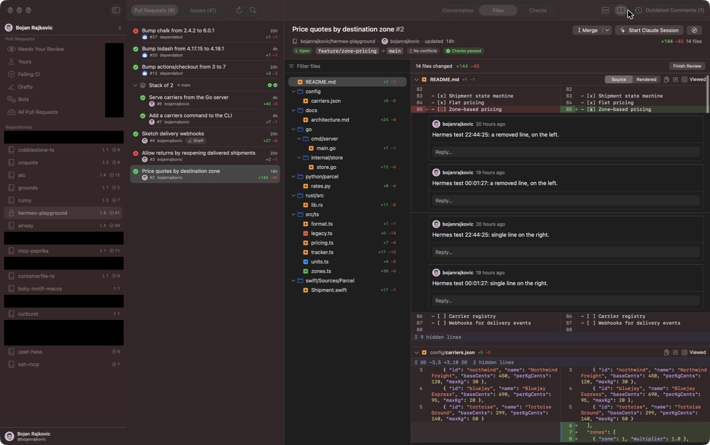
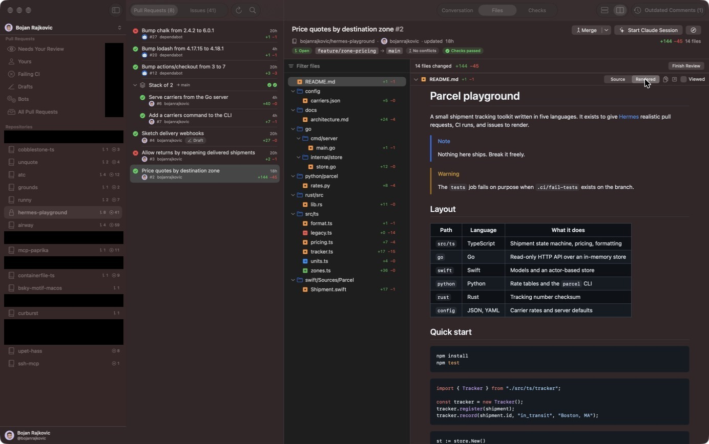
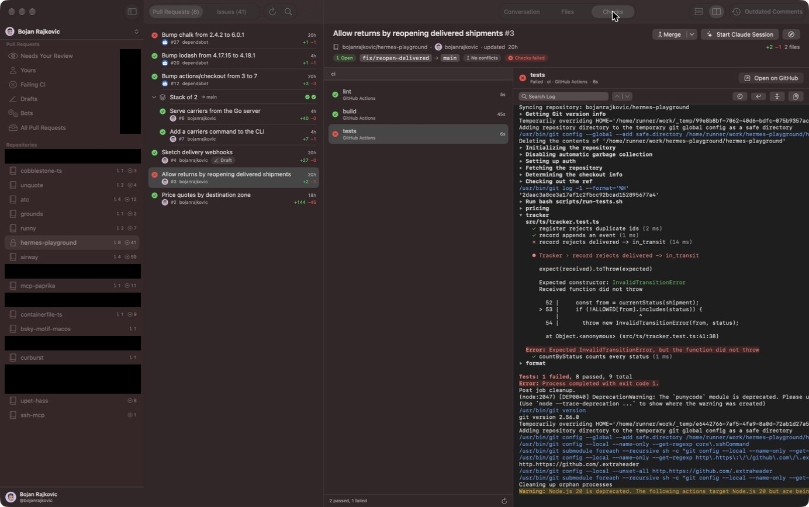
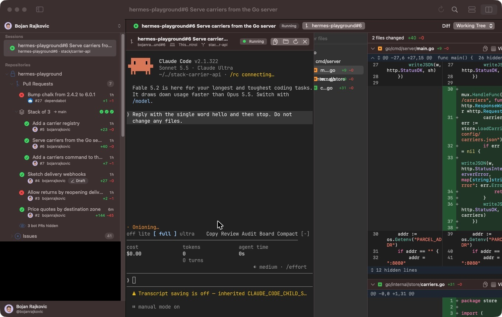
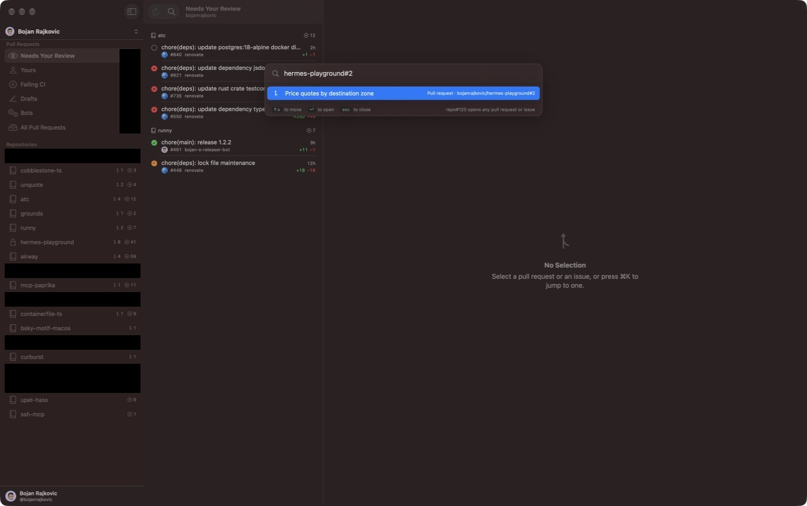

# Hermes

Hermes is a macOS app for reviewing GitHub pull requests. It lists the open
pull requests and issues of an account, shows diffs with batched review
comments, shows CI checks and their logs, and starts Claude Code sessions from
a pull request or an issue.



## Requirements

- macOS 26 or newer.
- A Swift 6.2 toolchain. Xcode provides `swift`, `codesign`, and `iconutil`.
  The build does not use an Xcode project or `xcodebuild`.
- The GitHub CLI, logged in: `brew install gh`, then `gh auth login`. Hermes
  reads its token from `gh auth token` and stores no credentials.
- `git`.
- The `claude` CLI, only for starting Claude Code sessions.

Hermes works with github.com. It is not sandboxed, because it runs `gh`,
`git`, and `claude` and reads your local checkouts.

## Build and run

```sh
make build   # compile and assemble build/Hermes.app, signed ad hoc
make run     # optimized build, then open the app
make test    # run the test suite
make check   # compile only
make help    # every target
```

The first build fetches and compiles the tree-sitter grammars and libghostty,
so it takes a few minutes. See [plans/build-system.md](plans/build-system.md).

## Features

**Lists**

- Open pull requests and issues for your personal account or any organization
  you belong to.
- Inbox navigation: filters across repositories (Needs Your Review, Yours,
  Failing CI, Drafts, Bots, and All) above the list of repositories.
- Stacked pull requests are grouped, and you can move up and down a stack.
- Merge a pull request when GitHub says it can merge, with the repository's
  default method or another it allows. A stacked pull request merges with the
  ones below it, through the `gh stack` extension.
- Bot pull requests are hidden unless their checks fail or they have merge
  conflicts.
- A command palette jumps to a repository, a pull request, or an issue. It
  also opens `repo#123` for items that are not in the lists.

**Diffs**

- Every changed file in one scrolling list, with a file tree beside it.
- Unified and side-by-side layouts, syntax highlighting, and intraline changes.
- Expanders reveal the unchanged lines around a hunk.
- Click an identifier to see its definition in a pane under the diff.
- Markdown files can show a rendered diff, including Mermaid diagrams.
- An open pull request reloads in place when its head commit changes.

**Reviews**

- Comment on a line or a range of lines, and reply to existing threads.
- Comments are drafts on your Mac until you finish the review. Hermes sends
  them as one review with a verdict: Comment, Approve, or Request Changes.
- Drafts whose lines left the diff are kept as outdated comments, and you can
  move them to a new line.

**Checks**

- A commit's checks grouped by workflow, refreshed while any is running.
- A log viewer for GitHub Actions jobs with collapsible groups, ANSI colors,
  and search. A failing log opens at its first error.

**Claude Code sessions**

- Start `claude` from a pull request or an issue in an embedded terminal.
- A local session runs in a git worktree of your checkout. Hermes never
  changes your main working copy.
- The session screen shows the terminal beside a live diff of the worktree.

## Keyboard shortcuts

| Shortcut | Action |
|----------|--------|
| ⌘K | Command palette |
| ⌘N | Start a Claude session from the open pull request or issue |
| ⌘R | Refresh the lists |
| ⇧⌘B | Show or hide all bot pull requests |
| ⇧⌘O | Open the current item on GitHub |
| ⌘1, ⌘2, ⌘3, ⌘4 | Conversation, Files, Checks, or Sessions tab of a pull request |
| ⌘[ and ⌘] | Down and up the stack |
| ⌃⌘↓ and ⌃⌘↑ | Next and previous file in the diff |
| ⌃⌘V | Mark the current file as viewed or unviewed |
| ⌃⌘L | Switch between the unified and side-by-side layouts |
| ⌘+, ⌘-, ⌘0 | Bigger, smaller, or default code size |
| ⌘↩ | Add the comment being written to the review, or submit the review |
| ⌘F | Search the open log |
| ⌘G and ⇧⌘G | Next and previous search match in the log |
| ⌘, | Settings |

## Screenshots

Inbox navigation, with filters across repositories:


The side-by-side layout with review threads:


A rendered Markdown diff:



A CI log:



A Claude Code session:



The command palette:



## Documentation

[PLAN.md](PLAN.md) is the index. [PROGRESS.md](PROGRESS.md) says what works
and what does not.

## License

MIT. See [LICENSE](LICENSE).
