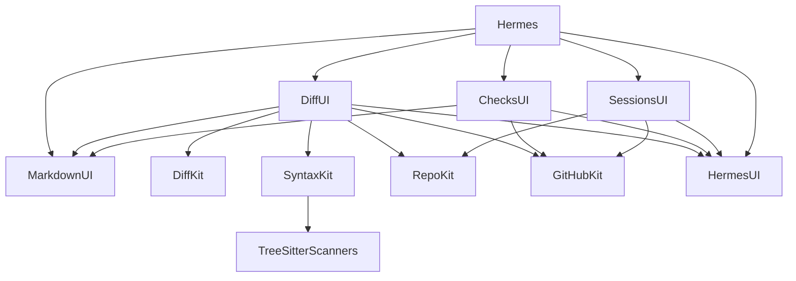
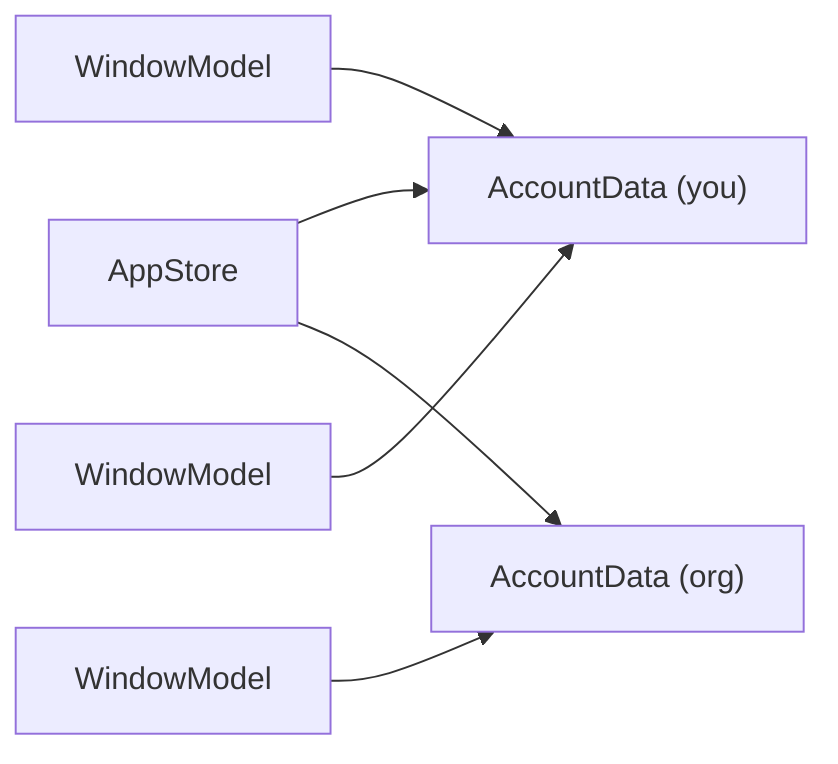
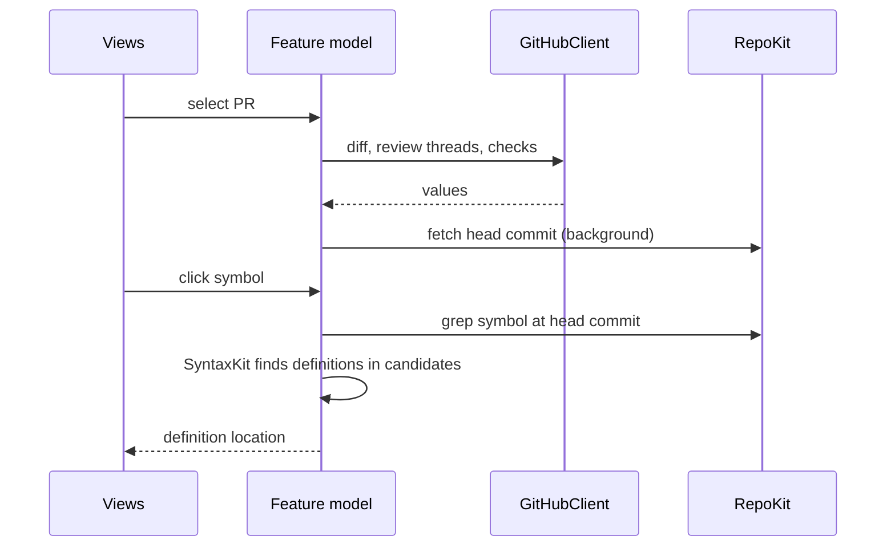

# Architecture

Hermes is a macOS app for reviewing GitHub pull requests. It lists open PRs and
issues for an account, shows diffs with batched review comments, shows CI
status and logs, and starts Claude Code sessions from a PR or an issue.

## Targets

Logic lives in `*Kit` library targets with no UI, so it is testable without a
window. Each feature's views live in a `*UI` target. The `Hermes` executable
wires them together.

The `Hermes` target also imports `GitHubKit` and `RepoKit` directly. Those
edges are left out of the diagram.

| Target       | Owns |
|--------------|------|
| `GitHubKit`  | Token from `gh auth token`, REST and GraphQL calls, domain models, the bot filter. |
| `RepoKit`    | Running `git`. A cache of bare clones for reading files at a PR's head commit. Local checkouts, worktrees, working-tree diffs, and file change watching. |
| `DiffKit`    | Parsing unified diffs, pairing lines for split view, intraline changes, review comment positions. Pure. |
| `SyntaxKit`  | Tree-sitter: language detection, highlighting, finding definitions in a source file. Pure. |
| `TreeSitterScanners` | C sources of four grammar scanners that their packages do not compile as dependencies. See [PROBLEMS.md](../PROBLEMS.md). |
| `MarkdownUI` | GitHub-flavored Markdown in a `WKWebView`, including Mermaid, and a rendered ("rich") diff of two Markdown versions. |
| `HermesUI`   | `Theme` (type scale and metrics) and small shared views. Depends on nothing. |
| `DiffUI`     | The diff viewer: file list, unified and split layouts, review comments, definition lookup. |
| `ChecksUI`   | CI check lists and the log viewer. |
| `SessionsUI` | The embedded terminal and Claude Code session launching. |
| `Hermes`     | Window, navigation, account picker, PR and issue lists, command palette, settings. |

A `*UI` target never imports another feature's `*UI` target, except
`MarkdownUI` and `HermesUI`. The app target is the only place features meet.

Each part has its own document: [github.md](github.md),
[diff-viewer.md](diff-viewer.md), [sessions.md](sessions.md), and
[design-system.md](design-system.md).

## State

Each feature owns an `@Observable @MainActor` model. Views receive models and
values as parameters or through `@Environment`. There is no `ObservableObject`.

`GitHubClient` is an `actor`. One instance is created at launch and passed to
the models that need it.

The `Hermes` target splits its state in three:

- `AppStore`, one for the app: the signed-in user, Claude sessions, settings,
  and one `AccountData` per account.
- `AccountData`, one per account: its pull requests, repositories, issues, and
  items loaded by number. Every window that shows the account reads the same
  copy, so each list loads once.
- `WindowModel`, one per window: the account the window shows and what it
  shows of it, such as the selection, the scope, and the tab.

Each window is a `WindowGroup` window whose value is a `WindowState`: its
account and a `hermes://` link to what it shows, kept current as the window
changes. macOS saves it with the window, so when the system setting "Close
windows when quitting an application" is off, a relaunch brings each window
back on its account and page. New windows come from File ▸ New Window (⇧⌘N),
File ▸ Open Link in New Window… (⌥⌘O), ⌥↩ in the command palette, Open in New
Window on list rows, and links that end in `?window=new`.

## Data flow

## Refresh

- The PR and issue lists refresh on a timer set in Settings, 60 seconds by
  default. They also refresh when the app becomes active, if the last refresh
  is more than 10 seconds old. One timer runs per window; windows on the same
  account share the refresh.
- An account's first load fetches the viewer's own PRs and review requests,
  shows them, then fetches the rest. Later refreshes fetch only the PRs updated
  since the last one, because reloading every PR of an organization with
  hundreds of repositories each minute uses up GitHub's rate limits. They also
  fetch every PR whose checks were still pending: a check that finishes does
  not change its PR's update time.
  Repositories reload on ⌘R or once they are 10 minutes old. A repository
  archived after the first load keeps its PRs until the app relaunches.
- An open PR polls its head commit every 10 seconds while its diff is on
  screen. When the head changes, the diff and threads reload in place and
  keep the scroll position.
- A commit's checks reload every 10 seconds while any check is queued or
  running.
- A local diff of a session's worktree reloads when files under the worktree
  change. `RepoKit` watches with FSEvents and debounces. The diff of one
  branch of a local stack loads once.

## Review comments

Draft comments are stored on disk per PR until submitted, so quitting the app
does not lose them. Submitting sends every draft as one review. A comment is
never posted on its own.

## Claude Code sessions

A session is a `claude` process in an embedded terminal. It starts from a PR
or an issue, in a git worktree of the repository's local checkout. The launch
sheet picks the environment: this Mac, with or without Remote Control, or a
saved cloud environment ID. The same sheet shows the command line for copying.
A cloud session creates no worktree.

A session records the branch it works on. A PR whose head branch matches is
that session's PR, which links an issue to the PR a session opened for it.

## Process and sandbox

The app is not sandboxed. It runs `gh`, `git`, and `claude`, and reads
checkouts under the search folders set in Settings, `~/Projects` by default.
First-run setup, a two-page sheet shown once after sign-in, confirms the
account and asks for these folders.
