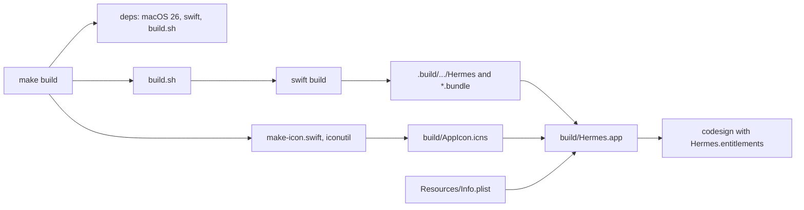
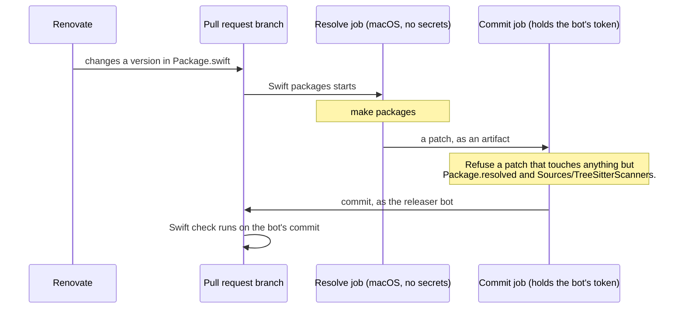

# Build system

Hermes is a Swift package. `swift build` compiles it, `build.sh` assembles and
signs the app bundle, and `make` drives both. There is no Xcode project. Xcode
only provides the tools: `swift`, `codesign`, `iconutil`, `notarytool`, and
`stapler`.



## Everyday commands

| Command | What it does |
|---------|--------------|
| `make build` (or `make`) | Debug build into `build/Hermes.app`, signed ad hoc. |
| `make run` | Release build, then opens the app. A debug build scrolls the diff noticeably slower. |
| `make test` | Runs `swift test`. |
| `make check` | Runs `swift build` only. No bundle and no signing. |
| `make release` | Release build into `build/Hermes.app`. |
| `make packages` | Run after a version change in `Package.swift`. Resolves the packages and re-copies the four grammar scanners in `Sources/TreeSitterScanners`. |
| `make icon` | Regenerates `build/AppIcon.icns`. |
| `make install` | Copies the app to `/Applications` and registers it with LaunchServices. |
| `make clean` | Removes `build/`, `.build/`, and `dist/`. |
| `make help` | Lists every target. |

A change must pass `make check` and `make test`. Look at a UI change in the
running app too, because a view can compile and still lay out wrong.

## Tool versions

`mise.toml` at the repository root pins the tools that [mise](https://mise.jdx.dev)
installs. `mise install` installs them, and a shell with mise activated puts
them on `PATH` anywhere in the repository.

| Tool | Used by |
|------|---------|
| Node | The relay in `relay/`: its checks, its deploy, and the scripts that verify the deployed Worker. |
| pnpm | The relay's package manager. [relay.md](relay.md#packages) describes its settings. |

`make relay-check` runs its commands through `mise x`, and the relay's
workflows install the same versions with `jdx/mise-action`, so a version
changes in one place.

Swift comes from Xcode, and `mise.toml` doesn't pin it. mise can install a
swift.org toolchain, and that toolchain compiles the package and passes the
tests. It can't run `scripts/make-icon.swift`, which `make build` needs: its
script interpreter doesn't load AppKit. The macOS SDK, `codesign`, and
`iconutil` come from Xcode either way, so the Xcode version decides what
builds.

`.xcode-version` names that Xcode. Three things read it:

- **[xcodes](https://github.com/XcodesOrg/xcodes).** `xcodes install` with no
  argument installs the version in the file.
- **The Makefile.** It looks for that version in `/Applications`, under the
  name xcodes gives it (`Xcode-27.1.0.app`) or the name GitHub's runners give
  it (`Xcode_27.1.app`). When it finds one, it sets `DEVELOPER_DIR`, so every
  command `make` runs uses that Xcode. The machine's `xcode-select` choice
  stays as it is, and other projects keep theirs.
- **`make deps`.** It fails when `xcodebuild -version` reports another
  version, and says to run `xcodes install`.

`swift build` run outside `make` uses whatever `xcode-select` points at.
The setting lives in the Makefile and not in `mise.toml`: `git` on macOS
runs through Xcode too, so a `DEVELOPER_DIR` that mise set for a version not
yet installed would stop `git` working in this directory.

## Dependency updates

[Renovate](https://docs.renovatebot.com) opens pull requests for dependency
updates. `renovate.json` extends the preset airway and order-up share,
`github>bojanrajkovic/renovate-config`, and adds the rules this repository
needs. The preset merges minor, patch, and digest updates once their checks
pass, and leaves majors and 0.x minors for a person.

| Dependency | File | Merges on its own |
|------------|------|-------------------|
| Node and pnpm | `mise.toml` | Minor and patch |
| The relay's lint, format, test, and type packages | `relay/package.json` | Minor and patch, once Relay check passes |
| The packages the relay imports, and Wrangler | `relay/package.json` | No |
| The relay's weekly lockfile refresh | `relay/pnpm-lock.yaml` | No |
| Actions | `.github/workflows/` | No |
| Swift packages | `Package.swift` | No |
| Xcode | `.xcode-version` | No |

A merge under `relay/` deploys the relay. So nothing that changes its bundle,
or the workflows that build, attest, and check it, merges without a person.
The lockfile refresh counts, because it moves the packages that the relay's
own packages depend on.

Renovate reads `.package(url:)` calls, so `Package.swift` writes each
dependency that way and has no helper function for them. A Swift update
changes `Package.swift` only: Renovate doesn't write `Package.resolved` for
packages named by URL, and four grammars have a copied scanner that must
match their version ([PROBLEMS.md](../PROBLEMS.md)).

The `Swift packages` workflow finishes the pull request. It runs
`make packages` on GitHub's Xcode 27 image and commits `Package.resolved` and
any re-copied scanner to the branch.



- Resolving runs the manifests of the packages the pull request names. So
  that job holds no secrets, and the job that pushes runs no package code.
- The bot's App ID and private key are in the `ci` environment, as
  `RELEASER_APP_ID` and `RELEASER_APP_PRIVATE_KEY`.
- `renovate.json` lists the bot in `gitIgnoredAuthors`, so Renovate keeps
  rebasing a branch the bot has committed to.

Renovate learns of a new Xcode from `xcodereleases.com`, the feed xcodes
itself uses, and offers releases only, not betas or release candidates. A
`customDatasources` entry in `renovate.json` reads the feed. Install the new
Xcode before merging its update, or `make deps` fails.

Update pull requests are titled as plain sentences, such as "Update
dependency hono to v4.14.0", like the rest of this repository's commits. The
preset's `chore(deps):` prefixes are off.

## The package

`Package.swift` uses tools version 6.2, targets macOS 26, and compiles every
Swift target in Swift 6 language mode.

- Ten library targets and the `Hermes` executable.
  [architecture.md](architecture.md) describes them.
- `TreeSitterScanners` is a C target. It holds scanner sources that four
  grammar packages do not compile when used as dependencies.
- Nine test targets: one for each library except `HermesUI` and
  `TreeSitterScanners`, and `HermesTests` for the app.
- Dependencies: `swift-tree-sitter`, 15 tree-sitter grammars, and
  `libghostty-spm` for the terminal.

[PROBLEMS.md](../PROBLEMS.md) explains the pinned versions and the
scanner target.

## What `build.sh` does

`./build.sh [debug|release]` runs these steps:

1. `swift build -c <config>`.
2. Creates `build/Hermes.app` and copies the executable into `Contents/MacOS`.
3. Writes `Contents/Info.plist` from `Resources/Info.plist`, replacing
   `__SHORT_VERSION__` with the version and `__BUILD_VERSION__` with a
   timestamp.
4. Copies every SwiftPM resource bundle into `Contents/Resources`, except
   bundles whose name ends in `Tests.bundle`. The app needs these bundles for
   tree-sitter queries, the Markdown renderer, and the terminal's resources.
5. Copies `build/AppIcon.icns` when it exists.
6. Signs the app with `Hermes/Hermes.entitlements`. If the identity in
   `SIGN_IDENTITY` is not available, it signs ad hoc.

The entitlements file turns the App Sandbox off. Hermes runs `gh`, `git`, and
`claude`, and reads checkouts outside its container.

## App icon

`scripts/make-icon.swift` draws the icon with Core Graphics: a pull request
mark with a gold wing on a dark blue tile. It writes PNGs for every size to
`build/AppIcon.iconset`, and `iconutil` packs them into `build/AppIcon.icns`.
`make` regenerates the icon when the script changes. No icon file is checked
in.

## Version

`make` picks the version from the first of these that exists:

1. `VERSION=` on the command line.
2. An exact `vX.Y.Z` git tag at `HEAD`.
3. The `VERSION` file.

`make print-version` shows the result and where it came from.

## Tests

`make test` runs the tests that need nothing but the machine. The `Swift
check` workflow runs `make check` and `make test` on GitHub's Xcode 27 image,
for a pull request or a push to `main` that changes the package, its sources
or tests, `.xcode-version`, or the Makefile.

Other tests run only when an environment variable is set:

| Variable | What runs |
|----------|-----------|
| `HERMES_LIVE=1` | Read-only calls to github.com in `GitHubKitTests`, and a fetch from github.com in `RepoKitTests`. |
| `HERMES_LIVE_WEBHOOKS=1` | The `WebhookForwarderTests` test that forwards `bojanrajkovic/hermes-playground` and comments on a pull request there. Needs the `cli/gh-webhook` extension. |
| `HERMES_LIVE_RELAY=<url>` | The `RelayLiveTests` in `GitHubKitTests`: a relay's `/version`, and a connection to a tenant it does not have. They sign in to nothing and store nothing on the relay. |
| `HERMES_LIVE_DIR=<dir>` | `SessionsUITests` that start real terminals and write PNGs. `HERMES_LIVE_CLAUDE=1` adds the ones that start `claude`. |
| `HERMES_SNAPSHOT_DIR=<dir>` | `ChecksUITests` snapshots written as PNGs. |
| `DIFFUI_RENDER=<dir>` | `DiffUITests` renders of the diff viewer written as PNGs. |
| `HERMES_SHOW_IGNORED=1` | Run the app with the ignore list in Settings switched off, so ignored repositories such as `hermes-playground` show again. The saved list is untouched. |
| `HERMES_SCROLL_BENCH=<file>` | Run the app's executable with this set to `$TMPDIR/bench.txt`, open a diff, and run `scripts/scroll-bench.sh <name>`. The diff scrolls down and up for six seconds; step times go to the file and a time profile to `$TMPDIR/<name>.trace`. `scripts/profile-hot.py <xml>` totals the profile by function. |
| `MARKDOWNUI_SNAPSHOT_DIR=<dir>` | Renders every `*.md` file in the directory in light and dark. |
| `DIFFUI_SUBMIT=<number>` | Submits a real review to that pull request in `bojanrajkovic/hermes-playground`. |
| `DIFFUI_WATCH=<number>` | Watches that playground pull request's threads for a minute. Reads only. |

The app executable also renders its own screens. Run
`build/Hermes.app/Contents/MacOS/Hermes` with `HERMES_SNAPSHOT_DIR=<dir>` to
write PNGs of each screen in light and dark, with live GitHub data, and exit.
`HERMES_SNAPSHOT_SCENES` limits it to scenes whose names start with the given
comma-separated prefixes.

## Release

`make dist` builds a signed, notarized zip. It needs an exact `vX.Y.Z` tag at
`HEAD`, a Developer ID certificate (`TEAM_ID` or `CERT_NAME`), and notary
credentials stored once with `make notary-setup`.

```
clean → release → sign → zip-notary → notarize → staple → zip-release → checksum → verify-release
```

Apple's notary service takes a zip, and stapling writes the ticket into the
app. So the zip that ships is made after stapling, not the one that was
notarized. `make github-release` uploads the zip and its checksum with `gh`.
