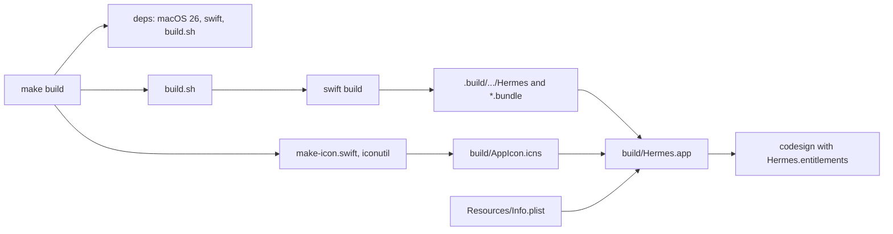
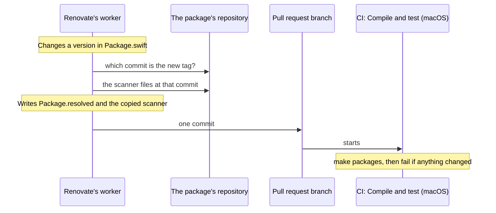
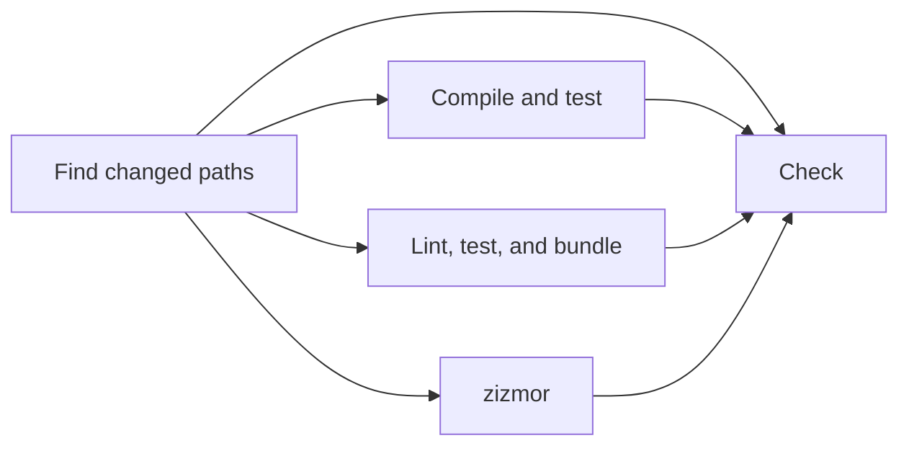
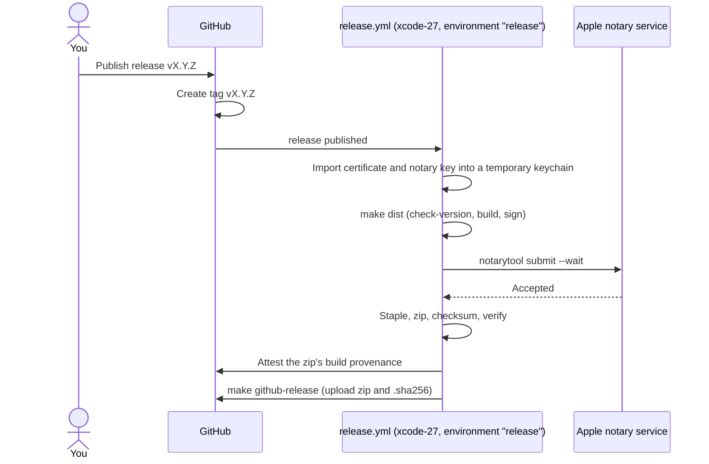

# Build system

Hermes is a Swift package. `swift build` compiles it, `build.sh` assembles and
signs the app bundle, and `make` drives both. There is no Xcode project. Xcode
only provides the tools: `swift`, `codesign`, `iconutil`, `notarytool`, and
`stapler`.



## Everyday commands

| Command | What it does |
|---------|--------------|
| `make build` (or `make`) | Debug build into `build/Hermes.app`, signed with the identity in `DEV_IDENTITY`, or ad hoc when it's unset. [relay-client.md](relay-client.md#the-refresh-token) explains why a Developer ID stops Keychain prompts. |
| `make run` | Release build, then opens the app. A debug build scrolls the diff noticeably slower. |
| `make test` | Runs `swift test`. |
| `make check` | Runs `swift build` only. No bundle and no signing. |
| `make release` | Release build into `build/Hermes.app`. |
| `make packages` | Run after a version change in `Package.swift`. Resolves the packages and re-copies the four grammar scanners in `Sources/TreeSitterScanners`. |
| `make icon` | Regenerates `build/AppIcon.icns`. |
| `make install` | Copies the app to `/Applications` and registers it with LaunchServices. |
| `make clean` | Removes `build/`, `.build/`, and `dist/`. |
| `make help` | Lists every target. |

A change must pass `make check` and `make test`. Look at a UI change in the
running app too, because a view can compile and still lay out wrong.

## Tool versions

`mise.toml` at the repository root pins the tools that [mise](https://mise.jdx.dev)
installs. `mise install` installs them, and a shell with mise activated puts
them on `PATH` anywhere in the repository.

| Tool | Used by |
|------|---------|
| Node | The relay in `relay/`: its checks, its deploy, and the scripts that verify the deployed Worker. |
| pnpm | The relay's package manager. [relay.md](relay.md#packages) describes its settings. |

`make relay-check` runs its commands through `mise x`, and the relay's
workflows install the same versions with `jdx/mise-action`, so a version
changes in one place.

Swift comes from Xcode, and `mise.toml` doesn't pin it. mise can install a
swift.org toolchain, and that toolchain compiles the package and passes the
tests. It can't run `scripts/make-icon.swift`, which `make build` needs: its
script interpreter doesn't load AppKit. The macOS SDK, `codesign`, and
`iconutil` come from Xcode either way, so the Xcode version decides what
builds.

`.xcode-version` names that Xcode. Three things read it:

- **[xcodes](https://github.com/XcodesOrg/xcodes).** `xcodes install` with no
  argument installs the version in the file.
- **The Makefile.** It looks for that version in `/Applications`, under the
  name xcodes gives it (`Xcode-<version>.0.app`) or the name GitHub's runners
  give it (`Xcode_<version>.app`). When it finds one, it sets
  `DEVELOPER_DIR`, so every command `make` runs uses that Xcode. The machine's
  `xcode-select` choice stays as it is, so other projects keep using the Xcode
  it points at.
- **`make deps`.** It fails when `xcodebuild -version` reports another
  version, and says to run `xcodes install`.

`swift build` run outside `make` uses whatever `xcode-select` points at.
The setting lives in the Makefile and not in `mise.toml`: `git` on macOS
runs through Xcode too, so a `DEVELOPER_DIR` that mise set for a version not
yet installed would stop `git` working in this directory.

## Dependency updates

[Renovate](https://docs.renovatebot.com) opens pull requests for dependency
updates. `renovate.json` extends a shared preset,
`github>bojanrajkovic/renovate-config`, and adds the rules this repository
needs. The preset merges minor, patch, and digest updates once their checks
pass, and leaves majors and 0.x minors for a person.

| Dependency | File | Merges on its own |
|------------|------|-------------------|
| Node and pnpm | `mise.toml` | Minor and patch |
| The relay's lint, format, test, and type packages | `relay/package.json` | Minor and patch, once CI passes |
| The packages the relay imports, and Wrangler | `relay/package.json` | No |
| The relay's weekly lockfile refresh | `relay/pnpm-lock.yaml` | No |
| Actions | `.github/workflows/` | No |
| Swift packages | `Package.swift` | No |
| Xcode | `.xcode-version` | No |

A merge under `relay/` deploys the relay. So nothing that changes its bundle,
or the workflows that build, attest, and check it, merges without a person.
The lockfile refresh counts, because it moves the packages that the relay's
own packages depend on.

Renovate reads `.package(url:)` calls, so `Package.swift` writes each
dependency that way and has no helper function for them. A Swift update
changes `Package.swift` only: Renovate doesn't write `Package.resolved` for
packages named by URL, and four grammars have a copied scanner that must
match their version ([PROBLEMS.md](../PROBLEMS.md)).

`scripts/renovate/swift-packages.sh` finishes the update. Renovate runs it as
a post-upgrade task, in the same commit as the version change.



- **The script runs no Swift and no package code.** `swift package resolve`
  would run the manifest of the version just brought in, and the worker holds
  a key that can write to every repository. The script only asks `git` for a
  tag's commit and fetches files.
- **It writes what SwiftPM would.** `Package.resolved` carries the SHA-256 of
  `Package.swift`, so the script can stamp it without SwiftPM.
- **It can't follow a package `Package.swift` doesn't name.** An update to
  `swift-tree-sitter` or `libghostty-spm` can move `tree-sitter` or
  `DisplayLink`, which only they depend on. The `Compile and
  test` job runs `make packages` first and fails if that changes any file. Run `make packages` on the branch
  and push the result.

Renovate learns of a new Xcode from `xcodereleases.com`, the feed xcodes
itself uses, and offers releases only, not betas or release candidates. A
`customDatasources` entry in `renovate.json` reads the feed. Install the new
Xcode before merging its update, or `make deps` fails.

Update pull requests are titled as plain sentences, such as "Update
dependency hono to v4.14.0", like the rest of this repository's commits. The
preset's `chore(deps):` prefixes are off.

## The package

`Package.swift` uses tools version 6.2, targets macOS 26, and compiles every
Swift target in Swift 6 language mode.

- The library targets and the `Hermes` executable.
  [architecture.md](architecture.md) describes them.
- `TreeSitterScanners` is a C target. It holds scanner sources that four
  grammar packages do not compile when used as dependencies.
- Test targets under `Tests/`, named for the target they test:
  `DiffKitTests` for `DiffKit`, `HermesTests` for the app. A target gets a
  test target only when it has tests.
- `TestSupport`, a library target in `Tests/TestSupport`, holds helpers that
  several test targets share.
- Dependencies: `swift-tree-sitter`, the tree-sitter grammars, and
  `libghostty-spm` for the terminal.

[PROBLEMS.md](../PROBLEMS.md) explains the pinned versions and the
scanner target.

## What `build.sh` does

`./build.sh [debug|release]` runs these steps:

1. `swift build -c <config>`.
2. Creates `build/Hermes.app` and copies the executable into `Contents/MacOS`.
3. Writes `Contents/Info.plist` from `Resources/Info.plist`, replacing
   `__SHORT_VERSION__` with the version and `__BUILD_VERSION__` with a
   timestamp, and writes `Contents/PkgInfo`.
4. Copies every SwiftPM resource bundle into `Contents/Resources`, except
   bundles whose name ends in `Tests.bundle`. The app needs these bundles for
   tree-sitter queries, the Markdown renderer, and the terminal's resources.
5. Copies `build/AppIcon.icns` when it exists.
6. When `PROVISION_PROFILE` is set to a file that exists, copies that file to
   `Contents/embedded.provisionprofile`.
7. Signs the app with `Hermes/Hermes.entitlements`. If the identity in
   `SIGN_IDENTITY` is not available, it signs ad hoc.

The entitlements file turns the App Sandbox off. Hermes runs `gh`, `git`, and
`claude`, and reads checkouts outside its container.

## App icon

`scripts/make-icon.swift` draws the icon with Core Graphics: a pull request
mark with a gold wing on a dark blue tile. It writes PNGs for every size to
`build/AppIcon.iconset`, and `iconutil` packs them into `build/AppIcon.icns`.
`make` regenerates the icon when the script changes. No icon file is checked
in.

## Version

`make` picks the version from the first of these that exists:

1. `VERSION=` on the command line.
2. An exact `vX.Y.Z` git tag at `HEAD`.
3. The `VERSION` file.

`make print-version` shows the result and where it came from.

## Tests

`make test` runs the tests that need nothing but the machine.

The CI workflow, `.github/workflows/ci.yml`, runs on every pull request and
every push to `main`. The first job lists the changed paths. Each check job
runs only when the change touches that job's paths. The last job, `Check`, is
the only status check that `main` requires. It fails when any earlier job
failed or was cancelled. It passes when every earlier job passed or was
skipped. CI filters paths in a job instead of with a workflow-level `paths:`
filter. When `paths:` skips a workflow, GitHub leaves that workflow's
required checks pending, so the pull request can't merge.



CI's `Compile and test` job runs `make check` and `make test` on GitHub's
Xcode 27 image. It runs for a pull request or a push to `main` that changes
any of these:

- `Package.swift` or `Package.resolved`
- `Sources/` or `Tests/`
- `.xcode-version`
- the Makefile
- `ci.yml`

It first runs `make packages` and fails if that changes `Package.resolved` or
a copied scanner.

Other tests run only when an environment variable is set:

| Variable | What runs |
|----------|-----------|
| `HERMES_LIVE=1` | Read-only calls to github.com in `GitHubKitTests`, and a fetch from github.com in `RepoKitTests`. |
| `HERMES_LIVE_WEBHOOKS=1` | The `WebhookForwarderTests` test that forwards `bojanrajkovic/hermes-playground` and comments on a pull request there. Needs the `cli/gh-webhook` extension. |
| `HERMES_LIVE_RELAY=<url>` | The `RelayLiveTests` in `GitHubKitTests`: a relay's `/version`, and a connection to a tenant it does not have. They sign in to nothing and store nothing on the relay. |
| `HERMES_LIVE_DIR=<dir>` | `SessionsUITests` that start real terminals and write PNGs. `HERMES_LIVE_CLAUDE=1` adds the ones that start `claude`. |
| `HERMES_SNAPSHOT_DIR=<dir>` | `ChecksUITests` snapshots written as PNGs. |
| `HERMES_SNAPSHOT_COMMIT=owner/name@sha[#check-id]` | With `HERMES_SNAPSHOT_DIR`, a snapshot of the checks screen for that commit, with check run `check-id` selected. `HERMES_SNAPSHOT_SETTLE=<seconds>` sets how long the app waits before the snapshot, 6 seconds by default. Reads only. |
| `DIFFUI_RENDER=<dir>` | `RenderTests` in `DiffUITests`: renders of the diff viewer written as PNGs, a scroll timing, and a check that the list keeps its scroll position through a reload. The table below lists its inputs. |
| `HERMES_SHOW_IGNORED=1` | Run the app with the ignore list in Settings switched off, so ignored repositories such as `hermes-playground` show again. The saved list is untouched. |
| `HERMES_SCROLL_BENCH=<file>` | Run the app's executable with this set to `$TMPDIR/bench.txt`, open a diff, and run `scripts/scroll-bench.sh <name>`. The diff scrolls down and up for six seconds; step times go to the file and a time profile to `$TMPDIR/<name>.trace`. `scripts/profile-hot.py <xml>` totals the profile by function. |
| `MARKDOWNUI_SNAPSHOT_DIR=<dir>` | Renders every `*.md` file in the directory in light and dark. |
| `DIFFUI_SUBMIT=<number>` | Submits a real review to that pull request in `bojanrajkovic/hermes-playground`. |
| `DIFFUI_WATCH=<number>` | Watches that playground pull request's threads for a minute. Reads only. |
| `DIFFUI_VIEWED=<number>` | Marks two files of that playground pull request viewed, one from Hermes and one through the API, checks each side sees the other's mark, then unmarks both. Takes about 40 seconds. |

These choose what `DIFFUI_RENDER` renders. Each needs `DIFFUI_RENDER` set.

| Variable | What it does |
|----------|--------------|
| `DIFFUI_DIFF=<file>` | The diff to render. The scroll timing fails without it, and the scroll-position check runs only when it is set. That check needs at least three files, each taller than the window. |
| `DIFFUI_PR=owner/name#number` | Renders that open pull request instead of `DIFFUI_DIFF`. |
| `DIFFUI_TREE=<dir>` | Renders a working tree against `DIFFUI_BASE=<ref>`, `HEAD` by default. |
| `DIFFUI_BRANCH=<checkout>#<branch>` | Renders one branch of the checkout's local stacks. |
| `DIFFUI_NAME=<name>` | The start of each PNG's file name, `diff` by default. |
| `DIFFUI_FONT=<points>` | The code font size. |
| `DIFFUI_EXPAND=<n>` | Reveals 20 lines of hidden region `n` in the first file that has hidden lines. |
| `DIFFUI_SCROLL=<n>` | Scrolls to file `n` before each render. |
| `DIFFUI_VIEWED=<number>` | When set, marks the first file viewed before the renders. The same variable runs the viewed-marks test in the table above. |
| `DIFFUI_REFERENCES=<name>` | Also renders the references to `name` in the docked pane. |
| `DIFFUI_FIND=<query>` | Also renders the find bar with the query's first match on screen. |
| `DIFFUI_REVIEW=1` | Renders the review views on `DIFFUI_PR`: comment popovers, Finish Review, and Outdated Comments. Drafts go to a temporary folder, and nothing is sent to GitHub. |
| `DIFFUI_DEFINE=<name>` | With `DIFFUI_REVIEW`, also renders a definition lookup of `name`. `DIFFUI_DEFINE_FROM=<path>` sets the file it starts from. |
| `DIFFUI_MARKDOWN=<text>` | With `DIFFUI_REVIEW`, picks the Markdown file shown as rendered Markdown: the first whose path contains the text. Without it, the review renders the first Markdown file. |
| `DIFFUI_LAYOUT=split` | Uses the split layout for the review renders and the scroll timing. Without it, both use the unified layout. |
| `DIFFUI_DARK` | When set, renders the review and `DIFFUI_LIVE_TREE` in dark mode. |
| `DIFFUI_AS_PR` | When set, times the scroll with the review views in the rows. |
| `DIFFUI_EXACT_HEIGHTS` | When set, times the scroll with exact row heights, as the app does. |
| `DIFFUI_PASSES=<n>` | Scrolls down and back up `n` times during the timing, for a profiler. |
| `DIFFUI_LIVE_PR=owner/name#number` | Watches that open pull request for two minutes and prints each reload. Push to its branch while it runs. Reads only. |
| `DIFFUI_LIVE_TREE=<dir>` | Watches a Hermes checkout's working tree, appends lines to `Sources/DiffKit/Notes.swift`, and writes PNGs that show whether the list kept its scroll position through the reload. Puts the file back afterwards. |

The app executable also renders its own screens. Run
`build/Hermes.app/Contents/MacOS/Hermes` with `HERMES_SNAPSHOT_DIR=<dir>` to
write PNGs of each screen in light and dark, with live GitHub data, and exit.
It only reads from GitHub, and it keeps its settings in a separate
`hermes-snapshots` defaults suite, so your saved settings stay untouched.
These variables add or limit
scenes:

| Variable | What it does |
|----------|--------------|
| `HERMES_SNAPSHOT_SCENES=<prefixes>` | Renders only the scenes whose names start with one of these comma-separated prefixes. |
| `HERMES_SNAPSHOT_ORG=<login>` | Adds two scenes for that organization: its inbox, and the issues of its repository with the most open issues. The organization must be one of the viewer's accounts. Without this variable, the snapshots leave out those scenes. |
| `HERMES_SNAPSHOT_LOCAL=owner/name` | Adds the repository's Local tab, opened on a branch with no pull request. |
| `HERMES_SNAPSHOT_MERGED=owner/name#number` | Adds that pull request, loaded by number, on its Conversation tab. |
| `HERMES_SNAPSHOT_CLOSED=owner/name#number` | Adds that issue, loaded by number. |

## Release

To cut a release, bump `VERSION` on `main`, then publish a release on GitHub
with a new tag `vX.Y.Z` and the release notes. Publishing creates the tag, and
`.github/workflows/release.yml` builds, signs, notarizes, and attests the app,
then attaches `Hermes-X.Y.Z-macos-arm64.zip` and its `.sha256` to the release.
A tag ruleset lets only admins and the owner's GitHub App for releases create
tags. Publishing a release creates a tag, so only they can publish one.



The `release` environment holds these secrets and runs only from `v*` tags:

| Secret | Holds |
|---|---|
| `BUILD_CERTIFICATE_BASE64` | The Developer ID Application certificate and key, as a base64 `.p12` |
| `P12_PASSWORD` | The `.p12` password |
| `NOTARY_KEY_P8` | The App Store Connect API key that notarizes |
| `NOTARY_KEY_ID`, `NOTARY_ISSUER_ID` | That key's ID and issuer |

The job creates a temporary keychain with a random password, and deletes it at
the end. The signing identity comes from the certificate, so no team ID is
configured.

Immutable releases stay off: the job uploads the zip after the release is
published, and an immutable release refuses new assets. If the job fails, the
release stays published without assets. Re-run the job, or upload from a local
build (below). `make github-release` replaces assets an earlier attempt left.

### make dist

`make dist` runs the pipeline. It needs an exact `vX.Y.Z` tag at `HEAD` that
matches the `VERSION` file, a Developer ID certificate in a keychain
(`TEAM_ID` or `CERT_NAME`), and the notary API key stored once with
`make notary-setup NOTARY_KEY=<.p8> NOTARY_KEY_ID=<id> NOTARY_ISSUER_ID=<uuid>`.

```
check-version → clean → release → sign → zip-notary → notarize → staple → zip-release → checksum → verify-release
```

Apple's notary service takes a zip, and stapling writes the ticket into the
app. So the zip that ships is made after stapling, not the one that was
notarized. The shipped zip leaves out resource forks and extended attributes.
`ditto` would store them as `._` files, which unzip tools other than Archive
Utility write into the bundle, and those break its signature. `make
github-release` uploads the zip and its checksum to the published release.

To release from your Mac instead of CI:

```sh
git fetch --tags && git checkout vX.Y.Z
make dist github-release TEAM_ID=XXXXXXXXXX
```

### Checking a release

The attestation ties the zip to the workflow run that built it:

```sh
gh attestation verify Hermes-X.Y.Z-macos-arm64.zip --repo bojanrajkovic/hermes
```

mise's `github` backend checks the attestation itself when it installs Hermes.
