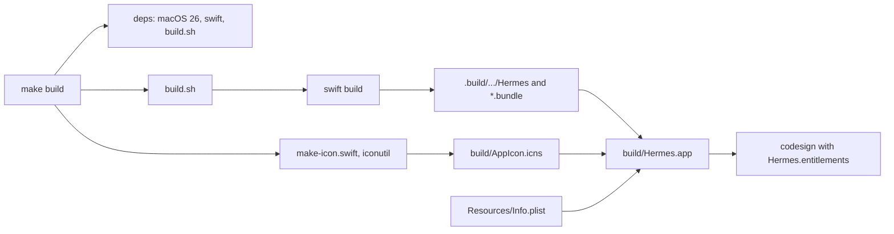

# Build system

Hermes is a Swift package. `swift build` compiles it, `build.sh` assembles and
signs the app bundle, and `make` drives both. There is no Xcode project. Xcode
only provides the tools: `swift`, `codesign`, `iconutil`, `notarytool`, and
`stapler`.



## Everyday commands

| Command | What it does |
|---------|--------------|
| `make build` (or `make`) | Debug build into `build/Hermes.app`, signed ad hoc. |
| `make run` | Release build, then opens the app. A debug build scrolls the diff noticeably slower. |
| `make test` | Runs `swift test`. |
| `make check` | Runs `swift build` only. No bundle and no signing. |
| `make release` | Release build into `build/Hermes.app`. |
| `make icon` | Regenerates `build/AppIcon.icns`. |
| `make install` | Copies the app to `/Applications` and registers it with LaunchServices. |
| `make clean` | Removes `build/`, `.build/`, and `dist/`. |
| `make help` | Lists every target. |

A change must pass `make check` and `make test`. Look at a UI change in the
running app too, because a view can compile and still lay out wrong.

## The package

`Package.swift` uses tools version 6.2, targets macOS 26, and compiles every
Swift target in Swift 6 language mode.

- Ten library targets and the `Hermes` executable.
  [architecture.md](architecture.md) describes them.
- `TreeSitterScanners` is a C target. It holds scanner sources that four
  grammar packages do not compile when used as dependencies.
- Nine test targets: one for each library except `HermesUI` and
  `TreeSitterScanners`, and `HermesTests` for the app.
- Dependencies: `swift-tree-sitter`, 15 tree-sitter grammars (Ruby from
  `Vendor/tree-sitter-ruby`), and `libghostty-spm` for the terminal.

[PROBLEMS.md](../PROBLEMS.md) explains the pinned versions, the vendored
grammar, and the scanner target.

## What `build.sh` does

`./build.sh [debug|release]` runs these steps:

1. `swift build -c <config>`.
2. Creates `build/Hermes.app` and copies the executable into `Contents/MacOS`.
3. Writes `Contents/Info.plist` from `Resources/Info.plist`, replacing
   `__SHORT_VERSION__` with the version and `__BUILD_VERSION__` with a
   timestamp.
4. Copies every SwiftPM resource bundle into `Contents/Resources`, except
   bundles whose name ends in `Tests.bundle`. The app needs these bundles for
   tree-sitter queries, the Markdown renderer, and the terminal's resources.
5. Copies `build/AppIcon.icns` when it exists.
6. Signs the app with `Hermes/Hermes.entitlements`. If the identity in
   `SIGN_IDENTITY` is not available, it signs ad hoc.

The entitlements file turns the App Sandbox off. Hermes runs `gh`, `git`, and
`claude`, and reads checkouts outside its container.

## App icon

`scripts/make-icon.swift` draws the icon with Core Graphics: a pull request
mark with a gold wing on a dark blue tile. It writes PNGs for every size to
`build/AppIcon.iconset`, and `iconutil` packs them into `build/AppIcon.icns`.
`make` regenerates the icon when the script changes. No icon file is checked
in.

## Version

`make` picks the version from the first of these that exists:

1. `VERSION=` on the command line.
2. An exact `vX.Y.Z` git tag at `HEAD`.
3. The `VERSION` file.

`make print-version` shows the result and where it came from.

## Tests

`make test` runs the tests that need nothing but the machine. Other tests run
only when an environment variable is set:

| Variable | What runs |
|----------|-----------|
| `HERMES_LIVE=1` | Read-only calls to github.com in `GitHubKitTests`, and a fetch from github.com in `RepoKitTests`. |
| `HERMES_LIVE_DIR=<dir>` | `SessionsUITests` that start real terminals and write PNGs. `HERMES_LIVE_CLAUDE=1` adds the ones that start `claude`. |
| `HERMES_SNAPSHOT_DIR=<dir>` | `ChecksUITests` snapshots written as PNGs. |
| `DIFFUI_RENDER=<dir>` | `DiffUITests` renders of the diff viewer written as PNGs. |
| `HERMES_SHOW_IGNORED=1` | Run the app with the ignore list in Settings switched off, so ignored repositories such as `hermes-playground` show again. The saved list is untouched. |
| `HERMES_SCROLL_BENCH=<file>` | Run the app's executable with this set to `$TMPDIR/bench.txt`, open a diff, and run `scripts/scroll-bench.sh <name>`. The diff scrolls down and up for six seconds; step times go to the file and a time profile to `$TMPDIR/<name>.trace`. `scripts/profile-hot.py <xml>` totals the profile by function. |
| `MARKDOWNUI_SNAPSHOT_DIR=<dir>` | Renders every `*.md` file in the directory in light and dark. |
| `DIFFUI_SUBMIT=<number>` | Submits a real review to that pull request in `bojanrajkovic/hermes-playground`. |
| `DIFFUI_WATCH=<number>` | Watches that playground pull request's threads for a minute. Reads only. |

The app executable also renders its own screens. Run
`build/Hermes.app/Contents/MacOS/Hermes` with `HERMES_SNAPSHOT_DIR=<dir>` to
write PNGs of each screen in light and dark, with live GitHub data, and exit.
`HERMES_SNAPSHOT_SCENES` limits it to scenes whose names start with the given
comma-separated prefixes.

## Release

`make dist` builds a signed, notarized zip. It needs an exact `vX.Y.Z` tag at
`HEAD`, a Developer ID certificate (`TEAM_ID` or `CERT_NAME`), and notary
credentials stored once with `make notary-setup`.

```
clean → release → sign → zip-notary → notarize → staple → zip-release → checksum → verify-release
```

Apple's notary service takes a zip, and stapling writes the ticket into the
app. So the zip that ships is made after stapling, not the one that was
notarized. `make github-release` uploads the zip and its checksum with `gh`.
