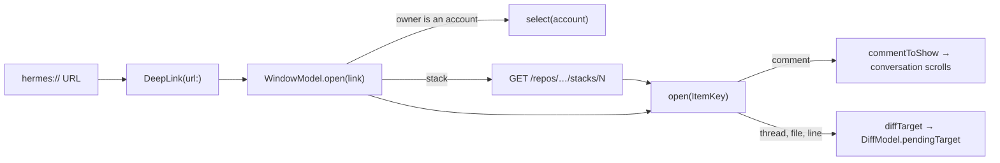

# Deep links

Hermes opens `hermes://` links. A link is a github.com URL with
`https://github.com/` swapped for `hermes://`, so any GitHub link can be
turned into one by hand or by a script.

```
hermes://bojanrajkovic/airway/pull/94/files#diff-<sha256>R45
         └─ owner ─┘└ repo┘└ the rest of the github.com URL ┘
```

## What opens

| Link | Opens |
|---|---|
| `hermes://owner/repo` | The repository's pull requests |
| `…/issues/5` | The issue |
| `…/issues/5#issuecomment-123` | The issue, scrolled to the comment |
| `…/pull/12` | The pull request on its current tab |
| `…/pull/12#issuecomment-123` | The Conversation tab, scrolled to the comment |
| `…/pull/12#discussion_r456`, `…/pull/12/files#r456` | The Files tab with the thread's popover open on its line |
| `…/pull/12/files`, `…/pull/12/changes` | The Files tab |
| `…/pull/12/files#diff-<hash>` | The Files tab at that file |
| `…/pull/12/files#diff-<hash>R45` (`L45`, `R45-R50`) | The Files tab at that line, highlighted |
| `…/stack/97` | The stack's bottom pull request, with the stack expanded |

GitHub names a file in a `#diff-` anchor by the SHA-256 of its path, so Hermes
hashes the diff's paths to find it. An outdated thread has no line in the diff,
and its link opens its file instead.

Pasting a github.com or `hermes://` link into the command palette (⌘K) offers
one row that opens it.

macOS sends `https://github.com` links only to apps GitHub has approved
through associated domains, so Hermes cannot claim them. A link router such as
Finicky, Velja or Switchbar can send them to Hermes by rule, and Hermes reads
github.com URLs the same as `hermes://` ones.

## Windows

A link opens in the frontmost window. A link that ends in `?window=new` opens
in a window of its own, and so does a link that arrives when no window is up.
The app delegate takes every link (`AppStore.open(_:)`), and the window group
handles none itself, so SwiftUI makes no window of its own for a link.

## Accounts

When the link's owner is the viewer or one of their organizations, Hermes
switches to that account first. Any other owner opens in the current account,
loaded from GitHub the way ⌘K loads an item outside the lists. A link that
arrives while Hermes starts waits for the accounts to load.

## How it works



- `DeepLink` (GitHubKit) parses the link. It reads `https://github.com` URLs
  too.
- The conversation and issue views take `WindowModel.commentToShow` once their
  comments load.
- The diff takes `WindowModel.diffTarget` as `DiffModel.pendingTarget`. A thread
  link waits until the threads load, since they come after the diff.
- The scheme is registered in `Resources/Info.plist` (`CFBundleURLTypes`).
