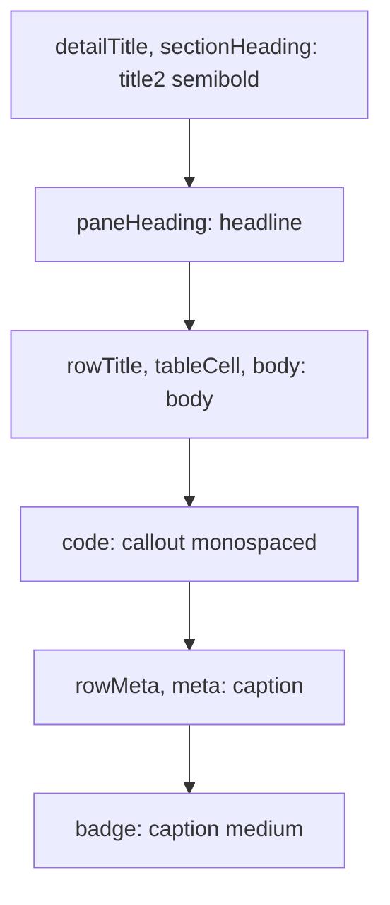

# Design system

`HermesUI` holds the type scale, the layout metrics, and the small views every
feature shares. It depends on no other target, and every `*UI` target and the
app depend on it.

## Rules

1. **Sizes come from text styles.** Fonts are SwiftUI text styles such as
   `.body` and `.caption`, not point sizes, so they follow the system's text
   size. The one exception is code in the diff viewer, which has its own
   adjustable size.
2. **Emphasis is weight, de-emphasis is color.** Headings are semibold.
   Quieter text is `.secondary` or `.tertiary`, never a lighter weight.
3. **Shared numbers have names.** A metric that several views use lives in
   `Theme`. A metric only one feature uses lives in that feature.

## Type scale

`Theme.Fonts` in `Sources/HermesUI/Theme.swift`:

| Token | Style | Used for |
|-------|-------|----------|
| `detailTitle` | `.title2` semibold | The title of a pull request or issue pane. |
| `sectionHeading` | `.title2` semibold | The heading of a check's detail. |
| `paneHeading` | `.headline` | Headings inside a pane, such as "Commits", and a session's title. |
| `rowTitle` | `.body` | A pull request or issue title in a list row. |
| `tableCell` | `.body` | A check's name in the checks list. |
| `body` | `.body` | Body text in the session launch sheet. |
| `code` | `.callout` monospaced | Branch names and commit SHAs. |
| `rowMeta` | `.caption` | A row's second line: number, author, counts, age. |
| `meta` | `.caption` | Timestamps, counts, and footers outside list rows. |
| `badge` | `.caption` medium | `Badge` and `LabelChip` text. |

`pageTitle`, `pageLead`, and `tableNumber` are defined and have no users.

## Metrics

All values are points, from `Theme`.

| Group | Metric | Value |
|-------|--------|-------|
| Window | minimum size | 900 × 520 |
| Window | default size | 1360 × 860 |
| Sidebar | min, ideal, max width | 200, 240, 320 |
| List column | min, ideal, max width | 400, 420, 560 |
| Rows | `avatarSize` | 16 |
| Rows | `rowVerticalPadding` | 3 |
| Rows | `rowGlyphSpacing` (glyph to text) | 8 |
| Rows | `rowMetaSpacing` (items on the second line) | 6 |
| Detail panes | `detailInset` | 20 |
| Detail panes | `cardCornerRadius`, `cardPadding` | 8, 12 |
| Detail panes | `conversationMaxWidth` | 860 |
| Detail panes | `readingSectionSpacing` (between sections) | 28 |
| Detail panes | `readingHeadingSpacing` (heading to body) | 8 |
| Badges | corner radius, horizontal and vertical padding | 4, 7, 2 |

The conversation is capped at 860 points, wider than a
prose column, to fit code blocks and tables.

`readingMaxWidth`, `readingHorizontalInset`, `readingTopInset`,
`readingBottomInset`, and `bodyLineSpacing` are defined and have no users.

## Feature metrics

- **Diff viewer.** `DiffMetrics` in `Sources/DiffUI/DiffMetrics.swift` derives
  the gutter and marker widths from the code font. The code font is the
  system monospaced font at 12 points by default, adjustable from 9 to 24
  with ⌘+ and ⌘-. The size is stored in user defaults.
- **Checks.** `Metrics` in `Sources/ChecksUI/CheckListViews.swift` holds the
  list and detail widths of the checks screen.

## Shared views

| View | What it shows |
|------|---------------|
| `StatusGlyph` | A CI state as a symbol with a tint: passed, failed, pending, or none. Each state has its own shape, so color is never the only signal. |
| `Badge` | A short label in a tinted capsule, such as "Draft" or "Running". |
| `LabelChip` | A GitHub label in its own color, adjusted to stay legible in light and dark. |
| `AvatarView` | A round avatar, loaded once per URL through `AvatarCache`. |
| `RelativeTime` | A compact age such as `5m` or `17h`. |

## macOS idioms in use

- `NavigationSplitView` with three columns: sidebar, list, detail.
- A `Window` scene, a `Settings` scene, and a menu bar entry with a shortcut
  for every action in the window.
- `ContentUnavailableView` for empty, loading-failed, and no-selection states.
- System colors and materials only (`.secondary`, `.bar`, the accent color),
  so light and dark need no second palette. Diff and syntax colors are the
  exception: `DiffColors` in `Sources/DiffUI/LineStyler.swift` defines a light
  and a dark value for each.
- Counts on a selected row take the row's text color, because green and red
  do not read on the accent color.
