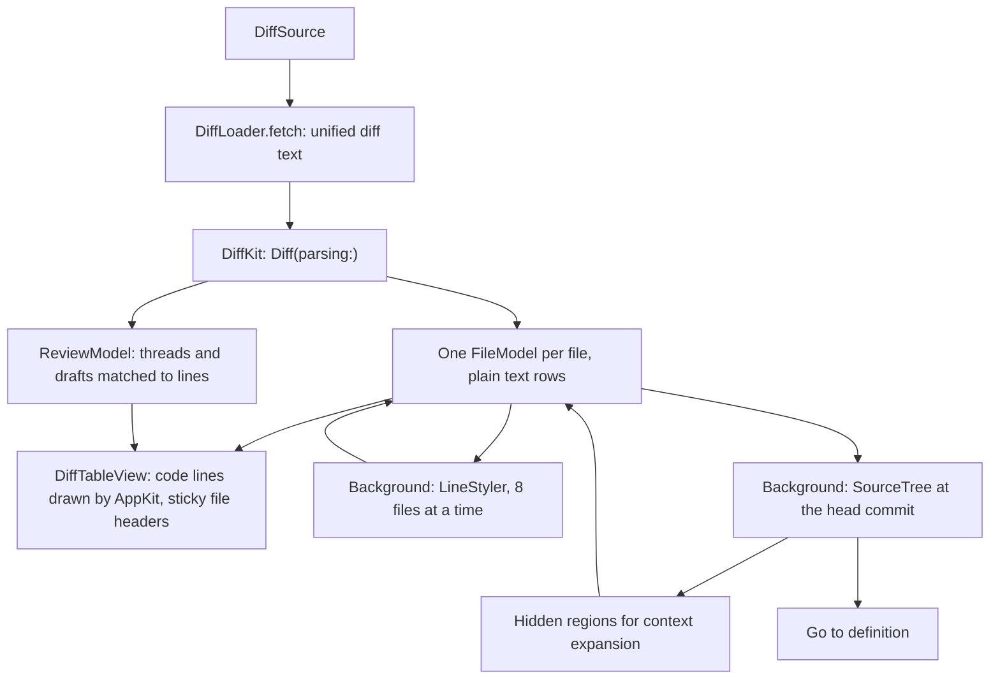
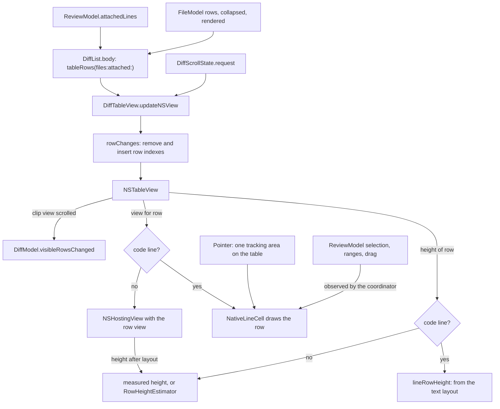
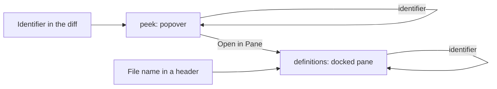

# Diff viewer

The diff viewer shows every changed file of a diff in one scrolling list, with
a file tree beside it. It takes review comments on a pull request and looks up
definitions.

Three targets make it up:

- `DiffKit` parses unified diffs and does the line math. Pure, no UI.
- `SyntaxKit` highlights code and finds definitions with tree-sitter. Pure.
- `DiffUI` holds the views and models. Its entry point is `DiffScreen`.

## Sources

`DiffScreen` takes a `DiffSource`:

| Source | Diff comes from | Stays current by | Comments |
|--------|-----------------|------------------|----------|
| `.pullRequest` | GitHub, or the bare clone when GitHub refuses a large diff | Polling the head commit every 10 seconds | Yes |
| `.workingTree` | `git diff` of a worktree against the merge base of a ref, plus untracked files | Watching the worktree's files | No |
| `.localBranch` | `git diff parent...branch` in a checkout | Nothing. It loads once | No |

## From source to rows

1. `DiffLoader.fetch` returns the diff text and, for a pull request, the head
   commit it belongs to.
2. `Diff(parsing:)` runs off the main actor.
3. `DiffModel.apply` keeps the `FileModel` of every file that is still in the
   diff. An unchanged file keeps its rows, its collapsed state, and its viewed
   mark. This is what lets a reload happen in place.
4. Rows show at once as plain text. `LineStyler` then adds syntax colors and
   intraline emphasis in the background.
5. The source tree is read next, for context expansion and definitions.

A file with more than 2,000 diff lines waits behind a "Load diff" button.

## Rows

`diffRows` builds a file's rows from its hunks, the revealed context lines,
and the layout. Each row has a `RowID` made of the file and the line numbers,
so the ID is the same after a reload and mostly the same in both layouts.
The list keeps rows, their heights, and the scroll position in place
because of that.

The unified layout puts deletions above the additions that replace them. The
split layout pairs them on one row, old on the left and new on the right.
Paired lines also get intraline emphasis: the changed words inside the line.

## The list

`DiffList` shows the rows in an `NSTableView` (`DiffTableView`). A table is
used because it places rows by height without building them, which a
`LazyVStack` cannot do. Cells are reused as rows scroll in and out.

A code line is drawn by AppKit, in a `NativeLineCell`. Everything else is a
SwiftUI view in a hosting cell: file headers, hunk headers, notices, comments,
rendered Markdown, and the gaps between files. Code lines are nearly all the
rows, and a SwiftUI view per row made each scrolled frame lay out a screenful
of hosting views.

- **Rows.** `tableRows(files:)` flattens the files into table rows: per file a
  header, then its diff rows or one row of rendered Markdown, then a spacer. A
  collapsed file has only the header and the spacer. Comments are not rows:
  they open in a popover over their line (see Review comments).
- **Updates.** The table does not observe the models. `DiffList.body` reads
  them and passes the rows in. `rowChanges` compares the old and new row IDs,
  and the table removes and inserts those indexes without animation. It
  reloads everything only when rows changed order. A row that stays and shows
  something else gets its new content in its existing cell.
- **Sticky headers.** The table shows a second copy of the current file's
  header above the rows, at the top of the list. The next file's header pushes
  it out as it arrives. The table's own floating group rows are not used: after
  a jump they keep floating the header of the file the list was on before.
- **Heights.** A code line's height comes from its text: `lineRowHeight`
  wraps the code at the row's width with the string drawing options SwiftUI
  uses for a `Text`. It is exact before the row is on screen, so scrolling
  through code moves nothing. The heights are kept per row until the width or
  the font changes. A hosted row's height is its measured height once it has
  been on screen: the hosted view reports it after every layout. Before that
  it comes from `RowHeightEstimator`, which is exact for a hunk header, a file
  header, and a spacer, and a guess for comments and rendered Markdown.
- **Width.** When the width changes, the heights are redone once a live resize
  is over. During the resize only the rows on screen are redone.
- **Place.** When rows above the visible ones come, go, or change height, the
  table scrolls so the same row stays where it was. A hosted row that scrolls
  in and turns out taller or shorter than its estimate moves the rows toward
  the edge it came from, not the ones being read. At the top or the bottom of
  the list, that edge is held instead.
- **Scroll requests.** `DiffScrollState.request` names a row and where it
  goes. A jump to a file or a line puts it at the top, a line just below its
  file's pinned header. "Show in Diff" puts the line in the middle of the space below the header. The
  table holds the row there while the rows around it get their real heights,
  until the user scrolls. Any scroll the table did not make itself counts as
  the user's.
- **Visible rows.** Each scroll reports the rows on screen to
  `DiffModel.visibleRowsChanged`, which picks the current file. Lines hidden
  under the pinned header are left out.

By default AppKit asks for the heights of rows near the visible ones and
extends their average to the rest, which moves the scroll bar as a long diff
scrolls. `HermesApp` registers the user default
`NSTableViewCanEstimateRowHeights` as `false` at launch, so the table asks
for every row's height and the scroll bar is exact for a diff without
comments. AppKit reads the default once per process and applies it to every
table, including SwiftUI lists, which then build every row to measure it.

### Code lines

`lineSides` gives the geometry of a code-line row: one side as wide as the
row, or the old and new halves of a split row. The height, the drawing, and
the pointer all use it.

`NativeLineCell` draws the row tint, the gutter tint, the line numbers with
the change marker, the code, and the "No newline at end of file" note. The
code is the line's `AttributedString` turned into an `NSAttributedString`
once per row shown, not per draw. Text starts on whole pixels, where SwiftUI
puts it.

The cells have no tracking areas, gestures, or observation of their own. The
table's coordinator has them:

| What | How |
|------|-----|
| "+" on the hovered line | One tracking area on the table. The coordinator tells the cell under the pointer where the pointer is. Only that cell and the one the pointer left redraw. While the list scrolls nothing is hovered. The row under a resting pointer gets its "+" 0.1 seconds after the last scrolled step. |
| Comment on a line or a range | A press on the "+" calls `ReviewModel.beginDrag`. Each drag event finds the row at the pointer's height and calls `drag(over:)` with its lines, so rows that scroll into view during the drag count. The release calls `endDrag`. A shift-click extends the open comment's range. |
| Selection and range marks | The coordinator observes the review's selection, comment ranges, and drag origin, and gives the cells on screen their `LineMarks`. A cell redraws when its marks change. |
| Go to definition | The cell lays the hovered side's code out with a layout manager and finds the character under the pointer. The line is parsed for identifiers when the pointer first reaches it. An identifier under the pointer is underlined, the cursor is a pointing hand, and a click looks it up. |
| Context menu | The cell's `menu(for:)`: Copy Line, and Add Comment… for a pull request. |
| Revealed line | A request that puts a line in the middle (`DiffModel.reveal`) tints its row yellow for 0.3 seconds, then fades the tint over 0.9 seconds. When the request names a symbol, as "Show in Diff" does, its first occurrence on the line is tinted more strongly. With Reduce Motion on, the tint goes away at once instead of fading. A jump from the navigator tints nothing. The tint is a view over the cell, so the row keeps its height. |
| VoiceOver | Each cell is one element. Its label is "Added line 12", "Removed line 7", or "Line 3", then the text. A custom action per line starts a comment on it. |

## Staying current

For a pull request, `DiffModel.run` asks GitHub for the head commit and update
time every 10 seconds while the screen is visible:

- A new head commit reloads the diff.
- A new update time with the same head reloads only the review threads.

GitHub serves the previous diff for a few seconds after a push. When the head
is new but the text is unchanged, the model keeps the old head so the next
poll asks again. After six such polls, about a minute, it accepts that the
commit left the diff as it was.

When a reload changes files at or above the one being read, the model scrolls
back to the first line that was on screen and still exists.

## Syntax highlighting

`SyntaxKit` supports Swift, TypeScript, TSX, JavaScript, Go, Rust, C#, Python,
Ruby, JSON, Bash, HCL, YAML, TOML, HTML, and CSS. `Language(path:)` picks the
language from the file name, the extension, or the shebang. Anything else is
plain text.

A hunk is highlighted as a fragment, old side and new side separately.
Tree-sitter recovers from the missing context, so most tokens are right, and a
keyword near a hunk's edge can be missed.

## Context expansion

The diff leaves out unchanged lines. Once the file's full text is read from
the source tree, `FileDiff.hiddenRegions` computes those lines, and the hunk
headers get controls that reveal them. For a pull request the text comes from
`RepoCache`, which fetches the head commit into a shallow bare clone under
`~/Library/Caches/Hermes/repos`.

## Review comments

`ReviewModel` holds a pull request's threads from GitHub, the user's drafts,
and the one comment being written.

- A line with threads or drafts has a badge at the end of its row: blue for
  an unresolved thread, gray when every thread is resolved, orange when it has
  a draft of the user's or the comment being written. `ReviewLayout.badges`
  works them out, and `NativeLineCell` draws them.
- The line's threads, drafts, notice, and composer open in a popover over the
  line. `ReviewModel.focusedLine` is the line the popover shows: a click on a
  badge sets it, and so do starting a comment and a notice. The table watches
  it and shows or closes the popover. Closing the popover keeps the comment
  being written, which is saved with the drafts.
- Dragging in the gutter selects a range. GitHub accepts a range only when
  both ends are lines of the same hunk. Other selections show the reason in
  the popover.
- A finished comment becomes a `DraftComment`. Drafts and the review summary
  are saved to
  `~/Library/Application Support/Hermes/drafts/<owner>/<repo>/<number>.json`.
- `ReviewLayout` matches threads and drafts against the current diff. A draft
  whose line left the diff is outdated. It stays in the Outdated Comments
  list, where it can be moved to a new line or deleted, and it is left out of
  a submission.
- Finish Review sends every draft that still has a place as one review, with
  the Comment, Approve, or Request Changes verdict. Approve and Request
  Changes are disabled on the viewer's own pull request.

GitHub's `addPullRequestReview` mutation cannot reply to existing threads. A
review without replies is one request. A review with replies takes three
steps: create a pending review with the new threads, add each reply, then
submit. If a step fails, Hermes deletes the pending review, so a retry starts
clean.

GitHub allows one pending review per user and pull request. When the viewer
already has one, for example started on github.com, Hermes adds its threads
and replies to that review and submits it. If a step fails there, Hermes
deletes only the comments it added and keeps the review.

## File navigator

The navigator lists the changed files as a directory tree, one list row per
visible node, indented by depth. A chain of directories with one child each
is one row (`packages/contract`). A lock file sits under its manifest when
both changed in the same directory: `pnpm-lock.yaml` under `package.json`,
`Cargo.lock` under `Cargo.toml`. `lockFileManifests` in
`Sources/DiffUI/FileTree.swift` holds the pairs.

## Rendered Markdown

A Markdown file has a Source and Rendered switch. Rendered shows the new
version with the changes marked on the rendered blocks. The new text comes
from the source tree, and the old text is rebuilt by undoing the hunks. A "+"
button on a block starts a comment on the block's lines that are in the diff.

## Go to definition

Clicking an identifier in the diff or in the definition pane looks it up:

1. `git grep` finds the files that contain the name as a whole word.
2. `DefinitionSearch.candidates` ranks them: the file that was clicked, files
   in its directory, files in its language, then the rest. It keeps the first
   40.
3. `Syntax.definitions` parses each candidate and returns the places that
   define the name.

A click in the diff shows the result in a popover over the identifier. One
result opens the file at the definition, and several show a list. Identifiers
clicked inside the popover are looked up in the popover, which keeps a back and
forward history. The popover's pane button moves the page on screen into the
definition pane docked under the diff.

The pane and the popover are two `DefinitionModel`s: `DiffModel.definitions`
and `DiffModel.peek`. They share the source tree. `LinePopover` shows the
popover, anchored to the table rather than a cell because the table reuses
cells as it scrolls.

## Opening a file

A file header's name is a link. It opens the new version of the file in the
definition pane at its first changed line (`FileDiff.firstChangedLine`). A
deleted file's name is plain text, because the pane reads the head commit,
where the file no longer exists.

Definitions work for Swift, TypeScript, TSX, JavaScript, Go, Rust, C#, Python,
Ruby, Bash, and HCL. The lookup is by name, not by type, so two unrelated
symbols with one name both show up.

## Commands and settings

`DiffCommands` adds the Diff menu: next and previous file, mark as viewed,
layout, and code size. It reaches the visible diff through the
`diffModel` focused value. The layout and the code font size are stored in
user defaults under `DiffUI.layout` and `DiffUI.codeFontSize`.
