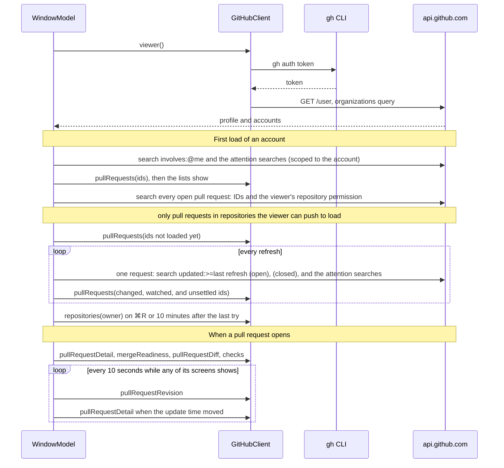
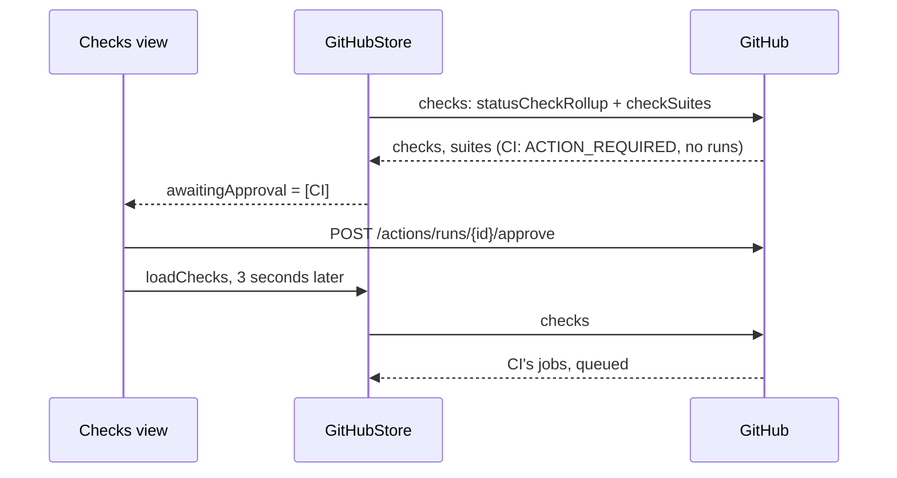

# GitHub

`GitHubKit` talks to github.com. It holds the API client, authentication, the
domain models, and the bot filter. It also holds the relay client, described in
[relay-client.md](relay-client.md), and the webhook forwarder, described in
[webhooks.md](webhooks.md). It has no UI and no dependencies.

## Authentication

Hermes stores no credentials. `GitHubAuth.token()` runs `gh auth token` and
returns what it prints.

A macOS app starts with a minimal `PATH`, so `gh` is looked up in
`/opt/homebrew/bin` and `/usr/local/bin` first. If it is in neither, Hermes
asks the user's login shell with `command -v gh`.

Two failures have their own startup screen:

- `ghNotInstalled`: no `gh` binary was found.
- `ghNotLoggedIn`: `gh auth token` failed or printed nothing.

## The client

`GitHubClient` is an actor. The app creates one at launch and passes it to
every model that needs it.

- The token is read on first use and kept. When GitHub answers HTTP 401, the
  client drops it, and the next call reads it again.
- `get`, `post`, and `put` send REST requests. `graphQL` runs a query or a
  mutation.
- REST requests ignore the URL cache. GitHub marks responses cacheable for 60
  seconds, which would hide a change from a caller that polls.

When GitHub responds with HTTP 403 or 429 for a used-up rate limit, and the
limit resets within 5 minutes, the client pauses. Every request, read or
write, waits for the reset, because GitHub asks clients to wait until then.
The client reads the reset time from `retry-after`, or from
`x-ratelimit-reset` when `retry-after` is missing. When GitHub sends neither
header, the client waits a minute. GraphQL reports a used-up limit with HTTP
200 and a `RATE_LIMITED` error. The client throws `GitHubError.rateLimited`
for it but doesn't pause.

`retryingReads` runs a read up to two more times. It retries on HTTP 502 or
504, which is how a GraphQL query that ran too long fails. It also retries a
read that hit a rate limit resetting within 60 seconds, once the reset passes. The searches,
the pull request fields, and the repository list go through it. Other reads,
such as a pull request's detail, revision, and checks, fail on the first error,
and their next poll tries again. A mutation never retries: it may have been
applied before the gateway gave up.

Every method throws `GitHubError`. `describe(_:)` turns an error into a
sentence for the user. The diff and checks views word some errors their own
way.

## What is loaded, and when



| Call | Source | Notes |
|------|--------|-------|
| `viewer()` | REST `/user` and GraphQL | The profile comes from REST because GraphQL's `email` needs a scope `gh` does not request. |
| `pullRequestHits(matching:)` | GraphQL search | The pull requests a search finds, each with whether the viewer can push to its repository, 100 per page and at most 1,000. `pullRequestIDs(matching:)` returns only the IDs. `PullRequestSearch` builds the queries. |
| `pullRequestHits(matchingEach:)` | GraphQL search | Several searches as one request, which costs one point. A search with more than 100 results runs again through `pullRequestHits(matching:)`. |
| `pullRequests(ids:perRequest:)` | GraphQL | Pull request fields by ID, 2 requests at a time. A first load asks for 10 per request, a refresh for 25. Then one more request per 25 pull requests whose checks failed, to learn whether a required check did. |
| `viewerTeams()` | REST `/user/teams` | The teams the viewer is on, to match against a pull request's requested reviewers. |
| `openPullRequests(owner:)` | GraphQL search | Both of the above for every open pull request in the account's non-archived repositories. |
| `repositories(owner:)` | GraphQL | Non-archived repositories the account owns that the viewer can push to (write, maintain, or admin), with open issue counts. Pages every repository with only its permission, then counts issues for the ones kept. |
| `issues(repository:pageSize:after:)` | GraphQL | One page of a repository's open issues. Loaded when the list is shown. |
| `pullRequestDetail` | GraphQL | Description, comments, reviews, requested reviewers, commits, review threads. |
| `pullRequestRevision` | GraphQL | Head commit, update time, and which changed files the viewer marked viewed, 100 files a page. The cheap call for polling. |
| `pullRequestDiff` | REST | Unified diff text. Throws `diffTooLarge` when GitHub refuses to render it. |
| `checks(repository:commitOID:)` | GraphQL | Check runs and legacy commit statuses of a commit, and its workflow runs that wait for approval. See [Workflow runs waiting for approval](#workflow-runs-waiting-for-approval). |
| `approveWorkflowRun(repository:runID:)` | REST | Approves a workflow run that waits for a maintainer, so it starts. |
| `jobLogs(repository:jobID:)` | REST | The log of a GitHub Actions job. |
| `rerunJob(repository:jobID:)` | REST | Runs a failed GitHub Actions job again, with the jobs that depend on it. |
| `rerunFailedJobs(repository:runID:)` | REST | Runs the failed and cancelled jobs of a workflow run again. |
| `submitReview` | GraphQL mutations | See [diff-viewer.md](diff-viewer.md). |
| `mergeReadiness(repository:number:)` | GraphQL | GitHub's merge state for a pull request, the methods its repository allows, the viewer's default method, and whether the viewer can push. |
| `mergePullRequest(pullRequestID:method:expectedHeadOID:)` | GraphQL mutation | Merges one pull request that is not in a stack. GitHub refuses it when the head has moved. |
| `enableAutoMerge(pullRequestID:method:expectedHeadOID:)` | GraphQL mutation | GitHub merges with the method once every requirement passes. |
| `disableAutoMerge(pullRequestID:)` | GraphQL mutation | Turns auto-merge off. |
| `markReadyForReview(pullRequestID:)` | GraphQL mutation | Takes a pull request out of draft. |
| `mergeStack(repository:upTo:method:)` | `gh stack merge` | Merges a stack from the bottom up to one pull request, all or nothing. |

The pull request fields load 10 per request because the query costs GitHub
about 100 ms per pull request, and GitHub answers HTTP 502 when a request
passes 10 seconds. Loading IDs first lets those requests run side by side.

## Accounts

`ViewerProfile.accounts` is the personal account followed by the viewer's
organizations, sorted by login. Each window shows one account. The account's
lists live in the app's `GitHubStore` as keys into its tables, and they stay in
memory, so switching back to an account shows its lists at once while they
reload. A pull request or issue that leaves a list keeps its record and loads
again, since a window may be showing it. See [store.md](store.md).

## Bot filter

`PullRequest.isShown(showingAllBots:)` decides whether a list shows a pull
request. A person's pull request always shows. A bot's shows only when
`needsAttention` is true: a check failed, required or not, or it has merge
conflicts. An optional failure counts here because a person still has to look
at the pull request to merge it.
The Show All Bot Pull Requests setting turns the filter off.

## Required and optional checks

`PullRequest.checkState` is a `ChecksRollup`: passed, pending, failed, or
optional failed. GitHub's own rollup is `FAILURE` when any check fails, required
or not. So for each pull request with a failed rollup, `pullRequests(ids:)`
reads the head commit's first 100 checks with `isRequired(pullRequestId:)`,
which takes the pull request as an argument and so cannot be part of
`PullRequest.fields`.

| The required checks | `checkState` |
| --- | --- |
| One failed | `failed` |
| None failed, one is still running | `pending` |
| None failed, all finished, or there are none | `optionalFailed` |

A repository that requires no checks has only optional ones, so a failure
there is `optionalFailed`. Only `failed` counts as failing in the Failing
filter and the attention inbox. `optionalFailed` shows as a
yellow warning triangle, "Optional checks failed", and does not stop a pull
request from being "Ready to merge".

## Stacks

A pull request carries its stack ID and its position in the stack.
`PullRequest.grouped` folds the pull requests of one stack into one group,
ordered by position, so a list shows a stack as one node.

## Items outside the lists

A closed pull request, or one in another account, is not in the lists.
`GitHubClient.item(_:)` loads a pull request or an issue by number in any
state. The command palette uses it for `repo#123`, and the detail pane uses
it to keep showing a pull request after it is merged or closed.

## Merging

The Merge button in a pull request's header is enabled when
`MergeReadiness.blocker` is nil: GitHub's merge state is clean, has hooks, or
unstable (a check that is not required fails or still runs), the pull request
is not a draft, the repository allows a method, and the viewer can push. The
button uses the viewer's default method and its menu lists the other allowed
ones. A confirmation names what will merge.

GitHub refuses to merge a draft, and `gh stack merge` refuses a stack that has
a draft below the pull request being merged. While the pull request, or a
member below it in its stack, is a draft, a viewer who can push sees a Ready
for Review button in place of the Merge menu. The button marks each draft
ready for review, bottom first. It skips a confirmation, because a pull
request can be converted back to draft on GitHub. Then it reloads those pull
requests and the merge readiness of the open pull request. Marking a pull
request ready can start checks and request reviewers, so the Merge menu often
stays disabled until the checks finish and the reviews arrive.

GitHub refuses the ordinary merge call for a stacked pull request, so a
stacked one is merged with the `gh stack` extension, which also merges every
member below it. `GH_REPO` tells the extension the repository, because it
otherwise reads it from the working directory.

## Workflow runs waiting for approval

A repository can require a maintainer to approve GitHub Actions runs from a fork before
they start. Until then GitHub creates the run's check suite with the conclusion
`ACTION_REQUIRED` and no check runs. The commit's `statusCheckRollup` leaves it out, so a
required check the run would report is missing, and the pull request is blocked while
every listed check has passed.

`checks(repository:commitOID:)` also reads the commit's first 100 check suites and keeps
each one that concluded `ACTION_REQUIRED` and has a workflow run. The Checks tab and the
overview's checks summary list those runs above the checks, with an Approve button that
calls `approveWorkflowRun` for each and then reloads the checks. The reload runs even when
GitHub refuses a run, so the row shows what still waits. GitHub can approve a commit's
other waiting runs along with the first and then refuse the rest, so a refusal shows an
error only when the reload still finds a run waiting. While a run waits, the checks reload
every 10 seconds, so an approval on github.com clears the row.



When a missing review or check blocks the merge, or the branch is behind its
base, and GitHub's `viewerCanMergeAsAdmin` is true, the Merge menu offers
"Merge Without Requirements" with each method. It is the same merge call:
GitHub lets a viewer who may bypass the rules merge past them. The
confirmation is destructive and names what is unmet. It is never offered for
conflicts, a draft, or a stacked pull request, because `gh stack merge`
cannot bypass.

When the repository allows auto-merge and GitHub's `viewerCanEnableAutoMerge`
is true, the Merge menu offers "Enable Auto-Merge" with each allowed method.
GitHub sets that flag only while the pull request cannot merge yet, so it never
sits beside the ordinary merge entries. It has no confirmation, because it can
be turned off before it fires. While it is on, the header shows an
"Auto-merge" badge with the method, and the menu offers "Disable Auto-Merge".
Stacked pull requests do not get it, because they merge through `gh stack`.

## What a refresh loads again

GitHub's search can trail a change by up to a minute, and some changes never
reach it: a check that finishes does not update its pull request. So each
refresh also loads by ID, which is exact:

- the pull requests the account's windows show, up to 100
  (`PullRequestChanges.watchLimit`): the open ones, those with a session, the
  attention inbox, then the lists on screen, in that order. `AppStore` collects
  them from its windows.
- every held pull request whose checks have not passed, so a finished check or
  a re-run shows.

A pull request loaded this way carries its `state`, so one that merged or
closed leaves the list without waiting for the search. A pull request opened by
number, which is in no list, loads again on its own.

## Writes

Most writes are GraphQL mutations on a pull request, such as a review, a
merge, or a file marked viewed. GitHub Actions writes, such as approving a run
or running jobs again, are REST `POST`s. Publishing a relay tenant commits a
file to the account's `.github-private` repository with a REST `PUT`. See
[Finding a tenant without a link](relay-client.md#finding-a-tenant-without-a-link).
A stack merges through `gh stack merge`, described in [Merging](#merging).

A write that `GitHubClient` sends waits out a rate-limit pause like any
request, but never retries. See [The client](#the-client).

Live tests that write use `bojanrajkovic/hermes-playground` only.

## Rate limits

GitHub has an hourly quota of points and a secondary limit on bursts, which
also caps the server time GraphQL queries use per minute. A large
organization trips the secondary limit long before the quota, so Hermes:

- loads pull requests and issue counts only for repositories the viewer can
  push to. A first load also loads every pull request that involves the
  viewer, from any repository. A refresh adds new pull requests that the
  viewer opened, reviewed, was asked to review, or was mentioned in. Anything
  else opens on demand from a link or ⌘K.
- loads pull request details 2 requests at a time.
- sends a refresh's searches as one request. GitHub charges a request at least
  one point, and several small searches together still cost one.
- keeps a first load's progress when it fails part way, and continues from
  there on the next refresh.
- pauses every request when GitHub reports over HTTP a used-up rate limit that
  resets within 5 minutes, and retries the list loads when the limit resets
  within a minute. See
  [The client](#the-client).

Every request logs one line under the `com.coderinserepeat.hermes` subsystem,
category `github`: what it was, its status, size, time, and rate limit
headers.

```bash
/usr/bin/log stream --predicate 'subsystem == "com.coderinserepeat.hermes" AND category == "github"'
```
