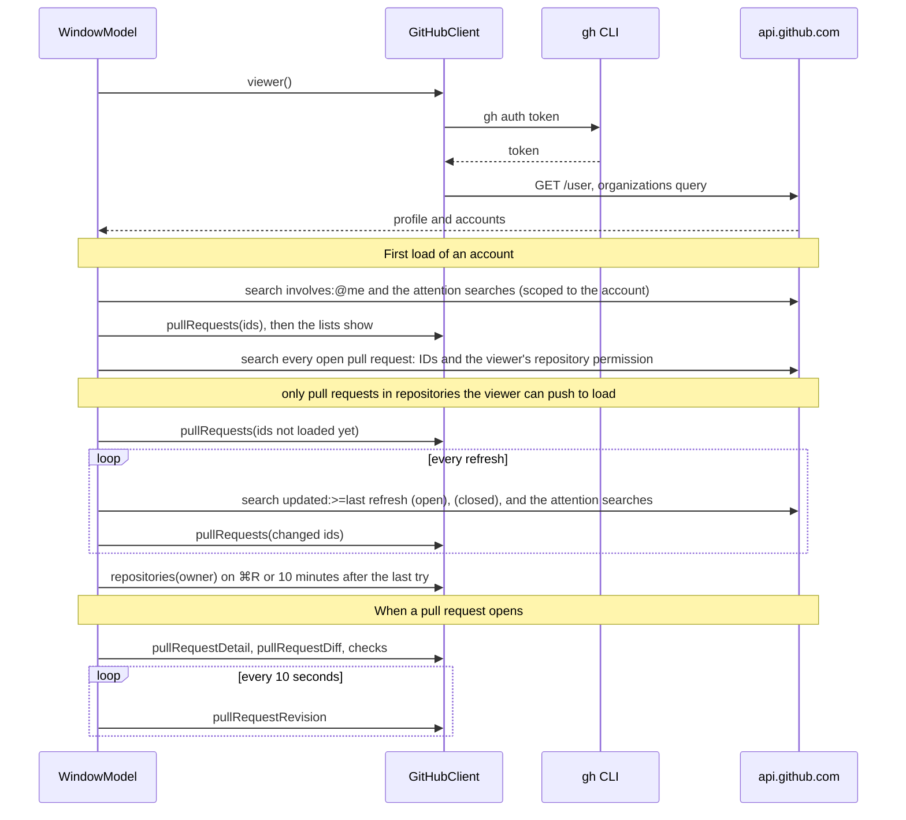

# GitHub

`GitHubKit` talks to github.com. It holds the API client, authentication, the
domain models, and the bot filter. It has no UI and no dependencies.

## Authentication

Hermes stores no credentials. `GitHubAuth.token()` runs `gh auth token` and
returns what it prints.

A macOS app starts with a minimal `PATH`, so `gh` is looked up in
`/opt/homebrew/bin` and `/usr/local/bin` first. If it is in neither, Hermes
asks the user's login shell with `command -v gh`.

Two failures have their own startup screen:

- `ghNotInstalled`: no `gh` binary was found.
- `ghNotLoggedIn`: `gh auth token` failed or printed nothing.

## The client

`GitHubClient` is an actor. The app creates one at launch and passes it to
every model that needs it.

- The token is read on first use and kept. When GitHub answers HTTP 401, the
  client drops it, and the next call reads it again.
- `get` sends a REST request. `graphQL` runs a query or a mutation.
- REST requests ignore the URL cache. GitHub marks responses cacheable for 60
  seconds, which would hide a change from a caller that polls.
- The pull request list query retries up to two more times on HTTP 502 or
  504, which is how a GraphQL query that ran too long fails. Nothing else
  retries, and a mutation must not: it may have been applied before the
  gateway gave up.

Every method throws `GitHubError`. `describe(_:)` in
`Sources/Hermes/WindowModel.swift` and `DiffLoader.message(for:)` turn an error
into a sentence for the user.

## What is loaded, and when



| Call | Source | Notes |
|------|--------|-------|
| `viewer()` | REST `/user` and GraphQL | The profile comes from REST because GraphQL's `email` needs a scope `gh` does not request. |
| `pullRequestHits(matching:)` | GraphQL search | The pull requests a search finds, each with whether the viewer can push to its repository, 100 per page and at most 1,000. `pullRequestIDs(matching:)` returns only the IDs. `PullRequestSearch` builds the queries. |
| `pullRequests(ids:)` | GraphQL | Pull request fields by ID, 10 per request and up to 8 requests at once. |
| `openPullRequests(owner:)` | GraphQL search | Both of the above for every open pull request in the account's non-archived repositories. |
| `repositories(owner:)` | GraphQL | Non-archived repositories the account owns that the viewer can push to (write, maintain, or admin), with open issue counts. Pages every repository with only its permission, then counts issues for the ones kept. |
| `issues(repository:pageSize:after:)` | GraphQL | One page of a repository's open issues. Loaded when the list is shown. |
| `pullRequestDetail` | GraphQL | Description, comments, reviews, requested reviewers, commits, review threads. |
| `pullRequestRevision` | GraphQL | Head commit and update time. The cheap call for polling. |
| `pullRequestDiff` | REST | Unified diff text. Throws `diffTooLarge` when GitHub refuses to render it. |
| `checks(repository:commitOID:)` | GraphQL | Check runs and legacy commit statuses of a commit. |
| `jobLogs(repository:jobID:)` | REST | The log of a GitHub Actions job. |
| `rerunJob(repository:jobID:)` | REST | Runs a failed GitHub Actions job again, with the jobs that depend on it. |
| `rerunFailedJobs(repository:runID:)` | REST | Runs the failed and cancelled jobs of a workflow run again. |
| `submitReview` | GraphQL mutations | See [diff-viewer.md](diff-viewer.md). |
| `mergeReadiness(repository:number:)` | GraphQL | GitHub's merge state for a pull request, the methods its repository allows, the viewer's default method, and whether the viewer can push. |
| `mergePullRequest(pullRequestID:method:expectedHeadOID:)` | GraphQL mutation | Merges one pull request that is not in a stack. GitHub refuses it when the head has moved. |
| `mergeStack(repository:upTo:method:)` | `gh stack merge` | Merges a stack from the bottom up to one pull request, all or nothing. |

The pull request fields load 10 per request because the query costs GitHub
about 100 ms per pull request, and GitHub answers HTTP 502 when a request
passes 10 seconds. Loading IDs first lets those requests run side by side.

## Accounts

`ViewerProfile.accounts` is the personal account followed by the viewer's
organizations, sorted by login. Each window shows one account. The account's
lists live in an `AccountData` that every window showing it shares, and it
stays in memory, so switching back to an account shows its lists at once
while they reload. A pull request or issue that leaves a list is kept by
number and loaded again, since a window may be showing it.

## Bot filter

`PullRequest.isShown(showingAllBots:)` decides whether a list shows a pull
request. A person's pull request always shows. A bot's shows only when
`needsAttention` is true: its check rollup is `failure` or `error`, or it has
merge conflicts. The Show All Bot Pull Requests setting turns the filter off.

## Stacks

A pull request carries its stack ID and its position in the stack.
`PullRequest.grouped` folds the pull requests of one stack into one group,
ordered by position, so a list shows a stack as one node.

## Items outside the lists

A closed pull request, or one in another account, is not in the lists.
`GitHubClient.item(_:)` in `Sources/Hermes/WindowModel.swift` loads a pull
request or an issue by number in any state. The command palette uses it for
`repo#123`, and the detail pane uses it to keep showing a pull request after
it is merged or closed.

## Merging

The Merge button in a pull request's header is enabled when
`MergeReadiness.blocker` is nil: GitHub's merge state is clean, has hooks, or
unstable (a check that is not required fails or still runs), the pull request
is not a draft, the repository allows a method, and the viewer can push. The
button uses the viewer's default method and its menu lists the other allowed
ones. A confirmation names what will merge.

GitHub refuses the ordinary merge call for a stacked pull request, so a
stacked one is merged with the `gh stack` extension, which also merges every
member below it. `GH_REPO` tells the extension the repository, because it
otherwise reads it from the working directory.

When a missing review or check blocks the merge, or the branch is behind its
base, and GitHub's `viewerCanMergeAsAdmin` is true, the Merge menu offers
"Merge Without Requirements" with each method. It is the same merge call:
GitHub lets a viewer who may bypass the rules merge past them. The
confirmation is destructive and names what is unmet. It is never offered for
conflicts, a draft, or a stacked pull request, because `gh stack merge`
cannot bypass.

## Writes

Writes are submitting a review and merging. `GitHubClient` has no other mutation.
Live tests that write use `bojanrajkovic/hermes-playground` only.

## Rate limits

GitHub has an hourly quota of points and a secondary limit on bursts, which
also caps the server time GraphQL queries use per minute. A large
organization trips the secondary limit long before the quota, so Hermes:

- loads pull requests and issue counts only for repositories the viewer can
  push to. Pull requests that involve the viewer or ask for their review load
  from any repository, and anything opens on demand from a link or ⌘K.
- loads pull request details 2 requests at a time.
- keeps a first load's progress when it fails part way, and continues from
  there on the next refresh.
- pauses every request when GitHub sends `retry-after` of five minutes or
  less, and retries reads once the pause ends.

Every request logs one line under the `com.coderinserepeat.hermes` subsystem,
category `github`: what it was, its status, size, time, and rate limit
headers.

```bash
/usr/bin/log stream --predicate 'subsystem == "com.coderinserepeat.hermes" AND category == "github"'
```
