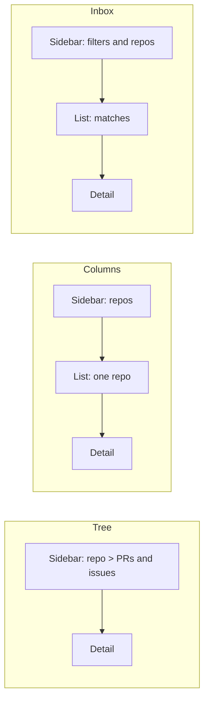
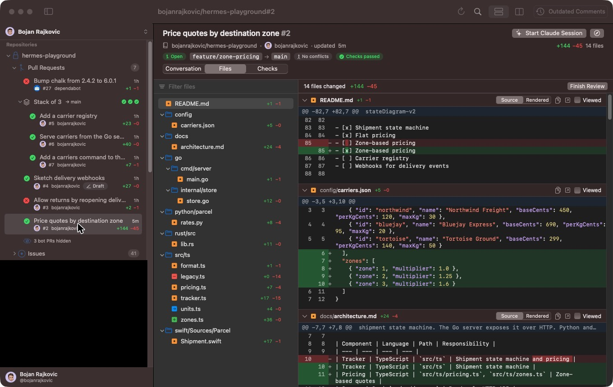
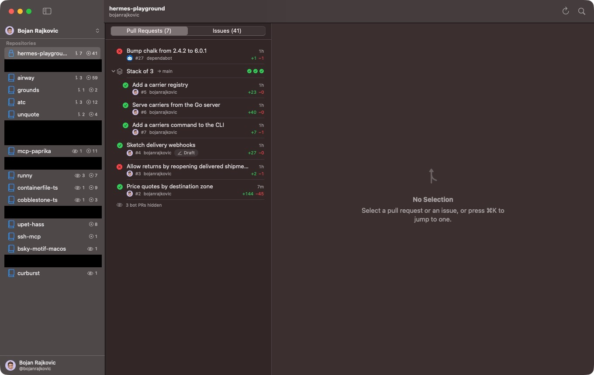
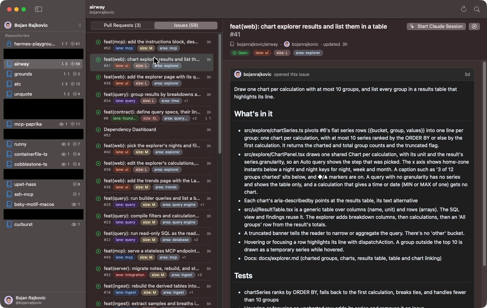
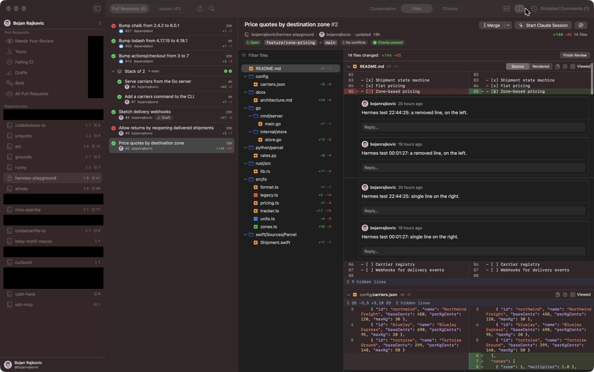
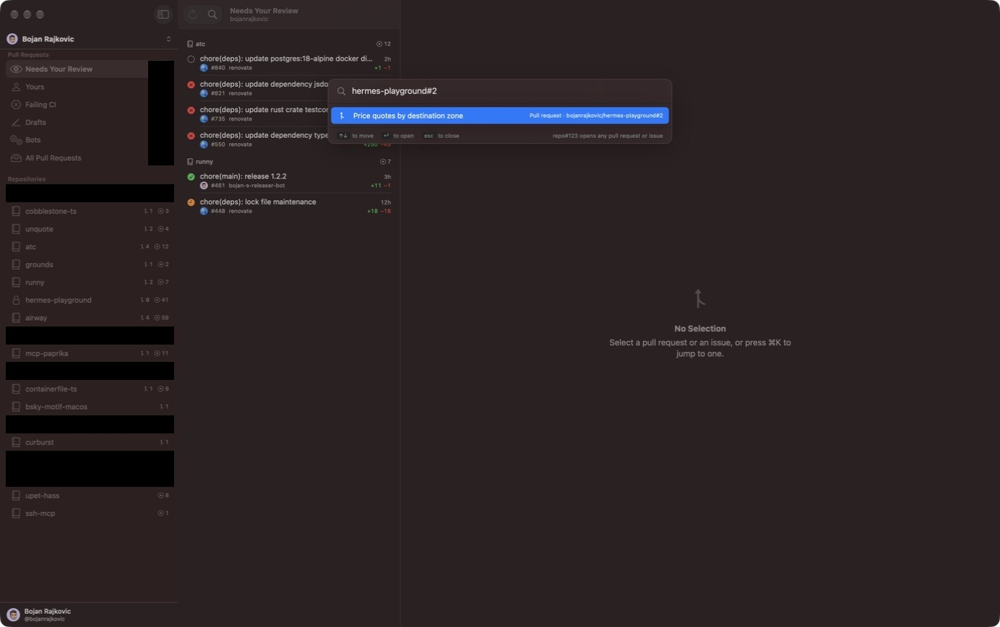

# Navigation bake-off

Private repositories in the screenshots are blacked out.

Hermes tried three navigation styles and kept one, Inbox. This file records
how each held up as real data replaced guesses.

## The data

A personal account with about twenty repositories that have open work, a
similar number of pull requests shown, a few dozen bot pull requests (most
hidden), and issue lists of 59 (`airway`) and 41 (`hermes-playground`). An
organization account has a repository with more than 150 open issues.

## Round 1: before any data

The brief asked for pull requests per repository in a tree. I expected Tree to
be enough and added Columns and Inbox as challengers.

- Tree: one sidebar, nothing between the list and the diff.
- Columns: Mail-style. Built on the guess that issue lists would outgrow a tree.
- Inbox: built on the guess that "what needs me?" matters more than "which repo?".

## Round 2: one repository, real pull requests

Data: `hermes-playground` only (7 pull requests, a stack of 3, 4 bot pull
requests, 41 issues).

- Tree read well. The stack row with its three check marks is the best single
  row in the app.
- 41 issues inside a tree node was the first crack. Expanding Issues pushed
  every other repository off screen.
- Columns fixed that by giving issues their own list and room for labels.
- Inbox had little to do with one repository.

View at this point: Tree for pull requests, Columns once issues matter.

## Round 3: the whole account

Data: every repository in the account.

Tree. The sidebar at 340 points truncates most titles ("Serve carriers from
the Go se…"). Two repositories fill the window, so the rest are a scroll
away. The diff gets every remaining point, and it shows: file list and unified
diff fit side by side with room to spare.

Columns. Every repository fits in the sidebar with their counts, which makes
it the best overview of the account. Titles fit in the list. The issue list
has room for three labels a row and pages 60 at a time.

The cost is about 380 points of width. A split diff in the space that is left
wraps most lines.

Inbox. "Needs Your Review" came back with a handful of pull requests, and
"Failing CI" with about a dozen. That is the question I had each time I opened the app.
Inbox also keeps the repository list under the filters, so it does everything
Columns does. It pays the same width cost.

## Where I ended up

| | Tree | Columns | Inbox |
|---|---|---|---|
| Find one repository's pull requests | Scroll | One click | One click |
| "What needs me?" across repositories | No | No | Yes |
| 50+ issues in a repository | Crowds the tree | Good | Good |
| Width left for the diff | Most | Least | Least |

⌘K removes most of the scrolling in any style: `airway#95` opens the pull
request and lists its repository.

My view moved twice. I started sure a tree was enough. One repository's issues
made me prefer Columns. The whole account made Columns redundant, and I
settled on Tree as the default for reading with Inbox for triage.

## Round 4: daily use

Bojan used all three on his own account and kept Inbox. It answers "what
needs me" first and still lists every repository, and the width it costs the
diff did not matter in practice. Tree and Columns are removed.
