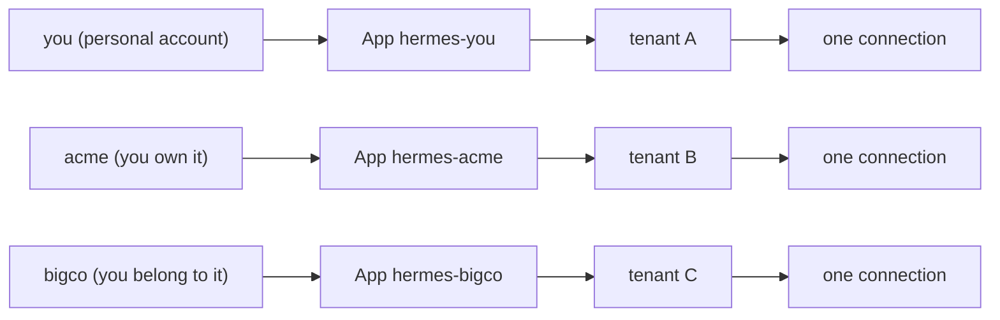
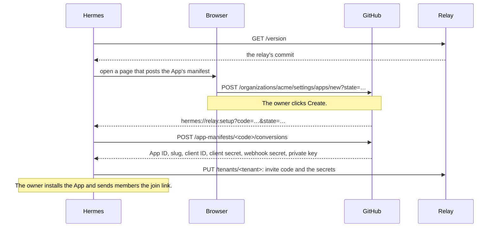
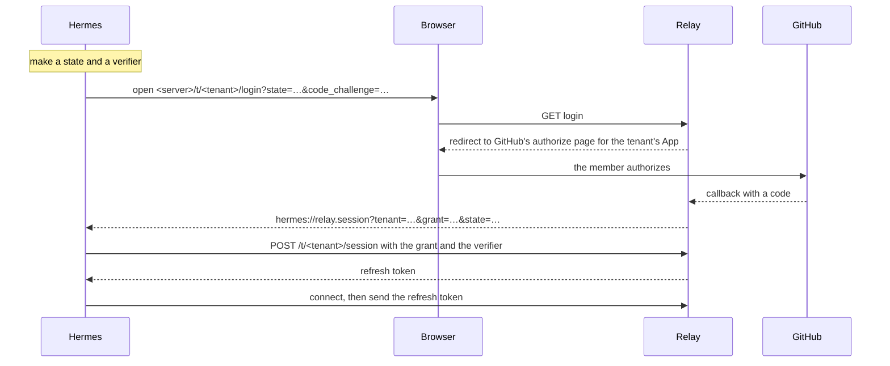
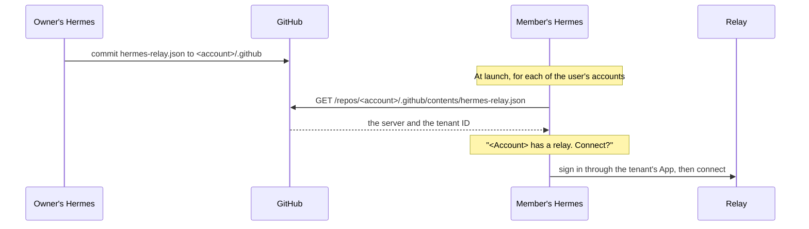
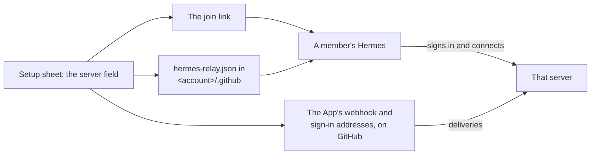
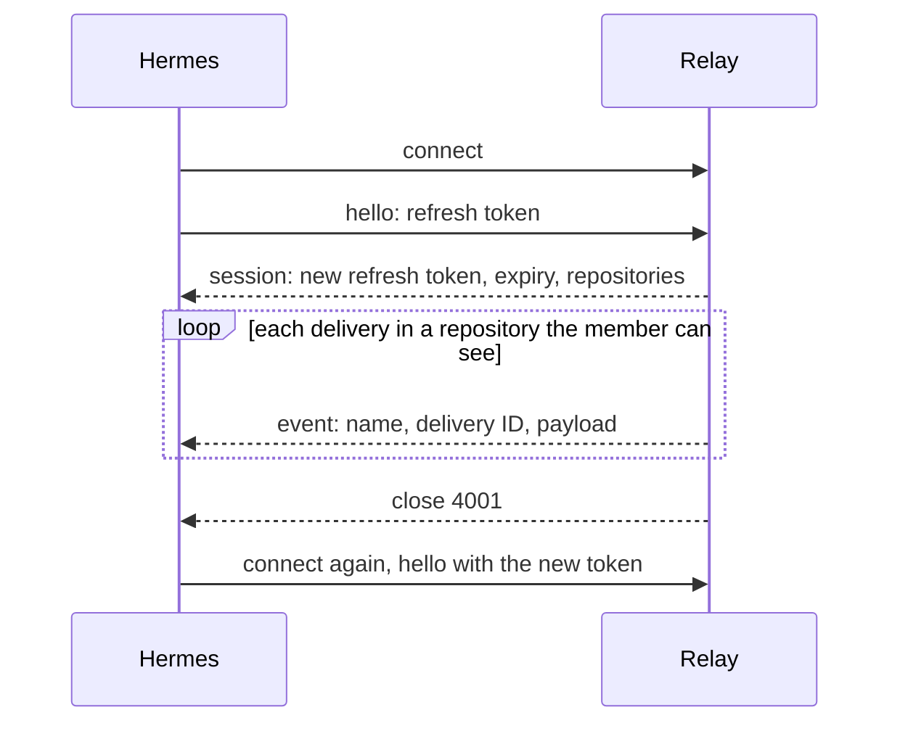

# The relay, from Hermes

The [relay](relay.md) is a server that passes a GitHub App's webhook
deliveries on to the people who can see the repository. This page covers the
Hermes side: setting up a tenant, joining one, the connection, and what
Hermes does with an event. [relay-privacy.md](relay-privacy.md) says what the
relay's operator can and cannot see.

A **tenant** is one GitHub account's place on a relay: the server's URL and a
tenant ID of 32 lowercase hex characters (`RelayTenant`). The hosted relay is
`RelayTenant.defaultServer`.

## Tenants on this Mac

`Relays` (in the `Hermes` target, `AppStore.relays`) holds a list of
`RelayMembership` values and saves it with the other settings. A membership is
a tenant, plus the account and App slug when this user set the tenant up. A
user can have several: one for their own account and one for each
organization, each with its own App and possibly its own server. Each has its
own refresh token and its own connection. The minus button on a tenant's row
in Settings removes it from this Mac and deletes its refresh token. The App
stays on GitHub.

A tenant's row in Settings shows whose it is, what its connection is doing,
and its server with the commit that server's relay reports at `/version`.

## Which accounts get a tenant

A tenant belongs to one GitHub account: a person's own account or an
organization. GitHub lets a private App be installed only on the account that
owns it, so every account needs its own App and its own tenant. Nothing is
shared between two tenants.



A tenant covers the repositories its App is installed on. The owner picks all
of the account's repositories or some of them on GitHub's install page. Each
person then gets events only for the covered repositories they can see.

What a user does depends on the account:

| The account | Who sets the tenant up | How this user gets it |
|---|---|---|
| The user's own | The user. "Set Up a Relay…" offers the account. | Setup adds it to this Mac. A second Mac finds it in `<login>/.github`, when the user published it. |
| An organization the user owns | Any owner, once. "Set Up a Relay…" offers it to each owner. | The owner who ran setup has it. Other owners and members find it in `<org>/.github`, or open the join link. |
| An organization the user belongs to | One of its owners. "Set Up a Relay…" does not offer it. | Found in `<org>/.github`, or the join link. |
| Another person's account, where the user collaborates on a repository | That person | The join link only. Hermes looks for a published tenant in the viewer's own accounts, and another person's account is not one of them. |

A personal account's repositories can already have webhook forwarders
([webhooks.md](webhooks.md)), because the user administers them. A tenant
replaces up to 20 forwarder processes and their webhooks with one connection,
and adds the repositories past the forwarders' limit.

Organizations have members and teams, so their Apps also send the events that
say someone's access changed, and the relay checks access again when one
arrives. A personal account has collaborators but no members or teams. Which
of those events GitHub sends for a personal account's App has not been tried.

## Setting up a tenant

An owner sets a tenant up once, from "Set Up a Relay…" in Settings or on the
last page of first-run setup. The sheet asks for an account (the user's own, or
an organization they own), the relay server, and an invite code from the
relay's operator.



- **The relay answers first.** GitHub fixes the App's webhook and sign-in
  addresses when it creates the App. Hermes calls the server's `/version`
  before it opens GitHub, and a server that does not answer stops the setup
  there, with no App created.
- **The account owns the App.** Only its owners can read the App's webhook
  deliveries on GitHub or make it a private key. The relay's operator cannot.
- **The manifest** (`RelayAppManifest`) names the App `hermes-<login>`, cut to
  GitHub's 34 characters, which the owner can change on GitHub's page. It
  points the App's webhook at `<server>/hook/<tenant>` and its sign-in callback
  at `<server>/t/<tenant>/callback`. It asks to read pull requests, issues,
  checks, commit statuses, and members, and subscribes to the events for those.
- **GitHub takes a manifest only as a form post from a browser.** Hermes writes
  a page that posts it to the temporary directory and opens it in the default
  browser. The page holds no secret, and Hermes deletes it when the sheet
  closes.
- **`state`** is a random value Hermes sends with the manifest. A
  `hermes://relay.setup` link with any other state is refused.
- **The private key** in GitHub's answer is not read. `RelayAppCredentials`
  has no field for it. Nothing in Hermes or the relay acts as the App.
- **GitHub's code is kept while it is still good.** GitHub takes a code once,
  within an hour. When the request for the App's secrets never reaches GitHub,
  or GitHub answers with a `5xx`, the code is unused, and Try Again asks
  again. A `4xx`, or an answer Hermes cannot read, means the code is spent.
  `RelayAPI.canRedeemAgain(after:)` decides.
- **The secrets stay in memory** until the relay has them. When the relay
  refuses the invite code, the sheet asks for another and registers again,
  without a second App. After that Hermes keeps only the tenant, the account,
  and the App's slug.

The sheet ends on the two steps that are left: the App's install page on
GitHub, and a button that copies the tenant's `hermes://relay.join` link for
the members. Both stay on the tenant's row in Settings. The owner signs in
from that row once the App is installed, the way a member does.

## Joining and signing in

A member opens the join link, or accepts a tenant their account publishes
(below). Hermes asks whether to join the relay at that server, adds the
tenant, and starts the sign-in. The owner, and a member whose
token the relay refused, start it with Sign In on the tenant's row.



The relay holds the App's client secret, so it makes the exchange with GitHub.
Hermes checks that the session link's `state` is one it sent for that tenant,
stores the refresh token in the Keychain, and connects. The grant is good for
ten minutes and for one use.

Each sign-in has its own `state` and its own verifier (`RelayVerifier`), which
is PKCE's code verifier: 32 random bytes in base64url, 43 characters.

- **The login address carries the challenge**, not the verifier. The challenge
  is the verifier's SHA-256 in base64url without padding.
  `RelayAPI.loginURL(for:state:verifier:)` builds the address.
- **The verifier goes in the body of the session request**, with the grant.
  The relay exchanges the grant only for the verifier that matches the
  challenge. The relay's operator can see a request's address but not its
  body, so what passes through addresses during a sign-in is not enough to
  get a token.
- **Hermes keeps the state and the verifier in memory only**, in `Relays`,
  until the session link comes back.

Removing a tenant ends its sign-in and drops its state and verifier. A session
link from before the removal is refused, and a removal while the relay is
answering keeps no token and connects nothing.

A tenant's ID names one tenant: its connection, its sign-in, and its Keychain
item all go by the ID. `RelayTenant` keeps a server's address in one form,
with a lowercase host and no trailing slash, so the same server spelled two
ways is one tenant. A join link or a published file that gives an ID this Mac
already has, on another server, is refused, and Hermes says which server has
the ID.

## Finding a tenant without a link

An owner can publish a tenant, so members need no join link. Publish, on the
last page of setup and in the menu of the tenant's row in Settings, commits a
file to the account's `.github` repository: `<org>/.github` for an
organization, `<login>/.github` for a personal account.

```json
{
  "server": "https://hermes-relay.services.coderinserepeat.com",
  "tenant": "0a0a0a0a0a0a0a0a0a0a0a0a0a0a0a0a"
}
```

- **Hermes asks first.** The alert names the repository and says that anyone
  who can see it can see the file. The file holds no secret: connecting still
  takes a sign-in through the tenant's App.
- **The commit uses the owner's `gh` token** and goes to the repository's
  default branch, replacing an older `hermes-relay.json`.
- **Hermes creates no repository.** When the account has no `.github`
  repository, it says so, and the join link stays the way in. When GitHub
  refuses the commit, such as on a branch that takes only pull requests,
  Hermes shows GitHub's reason.



On a member's Mac, once a launch, after the first window loads,
`AppStore.discoverRelays()` reads
`GET /repos/<account>/.github/contents/hermes-relay.json` for each of the
viewer's accounts, with the user's token. A `404` means the account publishes
no relay. When the file names a tenant this Mac does not use, Hermes asks
"<Account> has a relay. Connect?" in the alert a join link uses, and runs the
same sign-in. The file can be written by anyone who can write to the
repository, so it is read like a join link: the tenant must pass
`RelayTenant`'s checks, and the alert names the server.

The alert's other button is Not Now. Hermes remembers a tenant the user turned
down and does not ask about it again. The relay section of Settings lists
every published tenant this Mac does not use, from the same lookup, with the
account, the server, and a Connect button that runs the sign-in. A published
tenant whose ID this Mac has on another server is listed with the reason it
was refused and no button.

## Relay servers

Every tenant names its server, and Hermes has no setting for one relay to use
everywhere. Tenants on different servers work side by side.



- **The owner picks the server at setup.** The sheet's server field starts as
  the hosted relay, `RelayTenant.defaultServer`. An owner who runs their own
  relay ([relay.md](relay.md#running-your-own-relay)) enters its address
  there, with an invite code that relay accepts.
- **The address must be `https`.** `RelayTenant` also reads `http` for
  `localhost` and `127.0.0.1`, for a relay run on this Mac.
- **GitHub fixes the server in the App.** The App's webhook address and
  sign-in callback are the server's, set when GitHub creates the App. Hermes
  has no way to move a tenant to another server. A new server means setting up
  a new tenant, which creates a new App.
- **Members never choose a server.** The join link and the published file
  carry it. The alert that asks whether to join names the server's host, and
  the tenant's row in Settings shows the server and the commit its relay
  reports.
- **A tenant's ID belongs to one server.** A link or a published file that
  names an ID this Mac has on another server is refused.

The published file is how a custom server reaches an organization's members
without anyone typing an address: the owner publishes once, and each member's
Hermes offers the relay at that server.

## Calls

`RelayAPI` makes the relay's HTTP calls.

| Call | Request | Answers |
|---|---|---|
| `version(of:)` | `GET /version` | The commit the relay was built from |
| `register(_:as:)` | `PUT /tenants/<tenant>` with an invite code and the App's ID, client ID, client secret, and webhook secret | `403` is `RelayError.inviteRefused`, `409` is `.alreadyRegistered` |
| `refreshToken(grant:verifier:for:)` | `POST /t/<tenant>/session` with the grant from a `hermes://relay.session` link and the sign-in's verifier | The member's refresh token. `403` is `.grantRefused` |
| `redeemManifest(code:)` | `POST https://api.github.com/app-manifests/<code>/conversions`, with no sign-in | The App's ID, slug, and secrets |

Any other status is `RelayError.unexpected`.

## The connection

`RelayConnection` is one WebSocket to `wss://<server>/t/<tenant>/connect`. The
connection request carries no token. As soon as the socket is open, Hermes
sends the hello, one text frame with the member's refresh token:

```json
{"type": "hello", "refreshToken": "<refresh token>"}
```

The relay's operator can see a request's address and headers but not a
WebSocket's messages, so the token goes in a message.



The relay answers the hello with a `RelaySession`. Its refresh token replaces
the one in the hello, which no longer works. Its repositories are the ones
the member can see through the tenant's App. Each later message is a
`RelayEvent`: GitHub's name for the event, the delivery's ID, and the payload
as GitHub sent it. A frame of any other shape is skipped.

A connection reports through one stream, `RelayConnection.events`: its
messages, then its ending, in the order they happened. `Relays` reads the
stream in one task. The relay can send a session and close in the same
instant, and the session's token has to be in the Keychain before the ending
starts the next connection.

The connection pings the relay every 30 seconds. A Mac that slept or changed
networks can hold a dead connection that reports nothing until something is
sent on it.

When a connection ends, `RelayConnection.ending(closeCode:status:error:)` says
why:

| The relay sent | Ending | What it means |
|---|---|---|
| Close code `4001` | `recheck` | The relay checks access again after 8 hours and after a membership change. Connect again at once. |
| Close code `4003` | `unauthorized` | GitHub refused the refresh token, or the relay got no hello within 60 seconds. The member signs in again. |
| Close code `4004`, or `404` to the connection request | `gone` | The tenant's App was uninstalled or its invite code withdrawn. |
| Close code `1011` | `failed` | The relay could not reach GitHub. It did not use the refresh token, so Hermes keeps it. Connect again after a wait. |
| Anything else | `failed` | The network dropped or the relay failed. Connect again after a wait. |

A hello that can't be sent closes the connection, which ends as `failed`.

`Relays.next(after:failures:ran:)` turns an ending into what the tenant does:

- **`recheck`** connects again at once. One that comes within 5 seconds of
  connecting waits like a failure, so a relay that keeps asking is not
  answered in a tight loop.
- **`unauthorized`** deletes the refresh token. The row shows Sign In.
- **`gone`** deletes the refresh token and stops. The row says the relay no
  longer has the tenant, and still says so after a relaunch, until the user
  removes the tenant or signs in to it again.
- **`failed`** waits as a forwarder does: 30 seconds, doubling to 30 minutes,
  and from 30 seconds again after a connection that held for 5 minutes,
  whatever ended it.

`Relays.sync()` connects each tenant that has a refresh token and no
connection. It runs at launch and every 15 seconds with the forwarders.

The relay spends the refresh token when it hands it to GitHub, and sends the
new one in the session message. A connection that drops between those two leaves
Hermes with a spent token. The relay closes the next connection with `4003`,
and the member signs in again.

## Events

Each event goes through `AppStore.reload`, the same path as a forwarder's
delivery ([webhooks.md](webhooks.md)): Hermes finds the pull request the event
names, or the one whose head commit a status or a check is on, applies the
fields the payload carries, and loads the pull request when the event changed
more than that.

A relay's event also has GitHub's name for it, which says what part of the
pull request changed. When the event's payload can't be applied,
`AppStore.eventCounts` counts it for that part, and the screens showing the
part reload it when the count rises, ahead of their own 10-second polling:

| Events | Reloads |
|---|---|
| `pull_request_review_comment`, `pull_request_review_thread` | The diff's review threads |
| `check_run`, `check_suite`, `status` | The checks list and the checks summary |

What Hermes loads, it loads from GitHub with the user's own `gh` token.

Three rules keep a relay's volume from becoming requests:

- **An event in an account no window shows is dropped.** A relay sends events
  for every repository the member can see.
- **A burst loads a pull request twice, not once per event.** A CI run sends
  two events per job. `EventBursts` loads on the first event, and turns the
  events that arrive during that load and the 5 seconds after into one more.
  `BurstLoader` does the same for the review threads and the checks on
  screen, when their events can't be applied.
- **Events about nothing Hermes holds share the account's loads the same
  way.** A status or a check on a commit that is no held pull request's head
  loads the account, and a busy branch sends many.

A repository that a connected tenant covers gets no webhook forwarder.
`Forwarders.targets` leaves those out.

## The refresh token

`RelayKeychain` keeps one refresh token per tenant as a generic password in the
login Keychain, under the service `com.coderinserepeat.hermes.relay`. The token
lets the relay read, for eight hours at a time, what both the member and the
tenant's App can read, so it does not belong in the settings file.

A debug build is signed ad hoc, and its signature changes with each build, so
macOS asks for the Keychain password when a new build reads an item an older
one stored.
