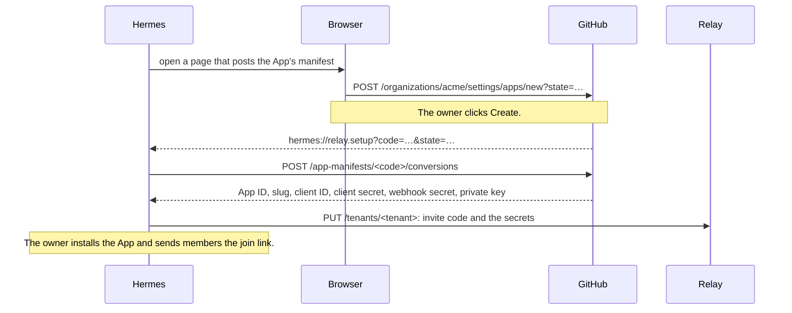
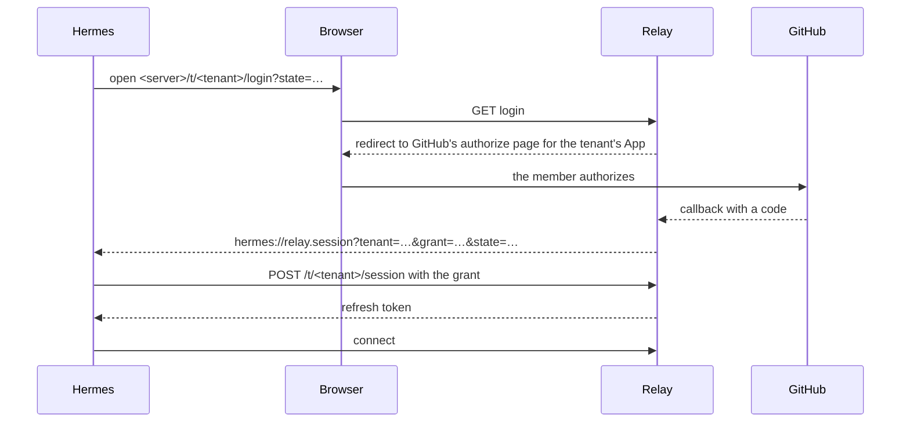
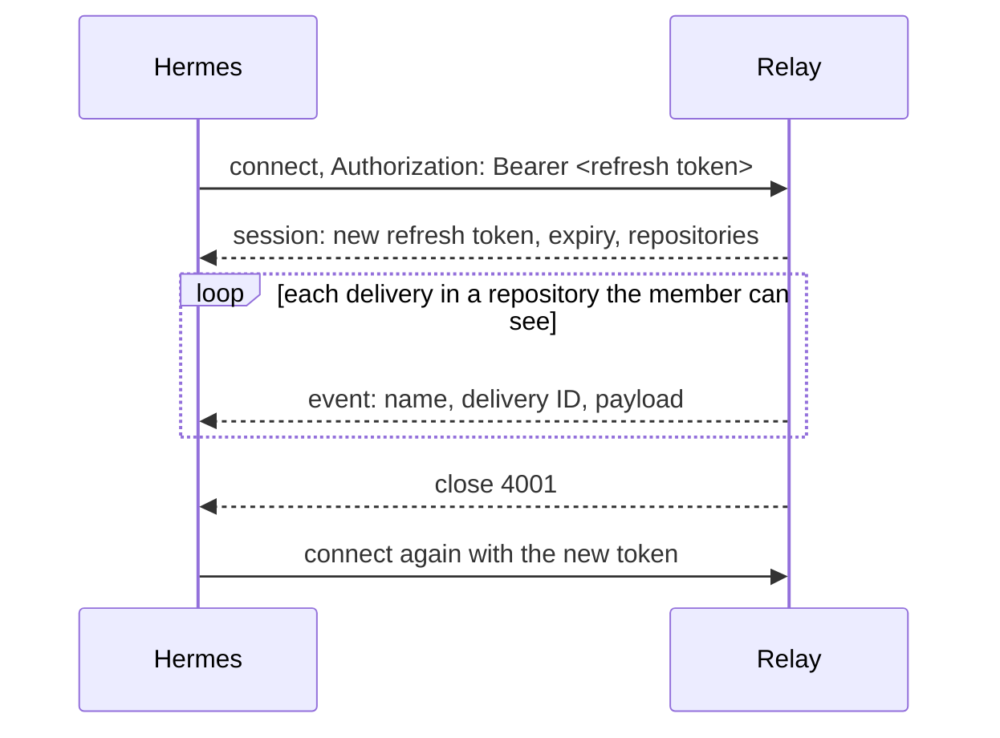

# The relay, from Hermes

The [relay](relay.md) is a server that passes a GitHub App's webhook
deliveries on to the people who can see the repository. This page covers the
Hermes side: setting up a tenant, joining one, the connection, and what
Hermes does with an event.

A **tenant** is one GitHub account's place on a relay: the server's URL and a
tenant ID of 32 lowercase hex characters (`RelayTenant`). The hosted relay is
`RelayTenant.defaultServer`.

## Tenants on this Mac

`Relays` (in the `Hermes` target, `AppStore.relays`) holds a list of
`RelayMembership` values and saves it with the other settings. A membership is
a tenant, plus the account and App slug when this user set the tenant up. A
user can have several: one for their own account and one for each
organization, each with its own App and possibly its own server. Each has its
own refresh token and its own connection. The minus button on a tenant's row
in Settings removes it from this Mac and deletes its refresh token. The App
stays on GitHub.

A tenant's row in Settings shows whose it is, what its connection is doing,
and its server with the commit that server's relay reports at `/version`.

## Setting up a tenant

An owner sets a tenant up once, from "Set Up a Relay…" in Settings or on the
last page of first-run setup. The sheet asks for an account (the user's own, or
an organization they own), the relay server, and an invite code from the
relay's operator.

- **The account owns the App.** Only its owners can read the App's webhook
  deliveries on GitHub or make it a private key. The relay's operator cannot.
- **The manifest** (`RelayAppManifest`) names the App `hermes-<login>`, cut to
  GitHub's 34 characters, which the owner can change on GitHub's page. It
  points the App's webhook at `<server>/hook/<tenant>` and its sign-in callback
  at `<server>/t/<tenant>/callback`. It asks to read pull requests, issues,
  checks, commit statuses, and members, and subscribes to the events for those.
- **GitHub takes a manifest only as a form post from a browser.** Hermes writes
  a page that posts it to the temporary directory and opens it in the default
  browser. The page holds no secret, and Hermes deletes it when the sheet
  closes.
- **`state`** is a random value Hermes sends with the manifest. A
  `hermes://relay.setup` link with any other state is refused.
- **The private key** in GitHub's answer is not read. `RelayAppCredentials`
  has no field for it. Nothing in Hermes or the relay acts as the App.
- **The secrets stay in memory** until the relay has them. When the relay
  refuses the invite code, the sheet asks for another and registers again,
  without a second App. After that Hermes keeps only the tenant, the account,
  and the App's slug.

The sheet ends on the two steps that are left: the App's install page on
GitHub, and a button that copies the tenant's `hermes://relay.join` link for
the members. Both stay on the tenant's row in Settings. The owner signs in
from that row once the App is installed, the way a member does.

## Joining and signing in

A member opens the join link. Hermes asks whether to join the relay at that
server, adds the tenant, and starts the sign-in. The owner, and a member whose
token the relay refused, start it with Sign In on the tenant's row.

The relay holds the App's client secret, so it makes the exchange with GitHub.
Hermes checks that the session link's `state` is one it sent for that tenant,
stores the refresh token in the Keychain, and connects. The grant is good for
ten minutes and for one use.

## Calls

`RelayAPI` makes the relay's HTTP calls.

| Call | Request | Answers |
|---|---|---|
| `version(of:)` | `GET /version` | The commit the relay was built from |
| `register(_:as:)` | `PUT /tenants/<tenant>` with an invite code and the App's ID, client ID, client secret, and webhook secret | `403` is `RelayError.inviteRefused`, `409` is `.alreadyRegistered` |
| `refreshToken(grant:for:)` | `POST /t/<tenant>/session` with the grant from a `hermes://relay.session` link | The member's refresh token. `403` is `.grantRefused` |
| `redeemManifest(code:)` | `POST https://api.github.com/app-manifests/<code>/conversions`, with no sign-in | The App's ID, slug, and secrets |

Any other status is `RelayError.unexpected`.

## The connection

`RelayConnection` is one WebSocket to `wss://<server>/t/<tenant>/connect`. It
sends the member's refresh token in the `Authorization` header.

The relay's first message is a `RelaySession`. Its refresh token replaces the
one the connection used, which no longer works. Its repositories are the ones
the member can see through the tenant's App. Each later message is a
`RelayEvent`: GitHub's name for the event, the delivery's ID, and the payload
as GitHub sent it. A frame of any other shape is skipped.

The connection pings the relay every 30 seconds. A Mac that slept or changed
networks can hold a dead connection that reports nothing until something is
sent on it.

When a connection ends, `RelayConnection.ending(closeCode:status:error:)` says
why:

| The relay sent | Ending | What it means |
|---|---|---|
| Close code `4001` | `recheck` | The relay checks access again after 8 hours and after a membership change. Connect again at once. |
| Close code `4003`, or `401` to the connection request | `unauthorized` | The refresh token was refused. The member signs in again. |
| Close code `4004`, or `404` to the connection request | `gone` | The tenant's App was uninstalled or its invite code withdrawn. |
| Anything else | `failed` | The network dropped or the relay failed. Connect again after a wait. |

`Relays.next(after:failures:ran:)` turns an ending into what the tenant does:

- **`recheck`** connects again at once. One that comes within 5 seconds of
  connecting waits like a failure, so a relay that keeps asking is not
  answered in a tight loop.
- **`unauthorized`** deletes the refresh token. The row shows Sign In.
- **`gone`** deletes the refresh token and stops. The row says the relay no
  longer has the tenant.
- **`failed`** waits as a forwarder does: 30 seconds, doubling to 30 minutes,
  and from 30 seconds again after a connection that held for 5 minutes.

`Relays.sync()` connects each tenant that has a refresh token and no
connection. It runs at launch and every 15 seconds with the forwarders.

The relay spends the refresh token as soon as a connection is accepted, and
sends the new one in its first message. A connection that drops between those
two leaves Hermes with a spent token. The next connection is refused, and the
member signs in again.

## Events

Each event goes through `AppStore.reload`, the same path as a forwarder's
delivery ([webhooks.md](webhooks.md)): Hermes loads the pull request the event
names, or the one whose head commit a status or a check is on.

A relay's event also has GitHub's name for it, which says what part of the
pull request changed. `AppStore.eventCounts` counts those per pull request,
and the screens showing that part reload it when the count rises, ahead of
their own 10-second polling:

| Events | Reloads |
|---|---|
| `pull_request_review_comment`, `pull_request_review_thread` | The diff's review threads |
| `check_run`, `check_suite`, `status` | The checks list and the checks summary |

Hermes does not apply an event's payload to what it shows. It reloads from
GitHub with the user's own `gh` token.

Two rules keep a relay's volume from becoming requests:

- **An event in an account no window shows is dropped.** A relay sends events
  for every repository the member can see.
- **A burst loads a pull request twice, not once per event.** A CI run sends
  two events per job. `EventBursts` loads on the first event, and turns the
  events that arrive during that load and the 5 seconds after into one more.

A repository that a connected tenant covers gets no webhook forwarder.
`Forwarders.targets` leaves those out.

## The refresh token

`RelayKeychain` keeps one refresh token per tenant as a generic password in the
login Keychain, under the service `com.coderinserepeat.hermes.relay`. The token
lets the relay read, for eight hours at a time, what both the member and the
tenant's App can read, so it does not belong in the settings file.

A debug build is signed ad hoc, and its signature changes with each build, so
macOS asks for the Keychain password when a new build reads an item an older
one stored.
