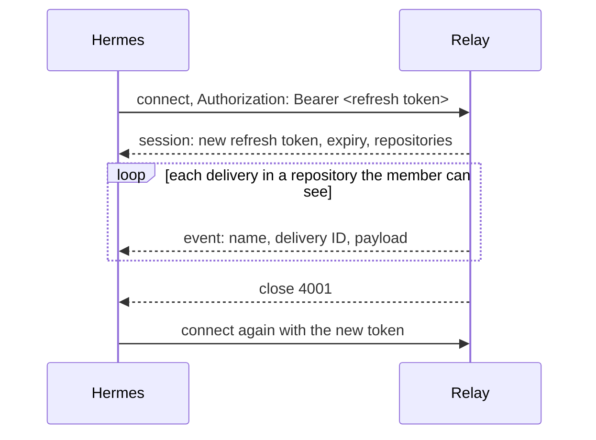

# The relay, from Hermes

The [relay](relay.md) is a server that passes a GitHub App's webhook
deliveries on to the people who can see the repository. This page covers the
Hermes side: the types in `GitHubKit` that talk to it. Nothing in the app uses
them yet.

A **tenant** is one GitHub account's place on a relay: the server's URL and a
tenant ID of 32 lowercase hex characters (`RelayTenant`). The hosted relay is
`RelayTenant.defaultServer`.

## Calls

`RelayAPI` makes the relay's HTTP calls.

| Call | Request | Answers |
|---|---|---|
| `version(of:)` | `GET /version` | The commit the relay was built from |
| `register(_:as:)` | `PUT /tenants/<tenant>` with an invite code and the App's ID, client ID, client secret, and webhook secret | `403` is `RelayError.inviteRefused`, `409` is `.alreadyRegistered` |
| `refreshToken(grant:for:)` | `POST /t/<tenant>/session` with the grant from a `hermes://relay.session` link | The member's refresh token. `403` is `.grantRefused` |

Any other status is `RelayError.unexpected`.

## The connection

`RelayConnection` is one WebSocket to `wss://<server>/t/<tenant>/connect`. It
sends the member's refresh token in the `Authorization` header.

The relay's first message is a `RelaySession`. Its refresh token replaces the
one the connection used, which no longer works. Its repositories are the ones
the member can see through the tenant's App. Each later message is a
`RelayEvent`: GitHub's name for the event, the delivery's ID, and the payload
as GitHub sent it. A frame of any other shape is skipped.

The connection pings the relay every 30 seconds. A Mac that slept or changed
networks can hold a dead connection that reports nothing until something is
sent on it.

When a connection ends, `RelayConnection.ending(closeCode:status:error:)` says
why:

| The relay sent | Ending | What it means |
|---|---|---|
| Close code `4001` | `recheck` | The relay checks access again after 8 hours and after a membership change. Connect again at once. |
| Close code `4003`, or `401` to the connection request | `unauthorized` | The refresh token was refused. The member signs in again. |
| Close code `4004`, or `404` to the connection request | `gone` | The tenant's App was uninstalled or its invite code withdrawn. |
| Anything else | `failed` | The network dropped or the relay failed. Connect again after a wait. |

## The refresh token

`RelayKeychain` keeps one refresh token per tenant as a generic password in the
login Keychain, under the service `com.coderinserepeat.hermes.relay`. The token
lets the relay read, for eight hours at a time, what both the member and the
tenant's App can read, so it does not belong in the settings file.
