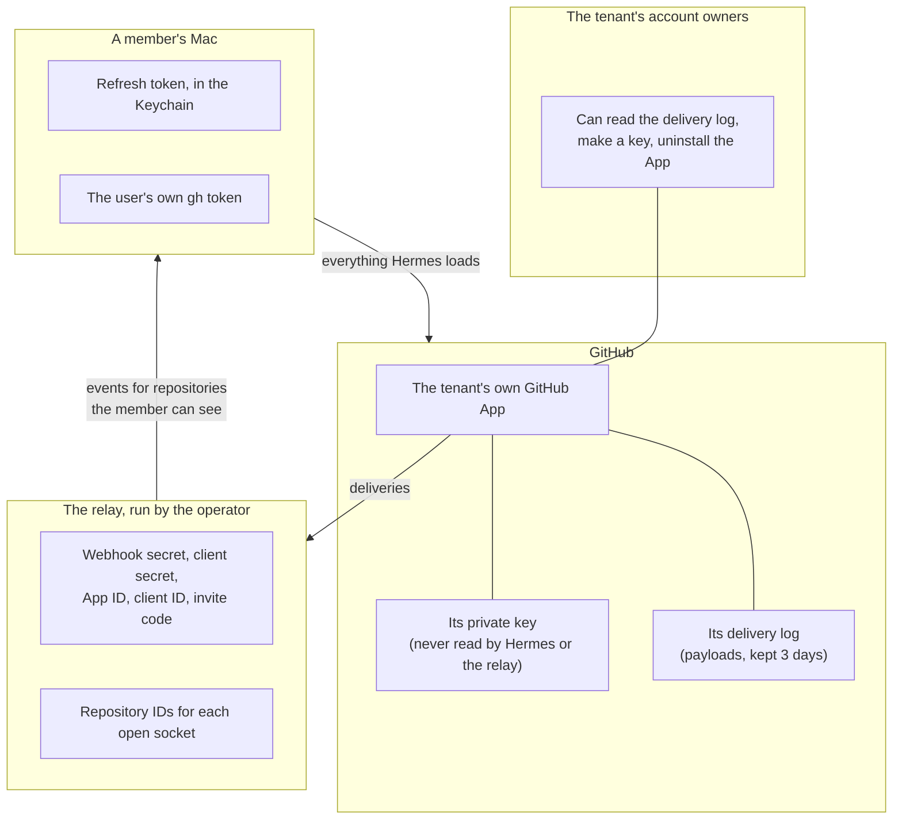
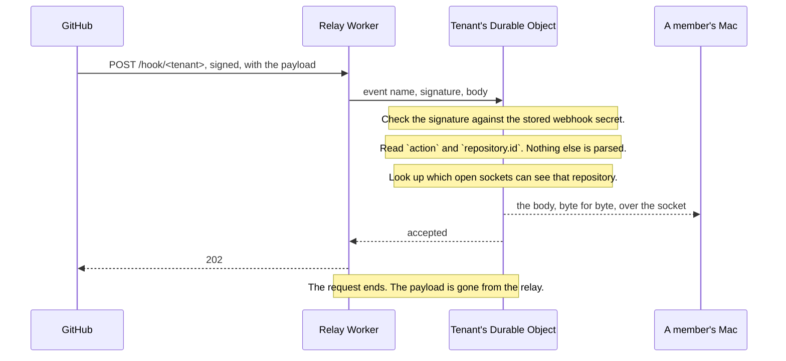
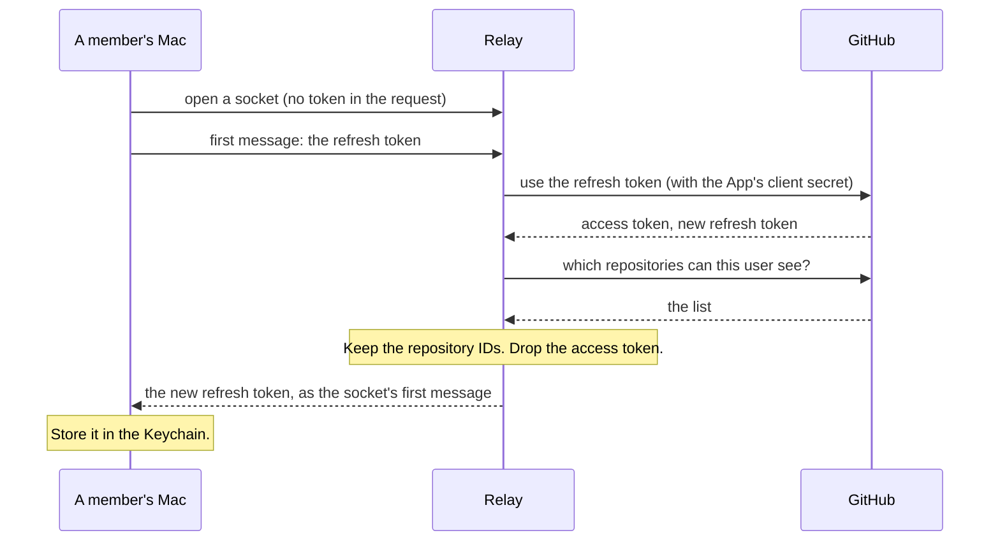
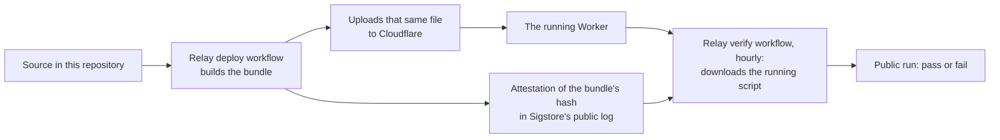

# How the relay keeps tenants' data from its operator

The [relay](relay.md) passes GitHub's webhook deliveries to Hermes. Those
deliveries hold pull request titles, comments, and lines of source code. The
relay is built so that whoever runs it does not end up holding them.

This page says what the relay handles, who can see each piece, how anyone can
check what is running, and where the protection stops. "The operator" means
whoever controls the Cloudflare account the relay runs in.

## The promise, and what it does not cover

- **An operator who only looks cannot read a tenant's data.** Nothing from a
  delivery is stored or logged, so there is nothing to look at.
- **Someone who steals the operator's credentials is in the same position.**
- **An operator who sets out to intercept deliveries can.** They control the
  hostname the relay is reached at. What the design does is make interception
  take a deliberate change, and make a change to the Worker's code or
  settings show up in public. [Limits](#limits) lists what is not caught.

## What the relay handles

| Data | Example | Where it exists in the relay |
|---|---|---|
| Delivery payloads | A comment's text, a diff hunk, a pull request's title | In memory, for the time one request takes. Never stored, never logged. |
| A user's GitHub tokens | The access and refresh token from a sign-in | In memory, for the time one request takes. The refresh token goes back to the user's Mac. The access token is discarded. |
| A tenant's App secrets | Webhook secret, client secret | Stored in the tenant's Durable Object. Neither one can read a repository. |
| Routing data | Tenant ID, App ID, client ID, repository IDs per open socket | Stored in the tenant's Durable Object. Repository IDs are deleted when their socket closes. |
| Invite codes | A code the operator made for an account's owner | Stored in the `Invites` Durable Object until a tenant registers with it, with nothing about who it was for. The tenant's Durable Object keeps the code it used. |

## Who holds what

Three choices put each piece where it is.

**Each tenant owns its GitHub App.** GitHub shows an App's owner every
delivery it sent, payload included, for three days. An App owned by the
relay's operator would hand the operator every tenant's payloads on a GitHub
page, whatever the relay did. So the account's owner creates the App, from
Hermes, and the operator is not an owner or manager of it. The same goes for
the App's private key, which can mint tokens that read the tenant's
repositories: Hermes never reads it, and only the tenant's owners can make
another.

**The relay does not act for the tenant on GitHub.** It holds no private key
and makes no call as the App. Hermes loads everything with the user's own
`gh` token, as it does without a relay.

**GitHub decides who sees what.** A member signs in through the tenant's App.
The relay uses the resulting token once, to ask GitHub which repositories that
member can see, and keeps only their IDs. It never stores a login or a token.

## The life of a delivery

- **Nothing is written.** There is no queue, no cache, and no retry buffer. A
  delivery that arrives while a member's socket is closed never reaches that
  member, and Hermes's own refresh covers the gap.
- **Nothing is parsed beyond two fields.** The relay forwards the body it
  received and has no code that understands a pull request or a comment. That
  keeps the relay small enough to read in one sitting, and means there is no
  place a field could be copied aside by accident.
- **Nothing is logged.** Workers Logs are off, and the relay's error handler
  prints nothing. The request records Cloudflare can give a Worker's operator
  hold addresses and headers, not request bodies.

## Tokens

The token GitHub issues can read only what both the tenant's App and the user
can read. The relay holds it for one request. GitHub replaces the refresh token
on every use, so the one in the Keychain is the only one that works.

**Tokens never travel where the operator can look.** Cloudflare can show a
Worker's operator each request's address and headers. It never shows a request
body or what a socket carries. So the refresh token goes in a socket's first
message, and the sign-in uses PKCE: GitHub's one-time code does pass through
the relay's address, but GitHub issues nothing for it without a verifier that
Hermes sends only in a request body.

## What the operator can see

| By | The operator learns | Left in public view |
|---|---|---|
| Doing nothing | Request counts and timing for the Worker. | — |
| Calling `POST /invites` with the operator token | Nothing. The call makes an invite code and returns it. It reads no tenant's storage. | — |
| Reading the Durable Objects' storage in Cloudflare's dashboard | Which accounts are tenants (from the App's client ID), each tenant's two secrets, and the repository IDs of open sockets. No payloads and no tokens: they are not there. | No. Each query is written to Cloudflare's audit log, which only the operator reads. |
| Deploying different code | Anything, including payloads. | Yes. The hourly check fails, because the running script is no longer one this repository's workflow attested. |
| Changing the Worker's settings, such as attaching a Tail Worker | Request addresses and headers: which tenants are active and when. No payloads and no tokens, because neither is ever in an address or a header. | Yes. The hourly check reads the Worker's settings and fails. |
| Pointing the hostname at another Worker | Anything, including payloads. | No. See [Limits](#limits). |

The operator can always learn who the tenants are. The promise is about
their data, not their identity.

## Checking what runs

The relay's code is public, but that only helps if the code that runs is the
code that is published.

- The deploy workflow builds the bundle, attests its hash, and uploads that
  exact file. The attestation names this repository, the workflow, and the
  commit.
- Every hour, the verify workflow downloads the script Cloudflare is running
  and checks that the deploy workflow attested a file with the same hash.
- The same run reads the Worker's settings, and fails when it has a Tail
  Worker, log push, observability, or a binding the relay does not use.
- Both workflows' runs and logs are public. A failed verify run means the
  Worker is running something this repository did not build.
- `GET /version` reports the commit the Worker was built from, and Hermes
  shows it beside each tenant. It is the Worker's own word, so it tells an
  honest relay's version and proves nothing about a dishonest one.

[relay.md](relay.md#deploying) has the workflows' details.

## Limits

These are the ways the protection stops. They are stated here so a tenant can
decide with them in view.

- **Cloudflare sees everything.** It ends the TLS connection and runs the
  code. A tenant trusts Cloudflare as it would any host.
- **The hourly check covers the Worker, not the hostname.** The operator
  controls DNS and routing. A second Worker placed in front of the relay
  could read every delivery and pass it on, and the check would still pass.
  Cloudflare records such a change in the account's audit log, which only the
  operator reads.
- **The check runs hourly.** A setting changed and changed back between two
  runs is not caught.
- **Reading stored secrets leaves no public trace.** The webhook secret lets
  its holder forge deliveries to that tenant's members. It reads nothing.
- **A dropped connection can cost a sign-in.** If the connection drops after
  GitHub replaces the refresh token and before the Mac receives the new one,
  the member signs in again.

None of these is closed by cryptography. Closing them fully would take
hardware attestation, where the host signs a statement of what it is running.
Cloudflare Workers does not offer that.

## What a tenant can do

- **Run the relay themselves.** The Worker deploys to any Cloudflare account,
  and Hermes takes any relay's address at setup. Then the tenant is the
  operator. See [relay.md](relay.md#running-your-own-relay).
- **Leave at any time.** Uninstalling the App stops deliveries at GitHub. The
  relay deletes everything it stored for the tenant when GitHub reports the
  uninstall.
- **See what the App can read.** The App's permissions are on its GitHub
  page: read access to pull requests, issues, checks, commit statuses, and
  the organization's members. It has no Contents permission. Read access to
  pull requests does include their diffs.
