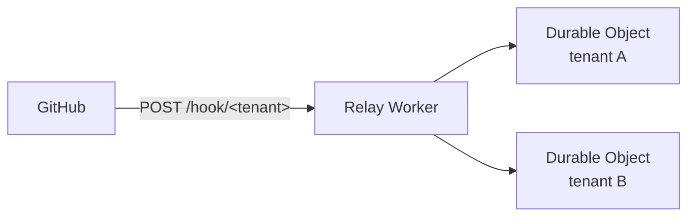
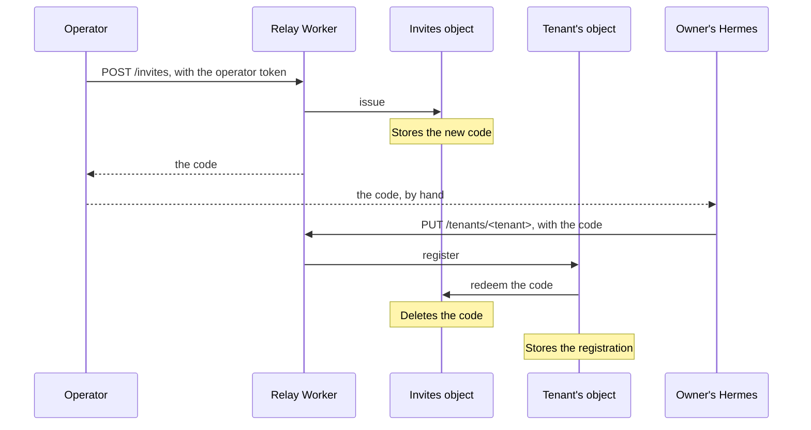

# The relay

The relay is a Cloudflare Worker in [`relay/`](../relay).



The Worker takes each request and hands it to the Durable Object of the tenant
the address names. That object checks the delivery.

## Tenants

A tenant is a GitHub account whose owner registered a GitHub App of their own
with the relay. The owner's client picks the tenant's ID: 32 lowercase hex
characters.

Each tenant is one Durable Object, named by the tenant's ID. The relay keeps no
list of tenants. A tenant's Durable Object stores one thing:

- Its registration: the invite code it used up and the App's ID, client ID,
  client secret, and webhook secret.

## Requests

| Request | Response |
|---|---|
| `GET /version` | `200 {"commit": "<sha>"}`: the commit the running Worker was built from. A local run reports `dev`. |
| `POST /invites` | Makes an invite code, for the operator. See [Invite codes](#invite-codes). |
| `PUT /tenants/<tenant>` | Registers a tenant. See below. |
| `POST /hook/<tenant>` | Takes a webhook delivery from GitHub. See below. |

A path with a malformed tenant ID answers `404`. A request the relay fails to
handle answers `500` with no body. The relay prints nothing about it.

### Registering a tenant

The body is JSON:

```json
{
  "invite": "an invite code",
  "appID": 123456,
  "clientID": "Iv1.0123456789abcdef",
  "clientSecret": "…",
  "webhookSecret": "…"
}
```

| Status | Meaning |
|---|---|
| `201` | The registration is stored. |
| `400` | The body is not a registration. |
| `403` | The relay never issued the invite code, or it has been used. Nothing is stored. |
| `409` | The tenant is registered with different values. |

A tenant registers once, so someone who learns a tenant's ID can't replace its
credentials. Sending the stored registration again answers `201`, so a client
whose first request succeeded but whose connection dropped can retry.

A tenant's first registration uses its invite code up. A `400` or a `409`
leaves the code unused.

### Webhook deliveries

A tenant's GitHub App sends its webhooks to `POST /hook/<tenant>`. The relay
checks the `X-Hub-Signature-256` header against the tenant's webhook secret,
using [`@octokit/webhooks-methods`](https://github.com/octokit/webhooks-methods.js).

| Status | Meaning |
|---|---|
| `202` | The delivery is genuine. |
| `401` | The signature is missing or wrong. |
| `404` | No tenant with this ID is registered. |

The relay reads three things from a genuine delivery: the `X-GitHub-Event`
header, the payload's `action`, and `repository.id`. `classifyDelivery` in
`delivery.ts` turns them into one of four actions:

| Delivery | Action |
|---|---|
| `installation` with action `deleted` (the App was uninstalled) | Delete everything the tenant stored. Its ID is unknown afterwards. |
| `installation_repositories`, `member`, `membership`, `organization`, `repository`, `team`, `team_add` | Someone's access may have changed. The relay drops it. |
| Any other event that names a repository | Nothing. The relay drops it. |
| Anything else | Ignored. |

The relay stores nothing from a delivery.

## Invite codes

An invite code registers one tenant. The operator makes a code and gives it to
the account's owner:

```bash
curl --fail -X POST -H "Authorization: Bearer $OPERATOR_TOKEN" \
  https://<the relay's address>/invites
```

| Status | Meaning |
|---|---|
| `201` | `{"invite": "<code>"}`: a new code of 32 hex characters. |
| `401` | The `Authorization` header is not `Bearer` and the operator token. |



The codes live in one more Durable Object, `Invites`, named `invites`. It
stores each code from the moment it is issued until a tenant registers with
it, and nothing else: not who a code was for, and not which tenant used it.
Using a code deletes it, so a second registration with the same code answers
`403`, and so does one sent after the tenant's App is uninstalled. A code
never runs out on its own, and the relay has no call that cancels one.

Once a tenant is registered, the relay never looks at its code again. The
relay has no call that stops a registered tenant.

`OPERATOR_TOKEN` is a Worker secret. While it is empty, `POST /invites`
answers `401` to everything. To make one:

```bash
openssl rand -hex 32
```

## Layout

```
relay/
├── src/                  everything the Worker runs, and nothing else
│   ├── index.ts          the Worker's entry: exports the routes and the Tenant class
│   ├── http/
│   │   └── app.ts        the routes: parse the request, call the tenant, map the result
│   ├── tenant.ts         the Tenant Durable Object
│   ├── registration.ts   decides whether a registration is accepted
│   ├── delivery.ts       decides what to do with a webhook delivery
│   ├── session.ts        a socket's states, how long each lasts, and the hello message
│   └── json.ts           parses JSON text without throwing
├── tests/                Vitest tests, run inside the Workers runtime
│   └── lint/             the lint fixture test and its fixture, run by Node
├── wrangler.jsonc        the Worker's name, bindings, and settings
├── vitest.config.ts
├── oxlint.config.ts      the relay's own lint rules, each with a comment saying why
├── oxlint.presets.ts     the rules of ESLint's and typescript-eslint's presets
├── .oxfmtrc.json         the formatter's settings
├── tsconfig.json         the compiler settings, on top of @tsconfig/strictest
├── package.json
├── pnpm-lock.yaml
└── pnpm-workspace.yaml   pnpm's settings: which package versions it refuses, and which build scripts run
```

The repository's `mise.toml` pins the Node and pnpm versions.
[build-system.md](build-system.md#tool-versions) describes it.

The code runs in two places, so it type-checks as four projects. Each has
only the types of the place it runs, so Worker code that reaches for a Node
API fails to compile.

| Project | Covers | Types |
|---|---|---|
| `tsconfig.json` | The config files beside it, which Node runs | Node |
| `src/tsconfig.json` | The Worker | The Workers runtime, from `wrangler types` |
| `tests/tsconfig.json` | The tests | The Workers runtime and the Vitest plugin |
| `tests/lint/tsconfig.json` | The lint fixture test, which Node runs | Node |

## Packages

[pnpm](https://pnpm.io) installs the relay's packages. `package.json` names
exact versions, and `pnpm add` writes them that way. `pnpm-workspace.yaml`
makes an install fail when:

- A version is less than a day old. Most malicious releases are pulled within
  that day.
- A version was published with weaker trust evidence, such as provenance, than
  an earlier version of the same package. That is the usual sign of a stolen
  publish token.
- A package has a build script that the file doesn't name. The file turns off
  the two the relay's packages have, because pnpm already installs the binary
  each one checks for.

The check workflow also runs `pnpm audit signatures`, which fails
if a package's registry signature doesn't verify.

Routing uses [Hono](https://hono.dev). Request bodies are checked with
[Zod](https://zod.dev).

## Lint

Oxlint runs the rules, and tsgolint runs the type-aware ones with TypeScript 7,
reading each file's nearest `tsconfig.json`. The rules are in two files:

- `oxlint.presets.ts` holds the rules of ESLint's recommended preset and
  typescript-eslint's `strictTypeChecked` and `stylisticTypeChecked` presets,
  translated for Oxlint, which has no presets of its own.
- `oxlint.config.ts` holds the house rules, each with a comment saying why.

A few house rules shape how the code reads:

- Types, not interfaces, and named return types instead of inline object
  shapes.
- Conditions are real booleans: `if (stub === undefined)`, never `if (!stub)`.
- Every `if` has braces, with a blank line after each block and before each
  `return`.
- No casts that claim more than the compiler knows. Parse with Zod, or narrow
  with a type guard.
- A function that returns a promise is `async` and awaits what it returns.

Oxlint runs some rules through JavaScript plugins it marks as alpha.
`tests/lint/lint.test.ts` lints `tests/lint/fixtures/violations.ts`, which
breaks a set of rules on purpose, including every rule that runs as an alpha
plugin, and checks the exact count per rule. An Oxlint update that stops a
rule reporting fails that test. `pnpm lint` skips the fixture. Vitest runs
this test in a `node` project and the rest in a `worker` project, inside the
Workers runtime.

## Settings

Workers Logs are off in `wrangler.jsonc`, so Cloudflare keeps no record of the
requests the relay receives.

## Checking a change

```bash
make relay-check
```

This installs the packages, then runs `pnpm check` and `pnpm build`. Nothing
is deployed. It needs [mise](https://mise.jdx.dev), which runs each step with
the pinned Node and pnpm. The `Relay check` workflow runs the same steps on a
pull request that changes `relay/` or `mise.toml`.

The relay's scripts run from `relay/`:

| Script | What it does |
|---|---|
| `pnpm check` | Generates the Worker's types with `wrangler types`, then runs `typecheck`, `lint`, `format:check`, and `test` together and reports every failure instead of stopping at the first. |
| `pnpm typecheck` | `tsc` on each of the four projects below, against the types `pnpm check` generated. |
| `pnpm test` | The tests, in a random order. A failing run prints its seed, and `pnpm test --sequence.seed=<seed>` replays that order. |
| `pnpm lint` | [Oxlint](https://oxc.rs/docs/guide/usage/linter), with type-aware rules. |
| `pnpm format` / `format:check` | [Oxfmt](https://oxc.rs/docs/guide/usage/formatter): rewrite the files, or only report. It formats TypeScript and JSON at a width of 100. |
| `pnpm build` | Bundles the Worker into `dist/index.js` with `wrangler deploy --dry-run`. |
| `pnpm dev` | Runs the Worker locally. |
