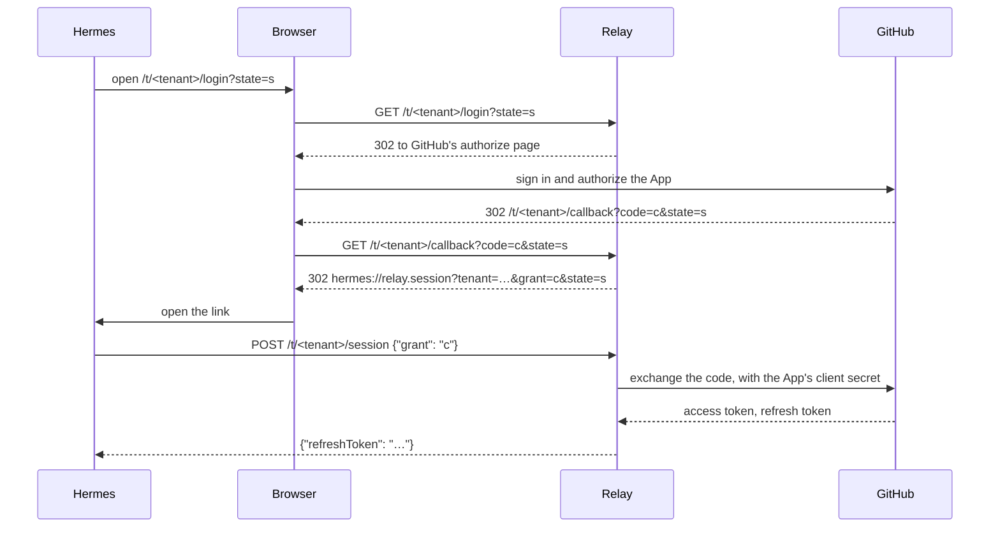

# The relay

The relay is a Cloudflare Worker in [`relay/`](../relay). It is not deployed,
and Hermes does not call it.

## Tenants

A tenant is a GitHub account whose owner registered a GitHub App of their own
with the relay. The owner's client picks the tenant's ID: 32 lowercase hex
characters.

Each tenant is one Durable Object, named by the tenant's ID. The relay keeps no
list of tenants. A tenant's Durable Object stores two things:

- Its registration: the invite code it used and the App's ID, client ID, client
  secret, and webhook secret.
- For each open socket, the IDs of the repositories that socket's user can see.
  They are deleted when the socket closes.

A person in several organizations uses one tenant per organization, each with
its own sign-in and its own socket.

## Requests

| Request | Response |
|---|---|
| `GET /version` | `200 {"commit": "<sha>"}`: the commit the running Worker was built from. A local run reports `dev`. |
| `PUT /tenants/<tenant>` | Registers a tenant. See below. |
| `POST /hook/<tenant>` | Takes a webhook delivery from GitHub. See below. |
| `GET /t/<tenant>/login?state=<s>` | Redirects the browser to GitHub's sign-in page for the tenant's App. |
| `GET /t/<tenant>/callback` | Where GitHub sends the browser after sign-in. Redirects to a `hermes://relay.session` link. |
| `POST /t/<tenant>/session` | Trades a sign-in grant for the user's refresh token. See below. |
| `GET /t/<tenant>/connect` | Opens a WebSocket for a signed-in user. See below. |

A path with a malformed tenant ID answers `404`.

### Registering a tenant

The body is JSON:

```json
{
  "invite": "an invite code",
  "appID": 123456,
  "clientID": "Iv1.0123456789abcdef",
  "clientSecret": "…",
  "webhookSecret": "…"
}
```

| Status | Meaning |
|---|---|
| `201` | The registration is stored. |
| `400` | The body is not a registration. |
| `403` | The invite code is not one the relay accepts. Nothing is stored. |
| `409` | The tenant is registered with different values. |

A tenant registers once, so someone who learns a tenant's ID can't replace its
credentials. Sending the stored registration again answers `201`, so a client
whose first request succeeded but whose connection dropped can retry.

### Webhook deliveries

A tenant's GitHub App sends its webhooks to `POST /hook/<tenant>`. The relay
checks the `X-Hub-Signature-256` header against the tenant's webhook secret,
using [`@octokit/webhooks-methods`](https://github.com/octokit/webhooks-methods.js).

| Status | Meaning |
|---|---|
| `202` | The delivery is genuine. |
| `401` | The signature is missing or wrong. |
| `403` | The tenant's invite code is no longer one the relay accepts. |
| `404` | No tenant with this ID is registered. |

The relay reads three things from a genuine delivery: the `X-GitHub-Event`
header, the payload's `action`, and `repository.id`. `classifyDelivery` in
`delivery.ts` turns them into one of four actions:

| Delivery | Action |
|---|---|
| `installation` with action `deleted` (the App was uninstalled) | Delete everything the tenant stored. Its ID is unknown afterwards. |
| `installation_repositories`, `member`, `membership`, `organization`, `repository`, `team`, `team_add` | Access may have changed. Nothing happens yet. |
| Any other event that names a repository | To be sent on to clients. Nothing happens yet. |
| Anything else | Ignored. |

The relay stores nothing from a delivery.

### Signing in

A user signs in through the tenant's own GitHub App, so the token GitHub issues
can read only what both the App and the user can.



The grant is GitHub's own code, passed through unchanged, so the relay holds
nothing between the browser's sign-in and the client's request. GitHub accepts
a code once, for ten minutes. The relay returns the refresh token and discards
the access token.

`POST /t/<tenant>/session` takes `{"grant": "<code>"}`:

| Status | Meaning |
|---|---|
| `200` | `{"refreshToken": "<token>"}` |
| `400` | The body has no grant. |
| `403` | GitHub refused the code, the tenant's invite code was withdrawn, or the App's user tokens don't expire. |
| `404` | No tenant with this ID is registered. |

The App must have "Expire user authorization tokens" on, which is GitHub's
default. With it off GitHub issues no refresh token. The calls to GitHub use
[`@octokit/oauth-methods`](https://github.com/octokit/oauth-methods.js).

### Connecting

The client opens a WebSocket at `GET /t/<tenant>/connect` with its refresh
token in an `Authorization: Bearer <token>` header.

| Status | Meaning |
|---|---|
| `101` | The socket is open. |
| `401` | There is no token, or GitHub refused it. The user must sign in again. |
| `404` | No tenant with this ID is registered, or its invite code was withdrawn. |
| `426` | The request is not a WebSocket upgrade. |

Before it opens the socket, the relay:

1. Uses the refresh token. GitHub answers with an access token and a new
   refresh token, and the old one stops working.
2. Lists the repositories the user can see through the tenant's App, with
   `GET /user/installations` and
   `GET /user/installations/{id}/repositories`. It reads at most 4,000.
3. Stores those repositories' IDs under a new session ID and discards the
   access token.

The first message on the socket is the session:

```json
{
  "type": "session",
  "refreshToken": "<the new refresh token>",
  "expiresAt": 1794000000,
  "repositories": ["acme/site", "acme/api"]
}
```

The client must store the new refresh token at once. If the connection drops
before this message arrives, the client holds a spent token, and the user has
to sign in again.

A socket stays open for eight hours. Then the relay closes it with code `4001`,
and the client reconnects, so the user's access is checked again. An alarm on
the Durable Object fires when the oldest socket runs out.

The sockets use the WebSocket Hibernation API, so an idle tenant is not kept in
memory. That is why the repository IDs are in storage and not in a field.

## Invite codes

The `INVITE_CODES` secret holds the codes the relay accepts, separated by
commas. Any number of tenants can register with one code. Taking a code off the list
stops the relay accepting deliveries for the tenants that registered with it.
To make a code and set the list:

```bash
openssl rand -hex 8
```

```bash
cd relay && npx wrangler secret put INVITE_CODES
```

## Layout

```
relay/
├── src/
│   ├── index.ts          the routes: parse the request, call the tenant, map the result
│   ├── tenant.ts         the Tenant Durable Object
│   ├── registration.ts   decides whether a registration is accepted
│   ├── delivery.ts       decides what to do with a webhook delivery
│   ├── session.ts        how long a socket lasts and which have run out
│   └── github.ts         the calls to GitHub
├── test/                 Vitest tests, run inside the Workers runtime
├── wrangler.jsonc        the Worker's name, bindings, and settings
├── vitest.config.ts
├── tsconfig.json
├── mise.toml             the Node version
└── package.json
```

Routing uses [Hono](https://hono.dev). Request bodies are checked with
[Zod](https://zod.dev).

## Settings

Workers Logs are off in `wrangler.jsonc`, so Cloudflare keeps no record of the
requests the relay receives.

## Checking a change

```bash
make relay-check
```

This installs the packages, generates the Worker's types with `wrangler types`,
type-checks with `tsc`, runs the tests, and bundles with
`wrangler deploy --dry-run`. Nothing is deployed. The `Relay check` workflow
runs the same steps on a pull request that changes `relay/`.

To run only the tests, or the Worker locally:

```bash
cd relay && npm test
```

```bash
cd relay && npm run dev
```
