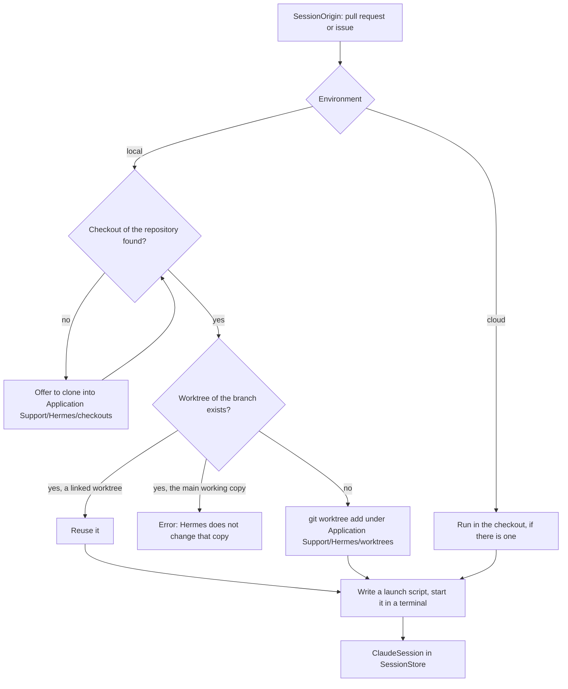

# Claude Code sessions

A session is a `claude` process in a terminal inside Hermes. It starts from a
pull request or an issue. `SessionsUI` holds the launch sheet, the session
store, and the terminal. `RepoKit` does the git work.

## Launching

⌘N, the Start Claude Session button, or a row's context menu opens
`SessionLaunchSheet` for a `SessionOrigin`: a pull request or an issue. The
sheet picks:

- **Where it runs.** This Mac, with or without Remote Control, or a saved
  cloud environment.
- **The permission mode**, for local sessions. Default passes no flag.
- **The name and the first prompt.** Both start with a default built from the
  origin, and both can be edited.

The sheet shows the command line and where it will run. A Copy button copies
the command for use in another terminal. For a local session it makes the
worktree first, so the copied `cd` works.

## Opening in the Claude app

"Open in Claude" in the launch sheet prepares the worktree the same way, then
opens the Claude desktop app on its new-session screen through
`claude://code/new`. `LaunchConfiguration.claudeAppURL` builds the link:

| Parameter | Value |
|---|---|
| `folder` | The worktree, for a session on this Mac. |
| `environment` | A saved cloud environment ID (`env_…`). |
| `runner_pool` | A saved self-hosted pool ID (`ccpool_…`). |
| `q` | The prompt. |

The Claude app's link handler reads these parameters; they are not
documented. The link cannot name a Remote Control host, so the user picks the
environment in the Claude app, whose picker lists every local, cloud, and
Remote Control target.

Hermes still lists the session. Its terminal runs `open` on the link and
exits, and the session screen keeps showing the worktree's diff. The session
reads "Exited", because Hermes cannot see the Claude app's session.

## Command line

`LaunchConfiguration.arguments` builds the arguments after `claude`:

| Choice | Arguments |
|--------|-----------|
| Local with Remote Control | `--remote-control <name>` |
| Local without Remote Control | `--name <name>` |
| A permission mode other than Default | `--permission-mode <mode>` |
| Cloud | `--environment <id>` |
| A prompt | `-- <prompt>` |

The `--` ends the options. Without it, a prompt that starts with `-` is parsed
as an option, and an unnamed `--remote-control` takes the prompt as its name.

A cloud environment is a name and an ID of the form `ccpool_…`, saved in
Settings under Sessions.

## Finding the checkout

A local session runs in the user's own clone. `CheckoutFinder` scans the
search roots two levels deep for directories with a `.git` directory and
matches their remotes against the repository. The roots default to
`~/Projects` and are set in Settings under Sessions. Hermes's own clones under
`~/Library/Application Support/Hermes/checkouts` are searched too.

The matching remote is not always `origin`. In a clone of a fork it is often
`upstream`, and `Checkout.remote` records which one it is.

## Worktrees

Hermes never changes the main working copy's branch, index, or files. Each
local session runs in a linked worktree at
`~/Library/Application Support/Hermes/worktrees/<owner>/<repo>/<branch>`, with
`/` in the branch name replaced by `-`.

- **From a pull request**, the branch is the head branch. It is fetched from
  the checkout's remote, and the worktree's diff is compared with
  `<remote>/<base branch>`.
- **From an issue**, the branch is new: `issue-<number>-<slug of the title>`,
  cut from the remote's default branch. The diff is compared with that
  default branch.

If the branch already has a linked worktree, the session uses it. If the
branch is checked out in the main working copy, the launch fails and asks the
user to switch that copy to another branch.

A pull request from a fork fails here: its head branch is not on the
checkout's remote, so the fetch finds nothing.

## The terminal

The terminal is libghostty, through `libghostty-spm`.

- The command runs from a script in the temporary directory, because the
  terminal's `command` setting is one line and a prompt can span several.
- The script sets `PATH` to the `PATH` of the user's login shell. A macOS app
  starts with a minimal one, which would hide `claude`, `gh`, and `git`.
- `ClaudeSession` owns its terminal view, so the process keeps running while
  another screen is shown.
- libghostty only runs a surface whose view is in a window. A terminal that no
  screen shows sits in an offscreen window, `TerminalParking`. Without it the
  process would block on its next write.

## The session screen

`SessionScreen` in the app target shows the terminal beside a `DiffScreen`.
The diff is the worktree against its base, and it reloads as files change. A
picker switches it to one branch of the local stack against its parent.
Stacks come from the `gh stack` extension when it tracks the checkout, and are
otherwise inferred from branch history.

A cloud session has no worktree on this Mac, so its diff pane says there is no
local diff.

## Linking sessions to pull requests

A session records its branch. A pull request whose head branch is that branch,
in the same repository, is the session's pull request. This is how a session
started from an issue shows the pull request it opened.

A pull request's Sessions tab and an issue's Claude Sessions section list the
sessions started from that item.

## Ending a session

- **Restart** ends the process and runs the same command in a new terminal.
  It is a new conversation.
- **Close** ends the process and removes the session from the list. When
  Hermes created the worktree and no other session uses it, Close offers to
  remove it. A worktree with uncommitted or untracked files is removed only
  after a second confirmation. The branch is kept either way.
- **Quitting Hermes** ends every session. The list is held in memory.
  Worktrees and branches stay on disk, and a later session on the same branch
  reuses the worktree.
