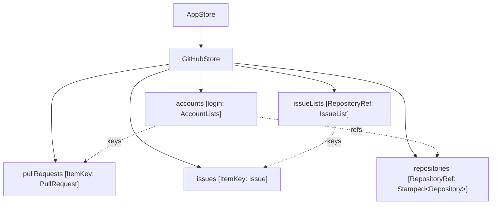

# The GitHub store

Hermes keeps one copy of everything it knows about GitHub, in `GitHubStore`
(the `StateKit` target). The sidebar, the lists, and every screen read from it,
so two views of the same fact can't disagree. A count is a field on a record,
and every view reads that field.

When a view shows something wrong, fix the store's copy. Don't give the view
a second source, and don't copy a value from one place into another.

## Shape

`AppStore` owns one `GitHubStore` for the app. Records live in tables keyed by
identity. An account's lists hold keys into those tables, so a pull request
that two lists show is one record.



| Table or list | Holds | Written by |
|---|---|---|
| `pullRequests` | Every pull request Hermes has loaded, open or not. | List refreshes, loads by number, webhook payloads. |
| `issues` | Every issue Hermes has loaded. | Issue pages, loads by number. |
| `repositories` | Each repository's URL, visibility, and open issue count. | The account's repository load and every issue page. |
| `accounts[login]` | The account's open pull requests and repositories, as keys, plus its review signals and load state. | The account's refresh. |
| `issueLists[repo]` | The loaded part of a repository's open issues, as keys, and its cursor. | Issue pages. |

Records stay until the app quits. A screen that shows one again makes the
store load it again, so a kept record doesn't stay stale on screen.

## Which answer wins

Two fetches can return the same fact in either order. The one that started
later saw GitHub later, so its answer wins even when it arrives first.
`Stamped` holds a value with its fetch's start time and refuses a write from a
fetch that started earlier.

For example, the repository list loads every 10 minutes, and each issue page
also reports the open issue count. Both write the repository record. If the
repository load started first but answered last, its older count is dropped.

Webhook payloads use `AppliedPayloads`. A payload older than the last one a
pull request took is dropped, and a load that ran while a payload arrived
loads that pull request once more. [webhooks.md](webhooks.md) has the details.

## Polling

Screens say what they show with the `.showing(_:in:)` view modifier from
`HermesUI`. It registers an `Interest` while the view is on screen and
releases it when the view goes away, through `.task` cancellation. The store
runs one poll loop per interest while any screen shows it, so two windows on
one account cost one refresh.

```swift
// Each window keeps its account's lists fresh while it is open.
RootView()
    .showing(.account(model.login), in: model.github)
```

| Interest | Refreshes | How often |
|---|---|---|
| `.account(login)` | The account's open pull requests, its repositories (every 10 minutes), and its opened issue lists. | Every 15 seconds while Hermes is the active app. In the background, every `refreshInterval` from Settings (60 seconds by default). |

A loop wakes every 15 seconds and asks `shouldRefresh` whether this tick
loads. Activation, ⌘R, and a window's first load refresh at once.
