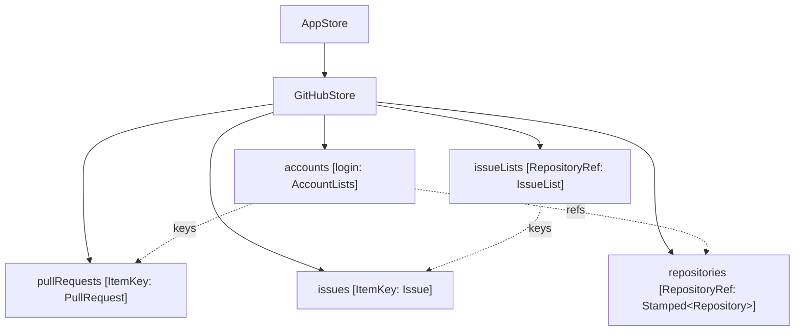
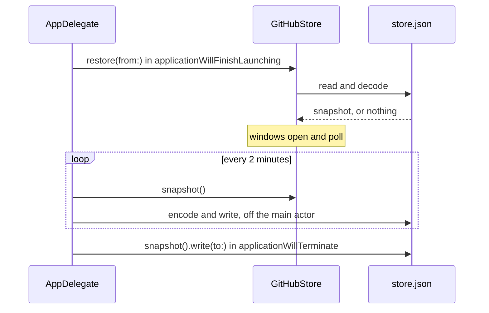

# The GitHub store

Hermes keeps one copy of everything it knows about GitHub, in `GitHubStore`
(the `StateKit` target). The sidebar, the lists, and every screen read from it,
so two views of the same fact can't disagree. A count is a field on a record,
and every view reads that field.

When a view shows something wrong, fix the store's copy. Don't give the view
a second source, and don't copy a value from one place into another.

## Shape

`AppStore` owns one `GitHubStore` for the app. Records live in tables keyed by
identity. An account's lists hold keys into those tables, so a pull request
that two lists show is one record.



| Table or list | Holds | Written by |
|---|---|---|
| `pullRequests` | Every pull request Hermes has loaded, open or not. | List refreshes, loads by number, webhook payloads. |
| `issues` | Every issue Hermes has loaded. | Issue pages, loads by number. |
| `repositories` | Each repository's URL, visibility, and open issue count. | The account's repository load and every issue page. |
| `accounts[login]` | The account's open pull requests and repositories, as keys, plus its review signals and load state. | The account's refresh. |
| `issueLists[repo]` | The loaded part of a repository's open issues, as keys, and its cursor. | Issue pages. |
| `details[key]` | A pull request's description, conversation, reviews, commits, and review threads. The conversation tab and the diff's review threads read it. | The pull request's poll, webhook changes, a submitted review, and a sent comment. |
| `readiness[key]` | Whether a pull request can merge, and how. | The pull request's poll, when its head, update time, or checks change, and after Hermes merges it, turns its auto-merge on or off, or marks it ready for review. |
| `revisions[key]` | A pull request's head commit, update time, and viewed files. | The pull request's poll, the diff's own load, and viewed marks. |
| `checks[commit]` | A commit's checks, keyed by repository and commit SHA, so a pull request's checks are its head commit's. The checks tab and the conversation's summary read the same list. | The commit's poll, webhook changes, retries, and reruns. |
| `issueDetails[key]` | An issue's description and first 100 comments. The comment count is in the issue's record, which the detail load also writes, so the row and the detail show the same number. | The issue view, when it opens and when the issue's update time moves, and a sent comment, which also raises the count. |
| `viewer` | The signed-in user's login. | Sign-in. |

Records stay until the app quits. A screen that shows one again makes the
store load it again, so a kept record doesn't stay stale on screen.

## Cache between launches

The store saves its tables to `~/Library/Caches/Hermes/store.json` and
restores them at the next launch, before any window opens. The lists show
at once instead of after the first refresh. The file is a cache, not a
second home for GitHub state: the store reads it once, and every fetch
after that writes over what it restored.



What it keeps:

| Kept | Left out |
|---|---|
| The pull requests in an account's open list, and their `details`, `readiness`, and `revisions`. | Pull requests that are in no list, such as one opened by link. |
| `repositories`, with each record's fetch time. The sidebar's issue counts live here. | `issues`, `issueLists`, and `issueDetails`. |
| `accounts`: the open list, repositories, review signals, `hasLoaded`, and `pullRequestsLoadedAt`. | `detailErrors`, `issueDetailErrors`, and the errors in `AccountLists` and `CommitChecks`. |
| The loaded checks of each kept pull request's head commit. | Load state: `isRefreshing`, `lastAttempt`, `repositoriesTriedAt`, `lastRefresh`. |
| | The bookkeeping that orders loads: write counters, load counters, `AppliedPayloads`, and what each detail was loaded for. |

Keeping only what the account lists name stops the file from growing across
launches. Issue lists stay out for the same reason: every refresh reloads
each issue list the store holds, one request per repository, so carrying
them across launches would grow that cost without end. A repository's
Issues list loads its first page when opened, and ⌘K finds issues once a
list has loaded.

**A restored value never beats a fetched one.** Restoring merges into the
tables and keeps any record a fetch already wrote. After that, every fetch
writes over a restored record: plain tables take any write, and a `Stamped`
value keeps the start time of the fetch that produced it, which is before
any fetch this launch makes. The bookkeeping starts empty, so each screen's
first poll loads its detail, readiness, and checks, and no write counter or
payload makes a load drop its answer.

**The first refresh loads only what changed.** `pullRequestsLoadedAt` is
restored, so the account's first refresh searches for pull requests updated
since the last launch's load. That finds pull requests that closed while
Hermes was quit, and costs a few requests instead of a full load.

**An account that loaded over a day ago isn't restored.** GitHub's search
returns at most 1,000 results. After a longer gap, a busy organization could
have more closed pull requests than that, and the ones the search missed
would stay listed. The check reads each account's own `pullRequestsLoadedAt`,
not the file's save time, because an account no window has shown keeps its
old load time through every save. Leaving it out also drops it from the next
save, so the file doesn't collect accounts nobody opens.

**Another user's snapshot is dropped at sign-in.** The snapshot records the
signed-in user. When `gh` now signs in as someone else, `signedIn(as:)`
empties the restored tables, so the last user's private pull requests don't
show.

**A file that doesn't decode is deleted**, such as one an older build wrote.
There is no migration: the next launch loads from GitHub.

**Encoding.** GitHubKit's models decode GitHub's GraphQL shapes with
hand-written `init(from:)`. Their `encode(to:)` writes the same shape back,
so each model has one decoder for both GitHub and the cache, and a
round-trip test catches a decoder and encoder that drift apart. A separate
cache format would have needed a second decoder per model, because a type
has only one `Decodable` conformance. One value has no GraphQL shape:
`ChecksRollup.optionalFailed`, which Hermes works out itself. `PullRequest`
writes its rollup under an extra `checkState` key, which the decoder reads
when it is present.

Snapshot mode (`HERMES_SNAPSHOT_DIR`) doesn't create the app delegate, so it
neither reads nor writes the cache.

## Which answer wins

Two fetches can return the same fact in either order. The one that started
later saw GitHub later, so its answer wins even when it arrives first.
`Stamped` holds a value with its fetch's start time and refuses a write from a
fetch that started earlier.

For example, the repository list loads every 10 minutes, and each issue page
also reports the open issue count. Both write the repository record. If the
repository load started first but answered last, its older count is dropped.
A viewed mark writes the pull request's revision with the time of the click,
so a poll that asked GitHub before the click can't undo the mark. Until GitHub
confirms the mark, every revision the store takes keeps it.

A pull request's detail uses a counter instead: a webhook change applied while
a load runs makes the load ask again, and a load that a later one overtakes
drops its answer.

A comment sent from Hermes joins the loaded conversation when GitHub answers.
A webhook or a reload may have brought it already, so it is added only when
no comment with its ID is there.

Webhook payloads use `AppliedPayloads`. A payload older than the last one a
pull request took is dropped, and a load that ran while a payload arrived
loads that pull request once more. [webhooks.md](webhooks.md) has the details.

## Webhooks

`AppStore.reload` puts each webhook or relay delivery into the store: a pull
request's fields into its record, a comment or review into its detail, a
thread change into its threads, a check into its commit's checks. What a
payload can't carry loads, but only while a screen shows it (`isShowing`).
Screens see the change because they read the store. A delivery that arrives
while a tab is closed and can be applied shows when it opens. One that can't
be applied is caught by the tab's first poll when it opens. [webhooks.md](webhooks.md) has the table of
deliveries.

## Polling

Screens say what they show with the `.showing(_:in:)` view modifier from
`HermesUI`. It registers an `Interest` while the view is on screen and
releases it when the view goes away, through `.task` cancellation. The store
runs one poll loop per interest while any screen shows it, so two windows on
one account cost one refresh.

```swift
// Each window keeps its account's lists fresh while it is open.
RootView()
    .showing(.account(model.login), in: model.github)
```

| Interest | Refreshes | How often |
|---|---|---|
| `.account(login)` | The account's open pull requests, its repositories (every 10 minutes), and its opened issue lists. | Every 15 seconds while Hermes is the active app. In the background, every `refreshInterval` from Settings (60 seconds by default). |
| `.checks(commit)` | The commit's checks: once when a screen starts showing them, then while one is queued or running, or for 2 minutes while the list is empty. A failed refresh tries again after 10 seconds, or once a used-up rate limit resets. A failed first load waits for Retry. | Every 10 seconds. |
| `.pullRequest(key)` | The pull request's revision. When the head or update time moved, its record and detail. When the head, update time, or checks moved, its merge readiness. | Every 10 seconds. The pull request pane shows it, so every tab gets it. |

A loop polls as soon as a screen shows its interest, then once per interval.
An account's loop asks `shouldRefresh` whether a tick loads, so in the
background it waits for `refreshInterval`. Activation and ⌘R refresh at once.

A poll runs in its own task. When the last screen goes away the loop stops,
and a poll already running finishes.
