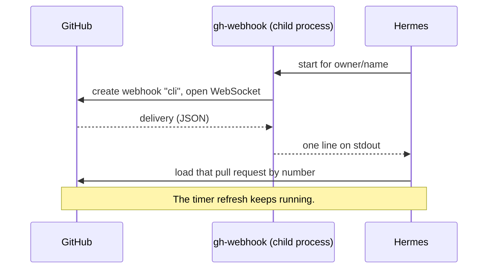

# Webhook forwarders

Hermes refreshes its lists on a timer. A webhook forwarder makes a change show
in about two seconds instead: GitHub pushes the repository's webhook deliveries
down a WebSocket, and Hermes reloads what a delivery names.

The forwarder is `gh webhook forward`, from the `cli/gh-webhook` extension of
the GitHub CLI. Only GitHub sees the deliveries. There is no Hermes server.



## What it is for

A delivery is only a signal. Hermes reads the repository and the pull request
number from it and loads the pull request the usual way. A delivery that names
no pull request Hermes holds, such as a commit status or a newly opened pull
request, refreshes the account. The timer refresh never stops, so a forwarder
that ends costs nothing but the delay.

## Which repositories

`Forwarders.repositories(watched:viewer:refused:)` in
`Sources/Hermes/Forwarders.swift` decides, every 15 seconds:

- Only repositories the signed-in user owns. The webhook is named `cli` and
  says nothing of who made it, which an organization's other admins would have
  to puzzle over. An organization-wide forwarder also needs the
  `admin:org_hook` scope, which a `gh` login does not have by default.
- Only repositories with a watched pull request: the open one, ones with a
  session, the attention inbox, and the list on screen.
- At most 20. Each forwarder is a process and a webhook.
- Not the ones waiting to retry. A forwarder that ends on its own may start
  again after 30 seconds. The wait doubles each time it ends again, up to 30
  minutes, and starts over once a forwarder has run for 5 minutes. GitHub
  refuses a forwarder within seconds when the user is not an admin of the
  repository or it already has one (GitHub allows one per repository), so such
  a repository is tried twice an hour and otherwise stays on the timer.

## The setting

Settings has "Get changes as they happen", off by default, because turning it
on writes a webhook to repositories. The last page of first-run setup offers
the same switch. When the extension is missing, both offer to install it with
`gh extension install cli/gh-webhook`.

## Logs

`Forwarders` logs under the `com.coderinserepeat.hermes` subsystem, category
`webhooks`: each start, and each end with how long the forwarder ran, what the
extension reported, and when the repository is tried again.

```bash
/usr/bin/log stream --predicate 'subsystem == "com.coderinserepeat.hermes" AND category == "webhooks"'
```

## The process

`WebhookForwarder` in `Sources/GitHubKit/WebhookForwarder.swift` runs one.

- It runs the extension's program directly, not `gh webhook forward`. `gh`
  starts the program as a child, and a signal sent to `gh` leaves the child and
  its webhook running.
- It passes the token in `GH_TOKEN`. The program cannot read a token that `gh`
  keeps in the keychain.
- It asks for the events that change a row or a pane: `pull_request`,
  `pull_request_review`, `pull_request_review_comment`, `issue_comment`,
  `check_suite`, and `status`.
- Each delivery is one line of JSON on stdout. The event's type is not in it,
  so `WebhookEvent` reads the keys that name a pull request: `pull_request`,
  `issue` with a `pull_request` key, and `check_suite.pull_requests`.
- GitHub deletes the webhook when the process ends, however it ends.
- Hermes stops its forwarders when it quits. A crash leaves them running,
  holding their repositories' webhooks. Each is started with the webhook secret
  `hermes-forwarder`, and the next launch ends every process that has it.

## Testing

`HERMES_LIVE_WEBHOOKS=1 swift test --filter WebhookForwarderTests` forwards
`bojanrajkovic/hermes-playground`, comments on its pull request 53, expects the
event, and deletes the comment.
