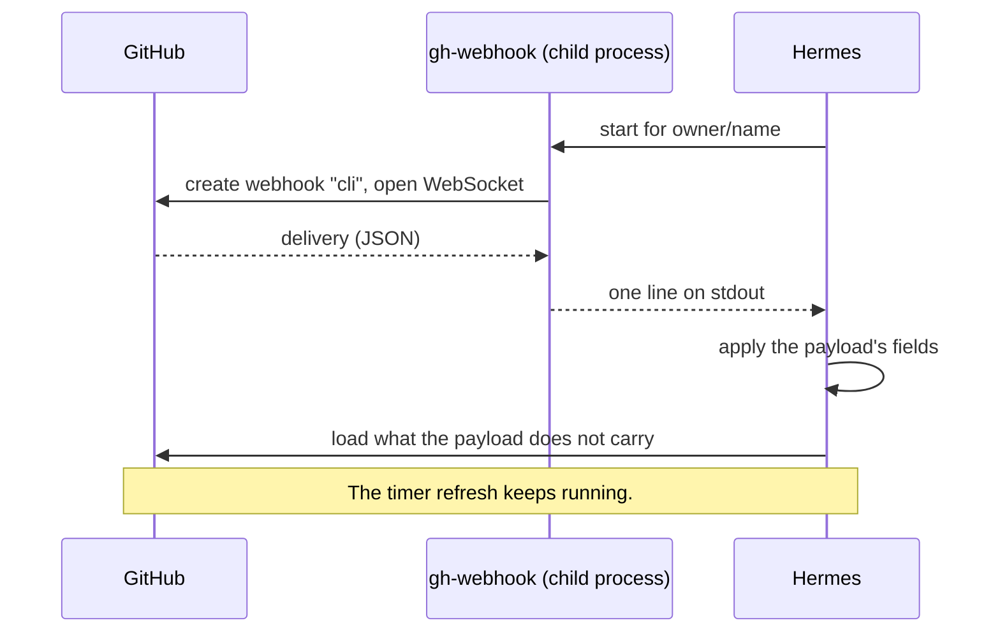

# Webhook forwarders

Hermes refreshes its lists on a timer. A webhook forwarder makes a change show
in about two seconds instead: GitHub pushes the repository's webhook deliveries
down a WebSocket, and Hermes applies each delivery's payload or reloads what
it names.

The forwarder is `gh webhook forward`, from the `cli/gh-webhook` extension of
the GitHub CLI. Only GitHub sees a forwarder's deliveries: no server sits
between it and Hermes.

A forwarder needs admin rights on its repository. For repositories where the
user has none, an account's owner can set up a [relay](relay-client.md)
tenant. A repository that a connected tenant covers gets no forwarder.



## What it is for

Hermes reads the repository and the pull request number from a delivery. A
commit status names no pull request, and a check often names none, so Hermes
finds theirs by the commit: the held pull request whose head it is. Held means
in the open list, or loaded by number. A pull request that is both is matched
as the open list has it, because that is the copy its row shows.

A delivery about a held pull request is applied or loads that pull request.
[Applying a payload](#applying-a-payload) says which.

A delivery about anything else loads the account. That covers a newly opened
pull request, and a commit that is no held pull request's head, which a push
makes true until its pull request loads again. A busy repository sends many of
those, so they share loads the way a burst about one pull request does.

The timer refresh never stops, so a forwarder that ends costs nothing but the
delay.

`AppStore.reload` does this for a relay's events too. A burst of deliveries
about one pull request loads it on the first and once more after, not once
per delivery. [relay-client.md](relay-client.md) has the rule.

## Applying a payload

A delivery's payload carries much of what changed. `WebhookChange` in
`Sources/GitHubKit/WebhookChange.swift` reads it, and Hermes puts those fields
into what it holds at once. It asks GitHub only for what the payload does not
carry.

| Delivery | Applied from the payload | Loaded from GitHub |
|---|---|---|
| `pull_request`: edited, labeled, unlabeled, converted to draft, ready for review, closed, review requested or removed, auto-merge on or off | Title, description, labels, draft, state, branches, head commit, line and file counts, auto-merge method, requested reviewers | Nothing |
| `pull_request`: new commits, reopened, a new base branch, any other action | The same fields | The pull request: its review decision, mergeability, checks, and stack |
| `issue_comment` on a pull request: created, edited, deleted | The comment, in the conversation | Nothing |
| `pull_request_review`: submitted, edited, dismissed | The review, in the conversation | The pull request, for its review decision |
| `pull_request_review_comment`: a new comment that answers another | The comment, added to the thread that holds the one it answers | Nothing, when that thread is loaded |
| `pull_request_review_comment`: a new comment that starts a thread, an edited one, a deleted one | Nothing | The review threads. The payload does not carry a new thread's ID. |
| `pull_request_review_thread`: resolved, unresolved | The thread's resolved state, found by the thread's ID | Nothing, when that thread is loaded |
| `status` on the head commit | The status, in the checks list | The pull request, for the rollup of its checks |
| `check_run` on the head commit | The check's name, state, times, link, and app | The pull request, for the rollup. Also the checks, when the check is a job of a workflow run none of the loaded checks belongs to, because the payload does not carry the workflow's name. |
| `check_suite` | Nothing | The checks and the pull request |
| Anything else | Nothing | The pull request |

A row's fields go into the pull request's record through `GitHubStore.apply`.

Deliveries can arrive out of order. A `pull_request` payload carries the time
GitHub last changed the pull request, and `GitHubStore.apply` drops a payload
that is older than the last one its row took. A dropped payload whose event
needs a load still loads the pull request.

The description, the requested reviewers, the conversation, and the reviews
belong to the pull request pane, which holds them in a `Loader`. `AppStore.eventCounts` keeps, for each
pull request and each part of it, a `WebhookChanges`: how many deliveries came
and the latest one's change. The pane watches the count. When it rises by one,
the pane applies that change with `PullRequestDetail.applying`. When it rises
by more, the earlier changes are gone, so the pane loads the detail again.

The diff screen does the same for the review threads, which `ReviewModel`
holds: it applies a change with `ReviewModel.apply`, and loads the threads when
that returns false. A change to a thread that is not loaded can't be applied.

The checks screen and the checks summary do the same with
`ChecksModel.apply`. A check run that is a job of a GitHub Actions workflow
names its workflow run in its link, `…/actions/runs/<run>/job/<job>`. A check
Hermes already holds keeps its workflow. A new job takes the workflow of a
loaded check of the same run, and replaces an earlier attempt of the same job.
Each attempt is a new check run with a higher ID, so a delivery about an
earlier attempt than the one held changes nothing.
A status or a check on an older commit of the pull request is not applied,
because the screens show the head commit's checks.

Changes that can't be applied come in bursts. A review with ten line comments
sends ten, and a new workflow run sends one check run per job, none of which
can be applied until a load knows the run. `BurstLoader` in
`WebhookChange.swift` loads the threads or the checks on the first, and once
more five seconds after that load for the ones that came meanwhile.

The checks list stops reloading once no check is queued or running. A
delivery that puts a check back in one of those states starts the reloading
again, so a check whose last delivery never arrives does not stay "running".

The pull request's update time is not applied. The pane loads the detail
again when it changes, which is at the next refresh, and that load settles
anything a payload got wrong.

A payload Hermes can't read has no change, and its delivery loads the pull
request as before.

A load that is running when a payload is applied runs once more, because it
may have asked GitHub before the change, and its answer would undo it:

| Load | When a payload is applied while it runs |
|---|---|
| One pull request, `GitHubStore.refetch` | It drops the answer and asks again. |
| The account's lists, `GitHubStore.refresh` | It loads the rows that took a payload again when it ends. |
| The pane's detail, `Loader.load` | It drops the answer and asks again. |
| The review threads, `ReviewModel.reloadThreads` | It drops the answer and asks again. |
| The checks, `ChecksModel.run` | It drops the answer and asks again, without waiting ten seconds. |

Two loads of the review threads can run at once: the diff's polling and a
delivery. The one that started first drops its answer.

The payload types are small `Decodable` structs that hold only the fields
Hermes reads. Types generated from GitHub's REST schema refuse real deliveries:
a review's `body` is `null` in a delivery and a string in the schema.

## Which repositories

`Forwarders.targets(watched:viewer:organizations:waiting:)` in
`Sources/Hermes/Forwarders.swift` decides, every 15 seconds. A watched pull
request is the open one, one with a session, one in the attention inbox, or one
in the list on screen.

- **Organizations the signed-in user owns and picked in Settings**, when one
  has a watched pull request and the `gh` token has the `admin:org_hook` scope.
  None is picked at first: the webhook is one every owner of the organization
  sees. One forwarder
  covers every repository of the organization.
- **Repositories the signed-in user owns** that have a watched pull request, at
  most 20. Each forwarder is a process and a webhook.
- **None that a relay covers.** A connected relay tenant lists the repositories
  it sends events for. Those are left out before the two rules above, so an
  organization whose watched repositories are all covered gets no forwarder.
- **Nothing else.** A repository of an organization gets no forwarder of its
  own. The webhook is named `cli` and says nothing of who made it, which the
  other admins of a shared repository would have to puzzle over. An
  organization's forwarder is one webhook that its owner chose.
- Not the ones waiting to retry. A forwarder that ends on its own may start
  again after 30 seconds. The wait doubles each time it ends again, up to 30
  minutes, and starts over once a forwarder has run for 5 minutes. GitHub
  refuses a forwarder within seconds when the user is not an admin of the
  repository or it already has one (GitHub allows one per repository), so such
  a repository is tried twice an hour and otherwise stays on the timer.

## The setting

Settings has "Get changes as they happen", off by default, because turning it
on writes a webhook to repositories. The last page of first-run setup offers
the same switch. When the extension is missing, both offer to install it with
`gh extension install cli/gh-webhook`.

## Organizations

`gh auth login` does not ask for `admin:org_hook`, and `admin:org` does not
include it. To add it:

```bash
gh auth refresh -h github.com -s admin:org_hook
```

Hermes reads the token's scopes from the `X-OAuth-Scopes` header of
`HEAD /user` when the setting is turned on and each time Hermes comes to the
front, with the token `gh` holds at that moment. `viewerCanAdminister` on the
organization says whether the user owns it. Settings lists each owned
organization with a switch, and shows the command with a Copy button when one
is picked and the scope is missing.

## Logs

`Forwarders` logs under the `com.coderinserepeat.hermes` subsystem, category
`webhooks`: each start, and each end with how long the forwarder ran, what the
extension reported, and when the repository is tried again.

```bash
/usr/bin/log stream --predicate 'subsystem == "com.coderinserepeat.hermes" AND category == "webhooks"'
```

## The process

`WebhookForwarder` in `Sources/GitHubKit/WebhookForwarder.swift` runs one.

- It runs the extension's program directly, not `gh webhook forward`. `gh`
  starts the program as a child, and a signal sent to `gh` leaves the child and
  its webhook running.
- It passes the token in `GH_TOKEN`. The program cannot read a token that `gh`
  keeps in the keychain.
- It asks for the events that change a row or a pane: `pull_request`,
  `pull_request_review`, `pull_request_review_comment`,
  `pull_request_review_thread`, `issue_comment`, `check_suite`, `check_run`,
  and `status`.
- Each delivery is one line of JSON on stdout. The event's type is not in it,
  so `WebhookEvent` reads the keys that name a pull request: `pull_request`,
  `issue` with a `pull_request` key, and the `pull_requests` of a `check_suite`
  or a `check_run`. It reads the commit from a status's `sha` and a check's
  `head_sha`.
- A forwarder's target is a repository (`--repo`) or an organization (`--org`).
- GitHub deletes the webhook when the process ends, however it ends.
- GitHub allows one forwarder per target. An organization's forwarder and a
  forwarder of one of its repositories can run at once.
- Hermes stops its forwarders when it quits. A crash leaves them running,
  holding their targets' webhooks. Each is started with the webhook secret
  `hermes-forwarder`, and the next launch ends every process that has it.

## Testing

`HERMES_LIVE_WEBHOOKS=1 swift test --filter WebhookForwarderTests` forwards
`bojanrajkovic/hermes-playground`, comments on its pull request 53, expects the
event, and deletes the comment.
